

# Year 1 Admission Assessment

Version 3.1, October 2026

[[namebox]]

🌈🎈⭐

<b>Hello!</b>

[[pagebreak]]

## Talk

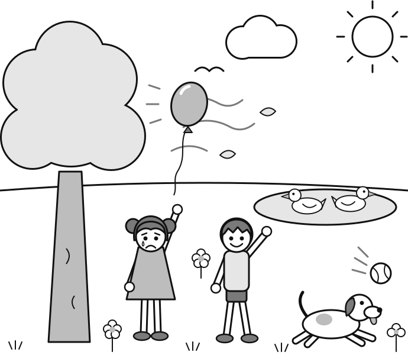{.w100}

[[pagebreak]]

## Listen

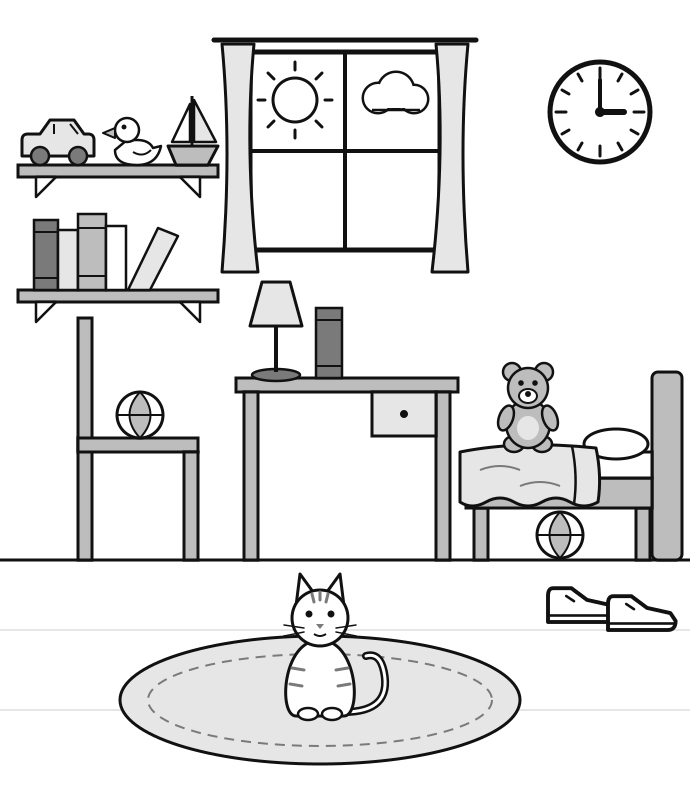{.w100}

[[pagebreak]]

## Maths

Section A: Number problems

### 1 [[marks:1]]

🐟🐟🐟🐟🐟🐟🐟

### 2 [[marks:1]]

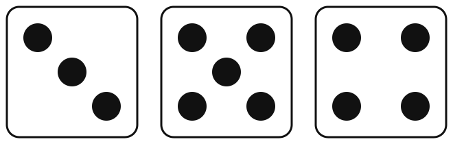{.w100}

[[pagebreak]]

### 3 [[marks:1]]

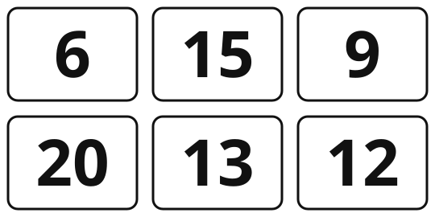{.w90}

### 4 [[marks:1]]

⭐⭐⭐⭐⭐⭐⭐⭐

⭐⭐⭐⭐⭐⭐⭐⭐

[[pagebreak]]

### 5 [[marks:1]]

{.w100}

### 6 [[marks:1]]

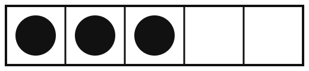{.w90}

[[pagebreak]]

### 7 [[marks:1]]

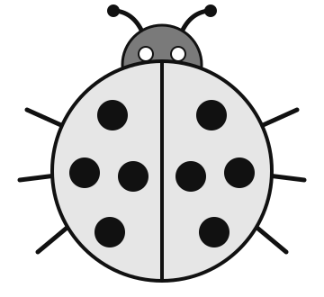{.w60}

### 8 [[marks:1]]

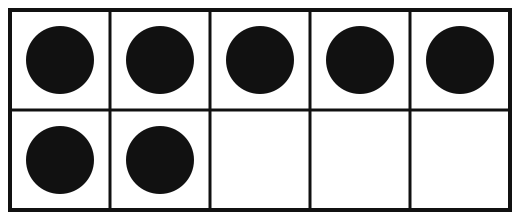{.w90}

[[pagebreak]]

Section B: Word problems and pictures

### 9 [[marks:1]]

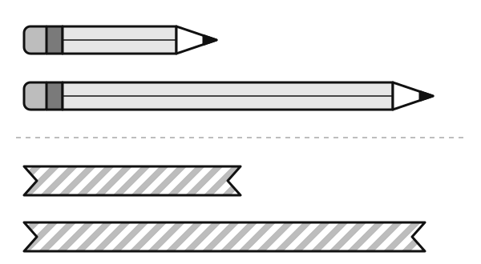{.w100}

### 10 [[marks:1]]

{.w100}

[[pagebreak]]

### 11 [[marks:1]]

{.w100}

### 12 [[marks:1]]

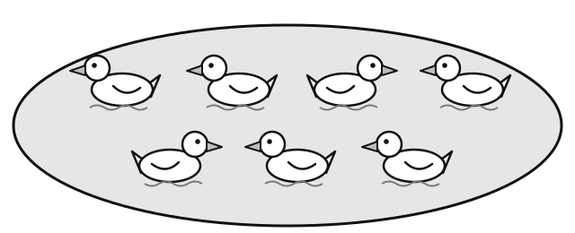{.w100}

[[pagebreak]]

### 13 [[marks:1]]

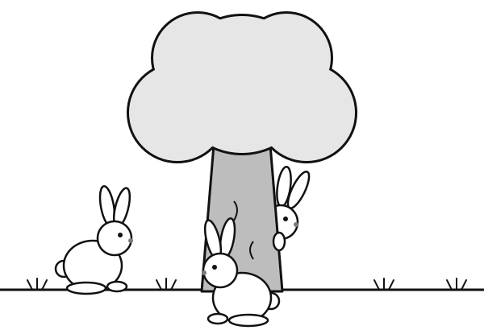{.w90}

### 14 [[marks:1]]

🍎🍌🍌🍎🍌🍌🍎?

🍎🍌🍊

[[pagebreak]]

### 15 [[marks:1]]

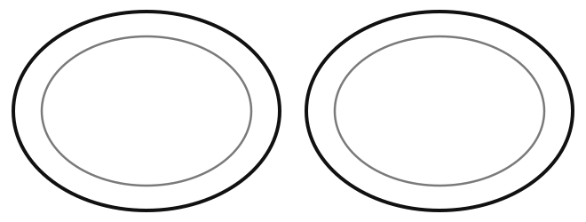{.w100}

[[pagebreak]]

## Write

<b style="width: auto; font-size: 18pt;">Name</b>

**Words**

<b>1</b>

<b>2</b>

<b>3</b>

<b>4</b>

<b>5</b>

[[pagebreak]]

## Write

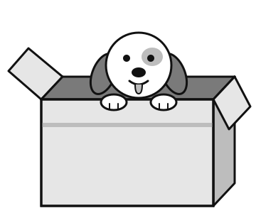{.w65}

[[lines:3]]

[[pagebreak]]

## Draw

