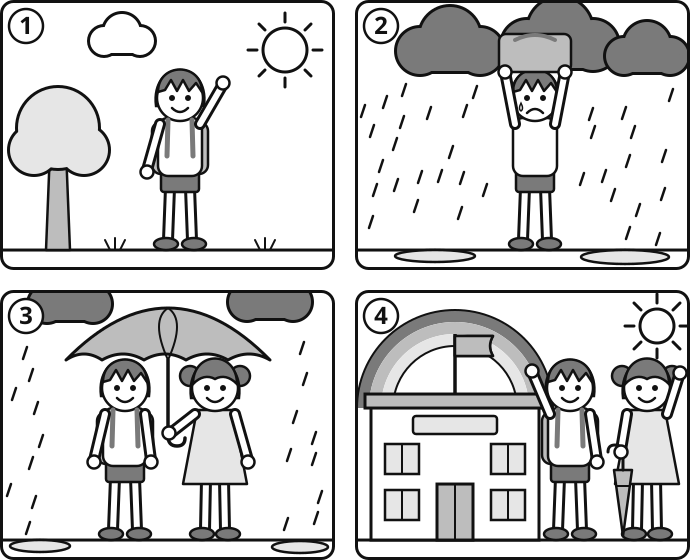
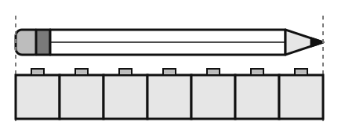
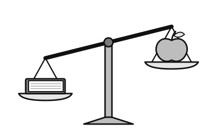
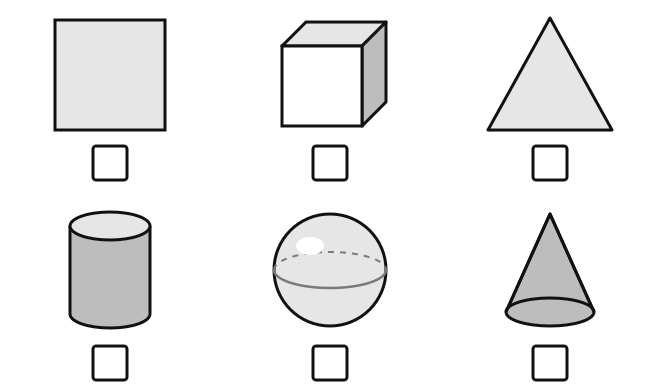
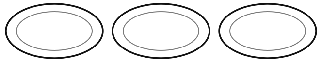
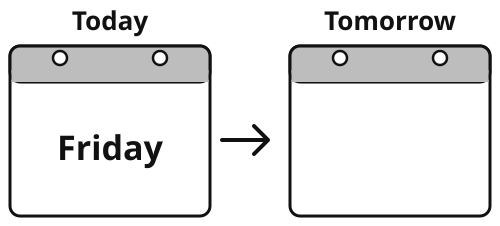
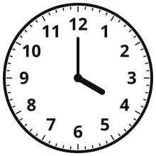
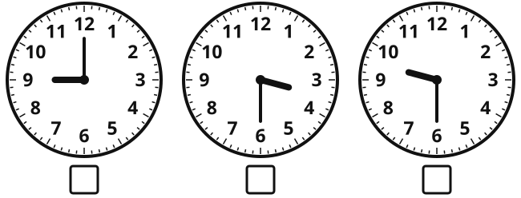
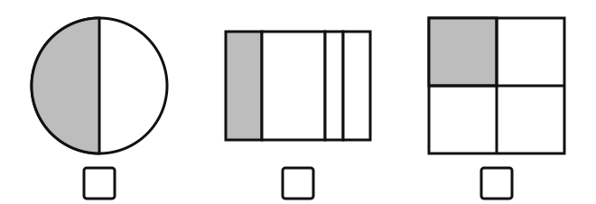
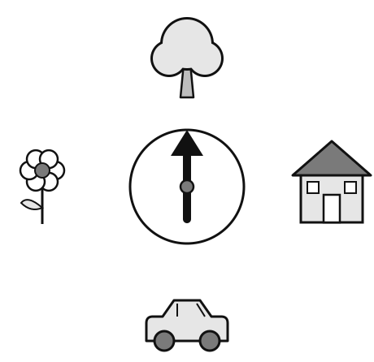

# Year 2 Admission Assessment

Version 3.1, October 2026

[[namebox]]

🌈🚲🌻

<b>Hello!</b>

[[pagebreak]]

## Talk

{.w100}

[[pagebreak]]

## Listen

{.w100}

[[pagebreak]]

## Maths

Section A: Number problems

[[example]]

<b>Example</b>2 + 1 = 3✓

[[/example]]

### 1 [[marks:1]]

5 + 3 = [[answer:short]]

### 2 [[marks:1]]

9 − 4 = [[answer:short]]

### 3 [[marks:1]]

<table class="y-track"><tr><td>38</td><td>39</td><td class="gap"></td><td>41</td><td class="gap"></td></tr></table>

### 4 [[marks:1]]

one more than 49 &nbsp; [[answer:short]] one less than 70 &nbsp;&nbsp; [[answer:short]]

### 5 [[marks:1]]

6 + [[answer:short]] = 10

[[pagebreak]]

### 6 [[marks:1]]

2, &nbsp;4, &nbsp;6, &nbsp;[[answer:short]] 5, &nbsp;10, &nbsp;15, &nbsp;[[answer:short]] 10, &nbsp;20, &nbsp;30, &nbsp;[[answer:short]]

### 7 [[marks:1]]

8 + 6 = [[answer:short]]

### 8 [[marks:1]]

15 − 7 = [[answer:short]]

### 9 [[marks:1]]

13 + [[answer:short]] = 20

### 10 [[marks:1]]

7 = [[answer:short]] − 9

[[pagebreak]]

Section B: Word problems and pictures

### 11 [[marks:1]]

{.w55}

[[answer:short]] cubes

Draw a circle around the heavier one.

{.w45}

### 12 [[marks:1]]

Li Na has 8 stickers. Her friend gives her 5 more. How many stickers does Li Na have now?

[[box:3]]

[[answer:short]]

[[pagebreak]]

### 13 [[marks:1]]

Put a tick under the cube and the cylinder.

{.w80}

### 14 [[marks:1]]

There are 3 rows of cakes. There are 5 cakes in each row. How many cakes are there?

🧁🧁🧁🧁🧁

🧁🧁🧁🧁🧁

🧁🧁🧁🧁🧁

[[answer:short]]

[[pagebreak]]

### 15 [[marks:1]]

Grandma has 12 mooncakes. She puts them on 3 plates. Each plate has the same number. How many mooncakes are on each plate?

🥮🥮🥮🥮🥮🥮

🥮🥮🥮🥮🥮🥮

{.w90}

[[answer:short]]

### 16 [[marks:1]]

Today is Friday. What day is tomorrow?

{.w65}

[[pagebreak]]

### 17 [[marks:1]]

Write the time shown in the box.

{.w35 .left}

[[answer:wide]]

[[clear]]

Put a tick under the clock that shows half past 9.

{.w90}

### 18 [[marks:1]]

Tom has 10 balloons. He gives half of them to his sister. How many balloons does he give to his sister?

🎈🎈🎈🎈🎈🎈🎈🎈🎈🎈

[[answer:short]]

[[pagebreak]]

### 19 [[marks:1]]

Put a tick under the shape that is one quarter grey.

{.w90}

### 20 [[marks:1]]

The arrow points to the tree now. The arrow makes a half turn. Draw a circle around the picture it will point to.

{.w60}

Start at the tree again. The arrow makes a quarter turn to the right. Put a cross on the picture it will point to.

[[pagebreak]]

## Write

**1**

[[lines:3]]

[[pagebreak]]

## Write

**2**

{.w75}

[[lines:6]]

[[pagebreak]]

## Draw

