

# Year 3 Admission Assessment

[[namebox]]

## Hello!

Today we will talk, listen, read, do some maths and write.

Your teacher will help you. Do your best.

It is fine if you cannot do everything.

## Talk

**Look** at the pictures. **Tell** me the story.

{.w100}

[[pagebreak]]

## Listen

**Listen** to your teacher. Do what your teacher says.

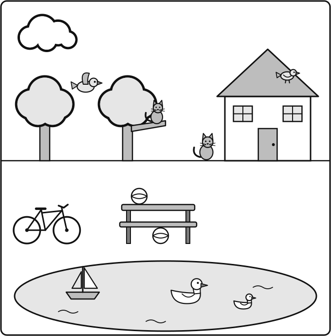{.w100}

[[pagebreak]]

## Maths: Section A

**Number problems.** Your teacher can read the questions to you.

[[example]]
**How to answer**

**Circle** the apple. &nbsp; 🍌 &nbsp; 🍎 &nbsp; 🍐

**Tick** the cat. &nbsp; 🐶 [[tick]] &nbsp;&nbsp; 🐱 ✓

**Write** the answer in the box. &nbsp; 3 + 2 = 5
[[/example]]

### 1 [[marks:2]]

**Write** the answer in the box.

8 + 6 = [[answer]]

17 − 5 = [[answer]]

### 2 [[marks:2]]

**Write** the answer in the box.

34 + 25 = [[answer]]

68 − 23 = [[answer]]

[[box:3:Working]]

### 3 [[marks:2]]

**Write** the answer in the box.

47 + 36 = [[answer]]

62 − 27 = [[answer]]

[[box:3:Working]]

### 4 [[marks:2]]

**Write** the answer in the box.

5 × 4 = [[answer]]

18 ÷ 2 = [[answer]]

### 5 [[marks:1]]

**Write** the answer in the box.

245 + 132 = [[answer]]

[[box:3:Working]]

[[pagebreak]]

## Maths: Section B

**Word problems and pictures.** Your teacher can read the questions to you.

### 6 [[marks:2]]

**Look** at the key.

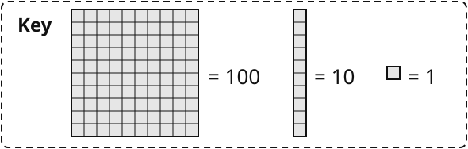{.w90}

**a** &nbsp; **Write** the number.

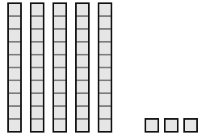{.w40 .left}

 [[answer]]

[[clear]]

**b** &nbsp; **Write** the number.

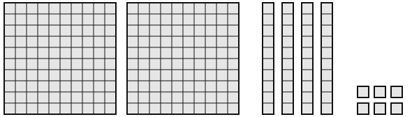{.w90}

[[answer]]

### 7 [[marks:1]]

Tom has 35 stickers.

He gives 12 stickers to his sister.

**How many** stickers does Tom have now?

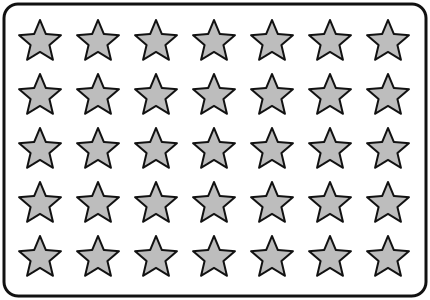{.w45 .left}

  [[answer]] stickers

[[clear]]

### 8 [[marks:1]]

There are 4 plates.

There are 5 dumplings on each plate.

**How many** dumplings are there altogether?

🥟🥟🥟 🥟🥟
🥟🥟🥟 🥟🥟
🥟🥟🥟 🥟🥟
🥟🥟🥟 🥟🥟

[[answer]] dumplings

### 9 [[marks:1]]

**How long** is the crayon?

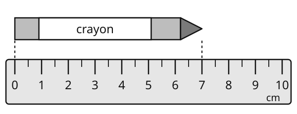{.w90}

[[answer:short]] cm

### 10 [[marks:1]]

**Count** the sides and the vertices (corners).

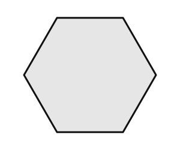{.w40 .left}

 sides [[answer:short]]

 vertices [[answer:short]]

[[clear]]

### 11 [[marks:2]]

**Look** at the pictogram.

<b>Fruit we like</b>

<table class="picto">
<tr><td>apple</td><td>🍎🍎🍎🍎🍎</td></tr>
<tr><td>banana</td><td>🍌🍌🍌</td></tr>
<tr><td>grapes</td><td>🍇🍇🍇🍇🍇🍇🍇</td></tr>
<tr><td>orange</td><td>🍊🍊🍊🍊</td></tr>
</table>

Each picture is 1 child.

**a** &nbsp; **How many** children like grapes? [[answer:short]]

**b** &nbsp; **How many more** children like apples than bananas? [[answer:short]]

### 12 [[marks:2]]

**Write** the time.

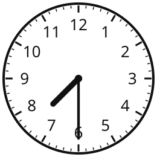 <b>a</b> [[answer]]

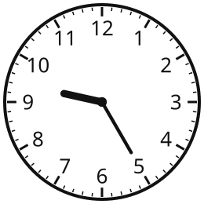 <b>b</b> [[answer]]

### 13 [[marks:2]]

**Look** at the prices.

⚽ ball <b>¥12</b>
📕 book <b>¥8</b>
🪁 kite <b>¥15</b>

**a** &nbsp; Amir buys the ball and the book. **How much** does he pay? &nbsp; ¥ [[answer]]

**b** &nbsp; Mei has ¥20. She buys the kite. **How much** money does she have left? &nbsp; ¥ [[answer]]

### 14 [[marks:1]]

**Draw** the line of symmetry. Use a ruler.

{.w40}

### 15 [[marks:2]]

**a** &nbsp; **Tick** the shape with 14 shaded.

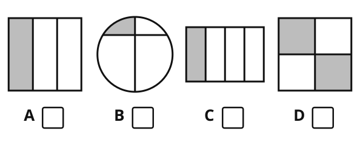{.w90}

**b** &nbsp; **Write** the fraction that is shaded.

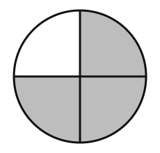{.w30 .left}

  [[answer]]

[[clear]]

[[stop]]

[[pagebreak]]

## Write

**Look** at the pictures. **Write** the story.

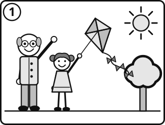

<b>First,</b>

[[lines:2]]

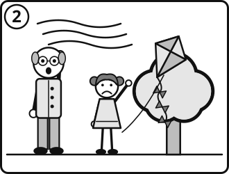

<b>Then,</b>

[[lines:2]]

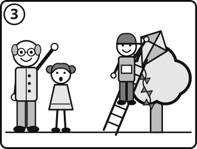

<b>Next,</b>

[[lines:2]]

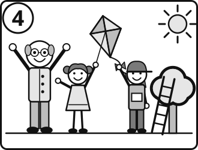

<b>At the end,</b>

[[lines:2]]

[[stop:Thank you. You have finished. Please wait for your teacher.]]
