

# Year 4 Admission Assessment

[[namebox]]

These activities help us get to know you. Do your best. It is fine if you cannot answer every question.

[[example]]
**How to answer**

**Tick** one box. Which one is an animal? &nbsp; a cat ✓ &nbsp; a cup [[tick]]

**Write** your answer in the box. &nbsp; 5 + 4 = 9

**Show** your working in the working box. &nbsp; 26 + 32 = 58

Working 20 + 30 = 50 &nbsp;&nbsp; 6 + 2 = 8 &nbsp;&nbsp; 50 + 8 = 58

[[/example]]

**The parts of this paper**

<table class="parts">
<tr><th>Part</th><th></th><th>Time</th></tr>
<tr><td>1</td><td>Listening</td><td>5 minutes</td></tr>
<tr><td>2</td><td>Reading</td><td>12 minutes</td></tr>
<tr><td>3</td><td>Writing</td><td>10 minutes</td></tr>
<tr><td></td><td>Break</td><td></td></tr>
<tr><td>4</td><td>Maths</td><td>18 minutes</td></tr>
</table>

Your teacher will tell you when to start each part.

[[pagebreak]]

## Part 1: Listening

Your teacher will read a phone call **two times**. Li Na is talking to her friend Amir.

**Listen.** Then answer the questions.

### 1 [[marks:1]]

Where are they going on Saturday? **Tick** one picture.

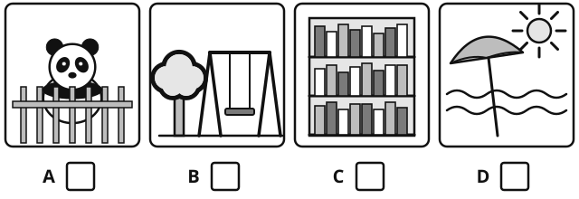{.w80}

### 2 [[marks:1]]

What time will they meet? **Tick** one clock.

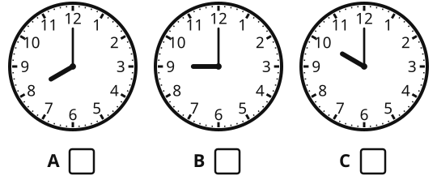{.w75}

### 3 [[marks:1]]

Where is the bus stop? **Tick** one picture.

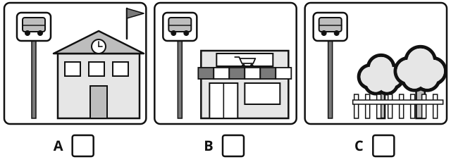{.w80}

### 4 [[marks:1]]

What must Amir bring? **Tick two** pictures.

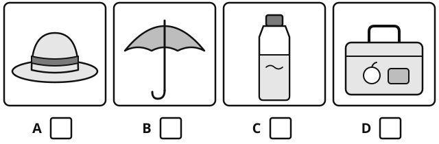{.w80}

### 5 [[marks:1]]

What will Grandma make for lunch? **Write** one word.

[[answer:wide]]

### 6 [[marks:1]]

How old is Amir's brother? **Write** a number.

[[answer:short]]

### 7 [[marks:1]]

Why does Amir's brother not need a ticket? **Write** your answer.

[[lines:2]]

### 8 [[marks:1]]

How does Amir feel about the trip? How do you know? **Write** your answer.

[[lines:2]]

[[stop]]

[[pagebreak]]

## Part 2: Reading

**Do as much as you can. It is fine if you do not finish.**

There are three texts. **Read** each text. Then answer the questions.

## Reading Part A

**Read** the menu. Then answer questions 1 to 7.

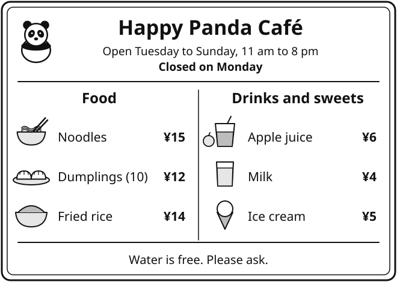{.w100}

### 1 [[marks:1]]

What is the name of the café? **Write** it in the box.

[[answer:wide]]

### 2 [[marks:1]]

How much are the dumplings? &nbsp; ¥ [[answer:short]]

### 3 [[marks:1]]

How many dumplings do you get on one plate? &nbsp; [[answer:short]]

### 4 [[marks:1]]

Which drink costs ¥6? **Tick** one.

apple juice [[tick]] &nbsp;&nbsp;&nbsp; milk [[tick]] &nbsp;&nbsp;&nbsp; water [[tick]]

### 5 [[marks:1]]

What time does the café open? &nbsp; [[answer]]

### 6 [[marks:1]]

On which day is the café closed? &nbsp; [[answer]]

### 7 [[marks:2]]

**Tick** True or False.

<table class="tf">
<tr><th></th><th>True</th><th>False</th></tr>
<tr><td>You can buy ice cream at the café.</td><td>[[tick]]</td><td>[[tick]]</td></tr>
<tr><td>Water costs ¥2.</td><td>[[tick]]</td><td>[[tick]]</td></tr>
</table>

[[pagebreak]]

## Reading Part B

**Read** the story. Then answer questions 8 to 14.

[[passage]]
#### The Paper Boats

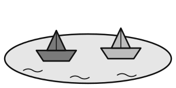{.w35 .right}

On Saturday, Wang Hao and Tom made paper boats. Wang Hao's boat was red. Tom's boat was blue.

They took the boats to the pond in the park. They put the boats on the water. The wind pushed them slowly across the pond.

Then the red boat got wet. It went down, down, down to the bottom. Wang Hao was sad.

"Don't worry," said Tom. "We can make a new one."

At home, they made a new red boat. This time, Wang Hao used thick paper and coloured it with wax crayons.

The next day, the new boat sailed all the way across the pond.

"It is the best boat in the world!" said Wang Hao.
[[/passage]]

### 8 [[marks:1]]

What did Wang Hao and Tom make? **Tick** one.

paper hats [[tick]] &nbsp;&nbsp; paper boats [[tick]] &nbsp;&nbsp; paper kites [[tick]]

### 9 [[marks:1]]

What colour was Tom's boat? &nbsp; [[answer]]

### 10 [[marks:1]]

Where did they put the boats on the water? **Write** your answer.

[[lines:1]]

### 11 [[marks:2]]

**Number** the sentences 1 to 4 to show the order in the story. The first one is done for you.

<table class="tf">
<tr><td>The red boat went down to the bottom.</td><td>[[answer:short]]</td></tr>
<tr><td>Wang Hao and Tom made paper boats.</td><td>1</td></tr>
<tr><td>Wang Hao used thick paper.</td><td>[[answer:short]]</td></tr>
<tr><td>They put the boats on the water.</td><td>[[answer:short]]</td></tr>
</table>

### 12 [[marks:1]]

Find and **copy** one word that tells you how Wang Hao felt when his boat went down.

[[answer]]

### 13 [[marks:1]]

Why did the first red boat go down to the bottom? **Write** your answer.

[[lines:1]]

### 14 [[marks:1]]

Why did the new boat not go down? **Write** your answer.

[[lines:2]]

[[pagebreak]]

## Reading Part C

This text gives information. **Read** it. Then answer questions 15 to 22.

[[passage]]
#### Honeybees: Busy Workers

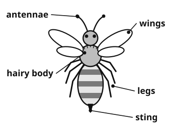{.w50 .right}

Honeybees live together in a home called a hive. A big hive can hold more than fifty thousand bees! Each hive has one queen. She is the largest bee, and her job is to lay eggs. Most of the other bees are workers.

**Busy workers**

Worker bees have many jobs. Young workers clean the hive and feed the baby bees. Older workers fly out to find flowers. They drink a sweet juice called nectar and carry it back to the hive. There, they turn the nectar into honey and store it in tiny wax rooms called cells.

**The waggle dance**

When a worker finds good flowers, she flies home and does a special dance. She waggles her body from side to side and walks in a figure of eight. The dance tells the other bees which way to fly and how far to go.

**Why we need bees**

As bees move from flower to flower, yellow dust called pollen sticks to their hairy bodies. They carry it to other flowers. This helps plants to make seeds and fruit. Without bees, there would be fewer apples, strawberries and pumpkins.

Bees can sting, but they usually sting only when they are frightened. If a bee comes near you, keep still, and it will usually fly away.
[[/passage]]

### 15 [[marks:1]]

What is the home of honeybees called? **Tick** one.

a nest [[tick]] &nbsp;&nbsp; a hive [[tick]] &nbsp;&nbsp; a cell [[tick]]

### 16 [[marks:1]]

What is the queen's job? **Write** your answer.

[[lines:1]]

### 17 [[marks:1]]

Which bees clean the hive and feed the baby bees? **Write** your answer.

[[lines:1]]

### 18 [[marks:1]]

"She waggles her body from side to side."

What does **waggles** mean? **Tick** one.

shakes [[tick]] &nbsp;&nbsp; sleeps [[tick]] &nbsp;&nbsp; sings [[tick]] &nbsp;&nbsp; eats [[tick]]

### 19 [[marks:1]]

Why does a worker bee do the waggle dance? **Write** your answer.

[[lines:1]]

[[pagebreak]]

### 20 [[marks:1]]

Why would there be fewer apples and strawberries without bees? **Write** your answer.

[[lines:2]]

### 21 [[marks:1]]

Why should you keep still if a bee comes near you? **Write** your answer.

[[lines:2]]

### 22 [[marks:1]]

Why do you think the writer put a diagram with this text? **Write** your answer.

[[lines:2]]

[[stop]]

[[pagebreak]]

## Part 3: Writing

**Choose** one task. **Tick** the box for the task you choose.

### Task 1: The big egg [[tick]]

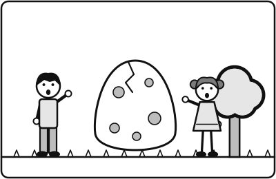{.w45 .right}

Jun and Sofia find a very big egg in the park.

**Write** a story.

What is inside the egg?

What happens next?

[[clear]]

### Task 2: My favourite day of the year [[tick]]

**Write** about your favourite day of the year.

When is it? What do you do? Who is with you? Why do you like it?

---

**Plan** your writing here. You can use words or pictures.

[[box:6:Plan]]

[[pagebreak]]

**Write** here.

[[lines:14]]

[[stop]]

[[pagebreak]]

## Part 4: Maths

**Section A: Number problems.** Your teacher can read the questions to you. Do not use a calculator.

### 1 [[marks:2]]

[[example]]
**Example** &nbsp; 20 + 5 = 25
[[/example]]

**Write** the answer in the box.

46 + 30 = [[answer]]

92 − 8 = [[answer]]

### 2 [[marks:2]]

**Write** the answer in the box. **Show** your working.

356 + 218 = [[answer]]

432 − 175 = [[answer]]

[[box:5:Working]]

### 3 [[marks:2]]

**Write** the answer in the box.

3 × 7 = [[answer]]

4 × 8 = [[answer]]

### 4 [[marks:1]]

**Write** the answer in the box.

56 ÷ 8 = [[answer]]

### 5 [[marks:1]]

**Write** the answer in the box. **Show** your working.

23 × 4 = [[answer]]

[[box:3:Working]]

### 6 [[marks:1]]

**Write** the answer in the box.

15 + 25 = [[answer:short]]

### 7 [[marks:1]]

**Write** the answer in the box. **Show** your working.

124 × 3 = [[answer]]

[[box:3:Working]]

[[pagebreak]]

## Maths: Section B

**Word problems and pictures.** Your teacher can read the questions to you.

### 8 [[marks:1]]

**Write** the number shown on the place value chart.

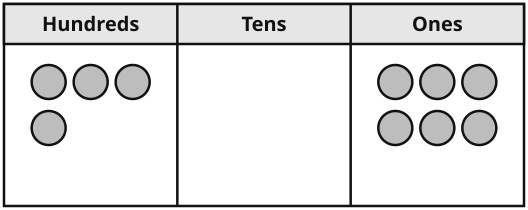{.w80}

[[answer]]

### 9 [[marks:1]]

**Look** at the bar chart.

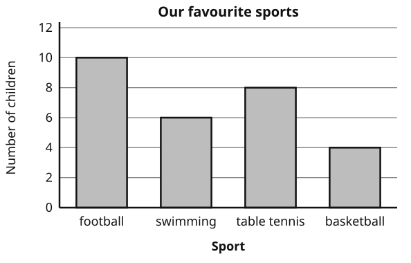{.w90}

**How many more** children chose football than basketball? &nbsp; [[answer:short]]

### 10 [[marks:1]]

One box has 8 mooncakes.

Mum buys 3 boxes.

**How many** mooncakes does she buy?

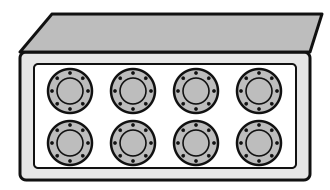{.w50 .left}

  [[answer]] mooncakes

[[clear]]

### 11 [[marks:1]]

**How long** is the pencil?

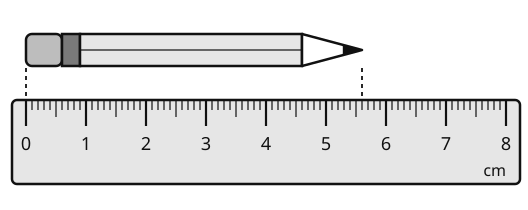{.w80}

[[answer:short]] cm &nbsp; [[answer:short]] mm

### 12 [[marks:1]]

A ribbon is 92 cm long.

Mei cuts off 35 cm.

**How long** is the ribbon now?

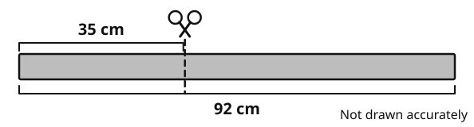{.w90}

[[box:2:Working]]

[[answer]] cm

### 13 [[marks:2]]

**a** &nbsp; **Tick** each right angle.

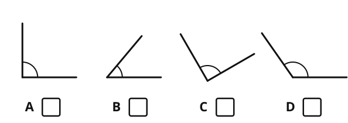{.w90}

**b** &nbsp; **Look** at lines E, F and G.

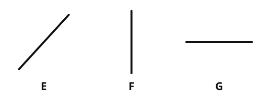{.w80}

The horizontal line is [[answer:short]] &nbsp;&nbsp; The vertical line is [[answer:short]]

### 14 [[marks:2]]

**a** &nbsp; **Write** the time in numbers, like a digital clock.

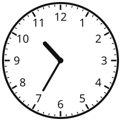{.w35 .left}

   [[answer]]

[[clear]]

**b** &nbsp; A cartoon starts at 2:45. It ends at 3:20.

**How many** minutes long is the cartoon?

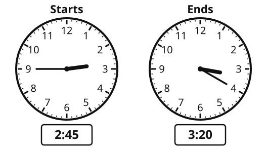{.w70}

[[answer:short]] minutes

### 15 [[marks:2]]

**a** &nbsp; What fraction of the bar is shaded? **Write** it in the box.

{.w80}

[[answer:short]]

**b** &nbsp; **Look** at the two bars. **Write** the missing number.

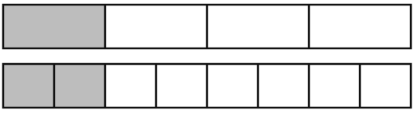{.w80}

14 = [[answer:short]]8

### 16 [[marks:2]]

The shape is on a grid. Each square is 1 cm long.

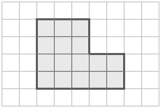{.w55 .left}

**a** &nbsp; What is the **perimeter** of the shape?

[[answer:short]] cm

**b** &nbsp; What is the **area** of the shape?

[[answer:short]] squares

[[clear]]

### 17 [[marks:2]]

Pencils cost ¥3 each.

Jun buys 4 pencils. He pays with a ¥20 note.

**How much** change does he get?

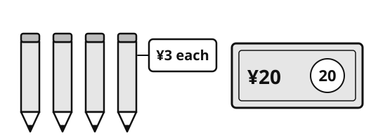{.w80}

[[box:3:Working]]

¥ [[answer]]

[[stop:Thank you. You have finished. Please wait for your teacher.]]
