

# Year 5 Admission Assessment

Version 3.1, October 2026

[[namebox]]

<b>Welcome!</b>

These activities help us get to know you. Do your best. It is fine if you cannot answer every question. You can ask your teacher to say the instructions again.

## How to answer

[[example]]
**Tick** one box. Which one is an animal? &nbsp; a chair [[tick]] &nbsp; &nbsp; a cat ✓

**Write** your answer in the box. &nbsp; 5 + 3 = 8

**Circle** the biggest number. &nbsp; 4 &nbsp; 9 &nbsp; 6

**Join** the picture to its word.

{.w30}

**Show** your working. &nbsp; 26 + 17 = 43

Working: &nbsp; 20 + 10 = 30 &nbsp; &nbsp; 6 + 7 = 13 &nbsp; &nbsp; 30 + 13 = 43

[[/example]]

## The parts of this booklet

| Part | | Time |
|---|---|---|
| 1 | Listening | 5 minutes |
| 2 | Reading | 12 minutes |
| 3 | Writing | 10 minutes |
| 4 | Maths | 18 minutes |
| 5 | Science | 8 minutes |

Your teacher will tell you when to start each part.

[[pagebreak]]

# Part 1: Listening

Your teacher will read the questions to you. Then your teacher will read a text **two times**.

**Listen** carefully. **Answer** the questions on this page and the next page.

### 1 [[marks:1]]

How will the class travel to the museum? **Tick** one box.

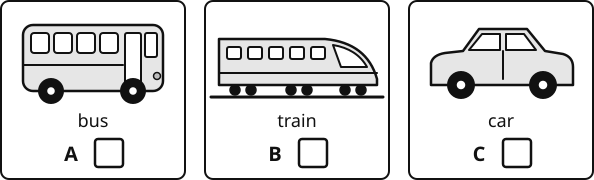{.w80}

### 2 [[marks:1]]

What time does the bus leave school? **Tick** one box.

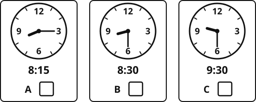{.w80}

### 3 [[marks:1]]

What must the children bring? **Tick** two boxes.

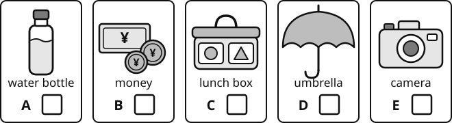{.w100}

### 4 [[marks:1]]

What will the class visit first? **Tick** one box.

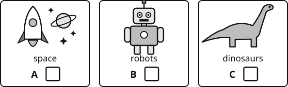{.w80}

### 5 [[marks:1]]

How many children will be in each group?

**Write** your answer in the box. [[answer:short]]

### 6 [[marks:1]]

How much does the trip cost?

**Write** your answer in the box. ¥ [[answer:short]]

### 7 [[marks:1]]

Mr Chen says, "Don't worry if it rains." Why does he say this?

**Write** your answer.

[[lines:2]]

### 8 [[marks:1]]

Will the children buy lunch at the museum? **Tick** one box. &nbsp; Yes [[tick]] &nbsp; No [[tick]]

How do you know? **Write** your answer.

[[lines:2]]

[[stop]]

[[pagebreak]]

# Part 2: Reading

**Read** the texts and **answer** the questions.

Do as much as you can. It is fine if you do not finish.

## Part A

**Read** the notice. Then answer questions 1 to 6.

{.w80}

### 1 [[marks:1]]

What time does the garden open in the morning? **Tick** one box.

[[tick]] 6:00 &nbsp; &nbsp; [[tick]] 8:00 &nbsp; &nbsp; [[tick]] 18:00

### 2 [[marks:2]]

**Tick** the **three** things you can do in the garden.

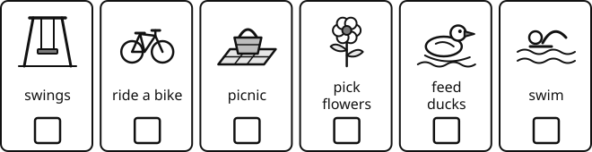{.w100}

### 3 [[marks:1]]

How much is one bag of duck food?

**Write** your answer in the box. ¥ [[answer:short]]

### 4 [[marks:1]]

Where can you buy duck food?

**Write** your answer in the box. [[answer:wide]]

### 5 [[marks:2]]

**Tick** True or False.

| | True | False |
|---|:---:|:---:|
| *Example:* There are swings in the garden. | ✓ | [[tick]] |
| You can swim in the lake. | [[tick]] | [[tick]] |
| The garden is open on Sundays. | [[tick]] | [[tick]] |

### 6 [[marks:1]]

Tom lost his hat in the garden. Where should he ask?

**Write** your answer in the box. [[answer:wide]]

[[pagebreak]]

## Part B

**Read** the text. Then answer questions 7 to 14.

[[passage]]
#### Silkworms

Silkworms are small insects. Many children in China keep silkworms at school or at home.

A silkworm starts life as a tiny egg. The egg is smaller than a grain of rice. After about ten days, a baby silkworm comes out of the egg. It is black and very thin.

Silkworms eat only one kind of food: mulberry leaves. They eat and eat, day and night, and they grow very fast. After about four weeks, a silkworm is as long as your finger, and it is white.

Then the silkworm stops eating. It makes a long, thin thread of silk. It turns round and round and wraps the thread around its body. This is called a cocoon. The thread can be hundreds of metres long!

Inside the cocoon, the silkworm changes. After about two weeks, a white moth comes out. The moth cannot fly. It lays eggs, and then the life cycle starts again.

People use the thread from cocoons to make silk for clothes.
[[/passage]]

[[cols:2]]

### 7 [[marks:1]]

How big is a silkworm egg? **Tick** one box.

 bigger than a grain of rice

 smaller than a grain of rice

 as long as your finger

### 8 [[marks:1]]

How many days does it take for a baby silkworm to come out of the egg?

**Write** your answer in the box.

About [[answer:short]] days

### 9 [[marks:1]]

What colour is a baby silkworm?

**Write** your answer in the box.

[[answer]]

### 10 [[marks:1]]

What do silkworms eat?

**Write** your answer in the box.

[[answer:wide]]

[[/cols]]

### 11 [[marks:1]]

"They eat and eat, day and night." What does this tell you about silkworms? **Tick** one box.

[[tick]] They sleep a lot. &nbsp; &nbsp; [[tick]] They eat a lot. &nbsp; &nbsp; [[tick]] They eat only at night.

### 12 [[marks:1]]

[[example]]
**Find and copy** one word from the text that means "very small". &nbsp; tiny
[[/example]]

**Find and copy** one word from the text. It is the name of the silk covering that the silkworm makes around its body.

[[answer:wide]]

### 13 [[marks:1]]

These pictures show the life of a silkworm. They are in the wrong order.

**Write** the numbers 1, 2, 3 and 4 in the boxes to show the right order. Number 1 is the first.

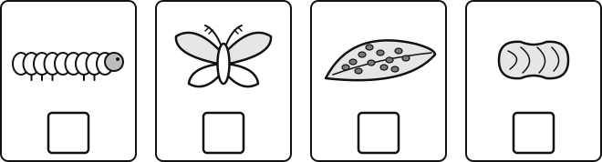{.w100}

### 14 [[marks:1]]

What do people make from the thread of cocoons?

**Write** your answer in the box. [[answer:wide]]

[[pagebreak]]

## Part C

**Read** the story. Then answer questions 15 to 22.

[[passage]]
#### The Snowman at the Window

When Chen Yu woke up, his bedroom was strangely bright. He pulled back the curtain. Snow! It covered the courtyard like a thick white blanket, and more was still falling, soft and silent.

He pulled on his coat, his hat and two pairs of gloves, and raced down the stairs. His plan was simple: he would build the biggest snowman in the whole building.

He rolled a ball of snow across the courtyard. It grew and grew until it was almost too heavy to push. Panting, he stopped to rest beside the ground-floor window of Mrs Zhao's flat.

Mrs Zhao was eighty-two. Her legs were not strong any more, so when the ground was icy she stayed indoors. Chen Yu could see her sitting by the window, wrapped in a grey shawl, watching the snow. She looked small and still.

Chen Yu looked at his huge snowball in the middle of the courtyard. Then he looked at Mrs Zhao's window again.

He left the giant snowball where it was. Right in front of her window, he started again. This snowman was much smaller, but he worked on it carefully. He gave it two black stones for eyes, a carrot for a nose and his own red scarf.

When it was finished, he tapped on the glass. Mrs Zhao looked up, and her whole face changed. She laughed and pressed her hand against the window, and Chen Yu waved back.

Later, his mother asked him why he had not finished the biggest snowman in the building.

Chen Yu smiled. "I made a better one," he said.
[[/passage]]

### 15 [[marks:1]]

What did Chen Yu plan to build?

**Write** your answer in the box. [[answer:wide]]

[[cols:2]]

### 16 [[marks:1]]

Why did Mrs Zhao stay indoors when the ground was icy?

[[lines:2]]

### 17 [[marks:1]]

**Find and copy** one word from the first paragraph that tells you the snow made no sound.

[[answer]]

[[/cols]]

[[cols:2]]

### 18 [[marks:1]]

"**Panting**, he stopped to rest." What does **panting** mean here? **Tick** one box.

 breathing fast and hard

 laughing loudly

 feeling cold

 singing quietly

### 19 [[marks:1]]

"She looked small and still." What does this tell you about Mrs Zhao? **Tick** one box.

 She was lonely and a little sad.

 She was excited about the snow.

 She was angry with Chen Yu.

 She was busy cooking.

[[/cols]]

[[cols:2]]

### 20 [[marks:1]]

How did Mrs Zhao feel when she saw the snowman? How do you know?

[[lines:2]]

### 21 [[marks:1]]

Why did Chen Yu build the small snowman in front of Mrs Zhao's window?

[[lines:2]]

[[/cols]]

### 22 [[marks:1]]

Chen Yu says, "I made a better one." Why do you think he says the small snowman is better?

[[lines:2]]

[[stop]]

[[pagebreak]]

# Part 3: Writing

You have 10 minutes. **Choose** A or B. **Tick** the one you choose.

### [[tick]] A &nbsp; The message in the bottle

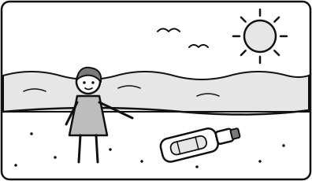{.w60}

**Write** a story about this picture. These questions can help you:

- Who finds the bottle?
- What does the message say?
- What happens next?
- How does your story end?

### [[tick]] B &nbsp; My favourite place

**Write** about your favourite place. These questions can help you:

- Where is it?
- What can you see, hear and smell there?
- What do you do there? Who do you go with?
- Why do you like it?

[[pagebreak]]

## Plan

You can write words or draw pictures to plan.

[[box:5:Plan]]

## Write here

[[lines:14]]

[[stop]]

[[pagebreak]]

# Part 4: Maths

You have 18 minutes. You can use a pencil, a rubber and a ruler. You cannot use a calculator.

You can ask your teacher to read a question to you. **Write** your answers in the boxes. You can use the working boxes.

## Section A: Number problems

[[cols:2]]

### 1 [[marks:1]]

356 + 238 = [[answer]]

[[box:3:Working]]

### 2 [[marks:1]]

7 × 8 = [[answer]]

### 3 [[marks:1]]

5&nbsp;024 − 1&nbsp;760 =

[[answer]]

[[box:3:Working]]

### 4 [[marks:1]]

12 × 6 = [[answer]]

### 5 [[marks:1]]

243 × 4 = [[answer]]

[[box:3:Working]]

### 6 [[marks:1]]

**Write** this fraction as a decimal.

47100 = [[answer:short]]

### 7 [[marks:1]]

**Write** the missing number.

34 = [[answer:short]]12

### 8 [[marks:2]]

[[example]]
27 rounded to the nearest 10 is 30
[[/example]]

**Round** 4&nbsp;362 to the nearest:

<table>
<tr><td>10</td><td>[[answer]]</td></tr>
<tr><td>100</td><td>[[answer]]</td></tr>
<tr><td>1&nbsp;000</td><td>[[answer]]</td></tr>
</table>

[[/cols]]

### 9 [[marks:1]]

36 × 24 = [[answer]]

[[box:5:Working]]

## Section B: Word problems and pictures

### 10 [[marks:1]]

There are 96 children. 8 children sit at each table.

How many tables do they need?

{.w30}

[[answer]] tables

### 11 [[marks:2]]

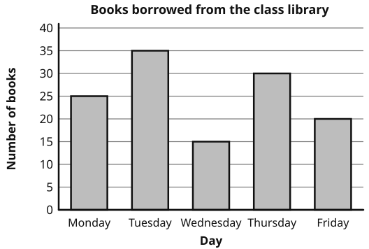{.w80}

(a) How many books were borrowed on Tuesday? [[answer:short]]

(b) How many **more** books were borrowed on Thursday than on Wednesday? [[answer:short]]

### 12 [[marks:1]]

Sofia has a ribbon. It is 2 m long. She cuts off 65 cm.

How long is the ribbon now? **Write** your answer in cm.

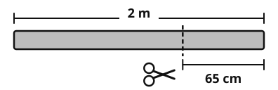{.w60}

[[answer]] cm

### 13 [[marks:2]]

Mei has ¥250. She buys a lantern and a book.

How much money does she have left?

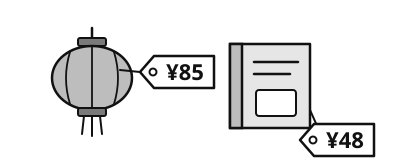{.w60}

[[box:3:Working]]

¥ [[answer]]

### 14 [[marks:2]]

The shape is drawn on a grid. Each square is 1 cm by 1 cm.

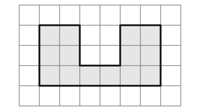{.w60}

(a) What is the **area** of the shape? [[answer:short]] cm²

(b) What is the **perimeter** of the shape? [[answer:short]] cm

### 15 [[marks:1]]

**Write** acute, obtuse or right in the box under each angle.

Use these words: acute obtuse right

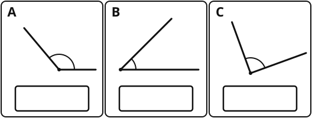{.w70}

### 16 [[marks:1]]

**Join** each shape to its name. Draw a line from dot to dot.

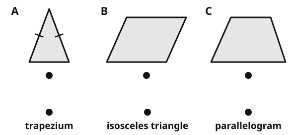{.w75}

### 17 [[marks:1]]

The dashed line is a line of symmetry.

**Draw** the other half of the shape. You can use a ruler.

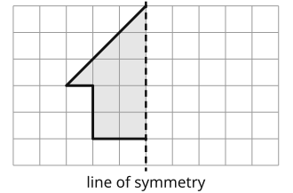{.w50}

### 18 [[marks:2]]

[[example]]
Point **E** is at (6, 1). Go 6 across, then 1 up.
[[/example]]

(a) **Write** the coordinates of point **A**.

( [[answer:short]] , [[answer:short]] )

(b) Point **A** moves 4 squares to the right and 2 squares down.

**Write** the new coordinates of point **A**.

( [[answer:short]] , [[answer:short]] )

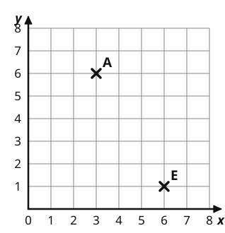{.w100}

### 19 [[marks:2]]

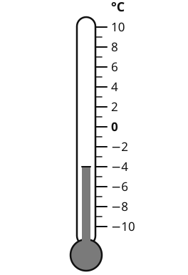{.w40 .right}

This thermometer shows the temperature in Harbin at 7 am.

(a) What is the temperature?

[[answer:short]] °C

(b) By 12 noon, the temperature goes up by 7 degrees.

What is the temperature at 12 noon?

[[answer:short]] °C

[[clear]]

[[stop]]

[[pagebreak]]

# Part 5: Science

You have 8 minutes. You can ask your teacher to read a question to you.

### 1 [[marks:1]]

**Write** solid, liquid or gas in each box.

Use these words: solid liquid gas

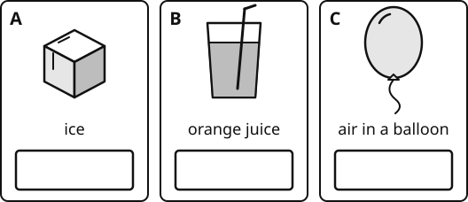{.w80}

### 2 [[marks:1]]

**Join** each tooth to its job. Draw a line from dot to dot.

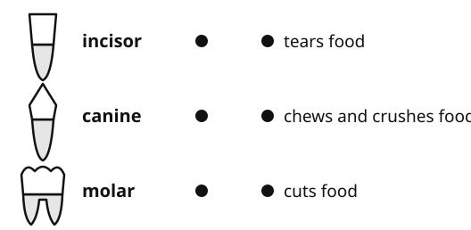{.w80}

### 3 [[marks:1]]

**Use** the key to find the name of animal A and animal B.

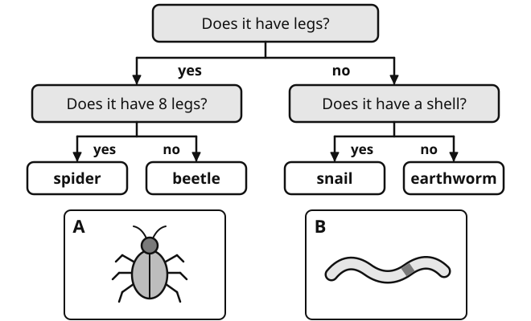{.w100}

Animal A: [[answer]] &nbsp; &nbsp; Animal B: [[answer]]

### 4 [[marks:2]]

[[example]]
In a food chain, the arrow → means "is eaten by". &nbsp; grass → rabbit → fox
[[/example]]

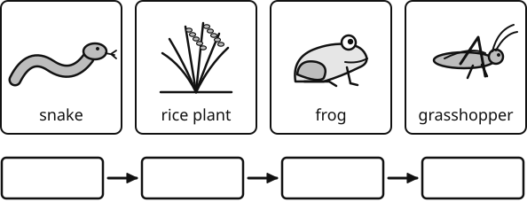{.w90}

(a) **Write** the food chain from a rice field in the boxes.

(b) All the frogs leave the rice field. What will happen to the number of grasshoppers? **Tick** one box.

[[tick]] more grasshoppers &nbsp; &nbsp; [[tick]] fewer grasshoppers &nbsp; &nbsp; [[tick]] the same

### 5 [[marks:1]]

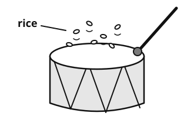{.w50 .right}

Chen Yu puts some rice on a drum. He hits the drum. The rice jumps up.

Why does the rice jump? **Tick** one box.

 The stick hits the rice.

 The top of the drum vibrates (moves up and down very fast).

 Wind blows the rice.

[[clear]]

### 6 [[marks:2]]

(a) Which bulb will light? **Tick** one box.

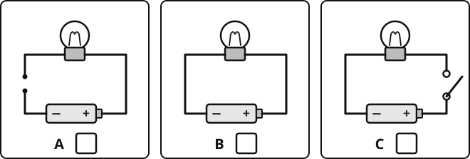{.w100}

(b) Amir puts different things in the gap in this circuit. Which thing will make the bulb light? **Tick** one box.

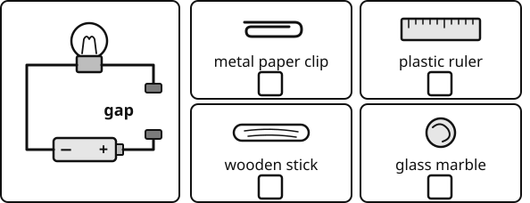{.w90}

### 7 [[marks:2]]

Amir puts 100 ml of water in three dishes. He puts the dishes in three places.

After 2 days, he measures the water in each dish.

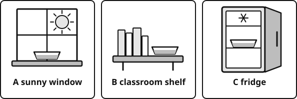{.w90}

| Place | Water at the start | Water after 2 days |
|---|:---:|:---:|
| A sunny window | 100 ml | 40 ml |
| B classroom shelf | 100 ml | 70 ml |
| C fridge | 100 ml | 95 ml |

(a) In which place did the water evaporate the **fastest**? [[answer:wide]]

(b) Amir wants a fair test. **Write** one thing he must keep the same.

[[answer:full]]

[[stop:Thank you. You have finished. Please wait for your teacher.]]
