

# Year 6 Admission Assessment

[[namebox]]

<b>Welcome!</b>

These activities help us get to know you. Do your best. It is fine if you cannot answer every question. You can ask your teacher to say the instructions again.

## How to answer

[[example]]
**Tick** one box. Which one is an animal? &nbsp; a chair [[tick]] &nbsp; &nbsp; a cat ✓

**Write** your answer in the box. &nbsp; 5 + 3 = 8

**Circle** the biggest number. &nbsp; 4 &nbsp; 9 &nbsp; 6

**Join** the picture to its word.

{.w30}

**Show** your working. &nbsp; 26 + 17 = 43

Working: &nbsp; 20 + 10 = 30 &nbsp; &nbsp; 6 + 7 = 13 &nbsp; &nbsp; 30 + 13 = 43

[[/example]]

## The parts of this booklet

| Part | | Time |
|---|---|---|
| 1 | Listening | 5 minutes |
| 2 | Reading | 12 minutes |
| 3 | Writing | 10 minutes |
| 4 | Maths | 18 minutes |
| 5 | Science | 8 minutes |

Your teacher will tell you when to start each part.

[[pagebreak]]

# Part 1: Listening

Your teacher will read the questions to you. Then your teacher will read a conversation **two times**.

**Listen** carefully. **Answer** the questions on this page and the next page.

### 1 [[marks:1]]

Where will Aisha and Jun meet? **Tick** one box.

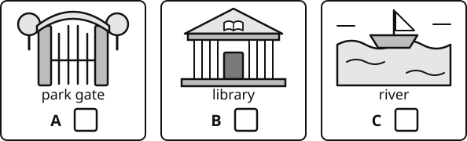{.w80}

### 2 [[marks:1]]

What time will they meet? **Tick** one box.

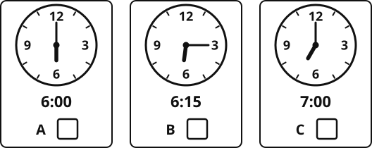{.w80}

### 3 [[marks:1]]

What must Jun bring? **Tick** two boxes.

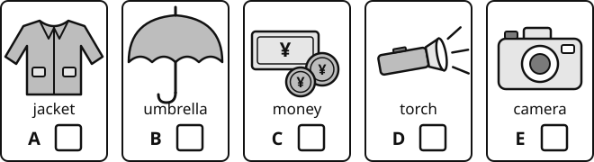{.w100}

### 4 [[marks:1]]

Who is going to the film night with Aisha? **Tick** one box.

 her mum

 her dad and her little brother

 her cousin

[[cols:2]]

### 5 [[marks:1]]

How wide is the screen?

**Write** your answer in the box.

[[answer:short]] metres

### 6 [[marks:1]]

What can they buy in the park?

**Write** your answer in the box.

[[answer]]

[[/cols]]

### 7 [[marks:1]]

Why does Aisha change the place where they meet?

**Write** your answer.

[[lines:2]]

### 8 [[marks:1]]

Jun's piano lesson finishes at six o'clock. Will he be late? **Tick** one box.

Yes [[tick]] &nbsp; &nbsp; No [[tick]]

**Explain** your answer.

[[lines:2]]

[[stop]]

[[pagebreak]]

# Part 2: Reading

**Read** the texts and **answer** the questions.

Do as much as you can. It is fine if you do not finish.

## Part A

**Read** the menu. Then answer questions 1 to 7.

{.w90}

[[cols:2]]

### 1 [[marks:1]]

How much is one plate of dumplings?

**Write** your answer in the box.

¥ [[answer:short]]

### 2 [[marks:1]]

How many dumplings are on one plate?

**Write** your answer in the box.

[[answer:short]]

[[/cols]]

### 3 [[marks:1]]

Which food is spicy? **Tick** one box.

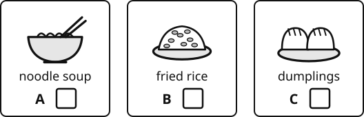{.w80}

[[cols:2]]

### 4 [[marks:1]]

Which drink can be hot or cold?

**Write** your answer in the box.

[[answer:wide]]

### 5 [[marks:1]]

What time does the café close?

**Write** your answer in the box.

[[answer]]

[[/cols]]

### 6 [[marks:2]]

**Tick** True or False.

| | True | False |
|---|:---:|:---:|
| *Example:* You can buy orange juice at the café. | ✓ | [[tick]] |
| The café is open on Mondays. | [[tick]] | [[tick]] |
| Fried rice costs more than an egg sandwich. | [[tick]] | [[tick]] |

### 7 [[marks:1]]

Wang Hao is 10 years old. On Wednesday, he buys fried rice at the café.

What does he get for free? **Write** your answer in the box. [[answer:wide]]

[[pagebreak]]

## Part B

**Read** the story. Then answer questions 8 to 15.

[[passage]]
#### The Rainy Day Picnic

On Sunday morning, Sofia and her little brother Tom were ready for a picnic in the park. Mum had made sandwiches, and Dad had packed some fruit and a big red blanket.

Then Sofia looked out of the window. Dark clouds were rolling across the sky. A moment later, rain began to beat against the glass.

"Oh no," said Tom. His face crumpled, and he looked as if he was going to cry.

Sofia had an idea. She pushed the sofa back against the wall and spread the red blanket on the living-room floor. Then she put Tom's toy animals all around the edge of the blanket.

"Welcome to the indoor park!" she said.

Dad played birdsong on his phone. Mum put a big plant in the middle of the blanket and called it a tree. They ate their sandwiches on the floor, and Tom gave pretend grapes to his toy lion.

After lunch, the rain stopped and the sun came out. But nobody wanted to go to the park.

"Can we have an indoor picnic every Sunday?" asked Tom.
[[/passage]]

[[cols:2]]

### 8 [[marks:1]]

On which day was the picnic?

**Write** your answer in the box.

[[answer:wide]]

### 9 [[marks:1]]

**Tick** the **two** things that Dad packed.

[[tick]] fruit &nbsp; [[tick]] sandwiches

[[tick]] a blanket &nbsp; [[tick]] a ball

### 10 [[marks:1]]

What colour was the blanket?

**Write** your answer in the box.

[[answer]]

### 11 [[marks:1]]

What did Mum use as a tree?

**Write** your answer in the box.

[[answer:wide]]

[[/cols]]

### 12 [[marks:1]]

Why could the family not go to the park in the morning?

[[lines:2]]

### 13 [[marks:1]]

What did Sofia put around the edge of the blanket?

[[lines:1]]

### 14 [[marks:1]]

"His face crumpled, and he looked as if he was going to cry." How did Tom feel? **Tick** one box.

[[tick]] sad &nbsp; &nbsp; [[tick]] happy &nbsp; &nbsp; [[tick]] hungry &nbsp; &nbsp; [[tick]] angry

### 15 [[marks:1]]

When the sun came out, nobody wanted to go to the park. Why do you think this was?

[[lines:2]]

[[pagebreak]]

## Part C

**Read** the text. Then answer questions 16 to 23.

[[passage]]
#### How Seeds Travel

A plant cannot walk, but its seeds can travel a long way. Why does this matter? If every seed fell straight down under its parent plant, the young plants would grow in the shade. They would also have to share water and space with the parent and with each other, and most of them would not survive. So plants have clever ways of sending their seeds away. Scientists call this seed dispersal.

**Carried by the wind.** Some seeds are so light that the wind can carry them. A dandelion seed has a tiny parachute of soft hairs, which can carry it a long way on a breezy day. A sycamore seed has a wing. As it falls, it spins like a small helicopter, and the wind pushes it away from the tree.

**Floating on water.** The coconut is one of the largest seeds in the world. Its thick, hairy outer layer traps air, so it floats. A coconut can drift on the ocean for months before it washes up on a beach and starts to grow.

**Hitching a ride.** Some seeds travel on animals. A burdock seed is covered in tiny hooks that catch on fur. In 1941, a Swiss engineer called George de Mestral noticed burdock seeds stuck to his dog's coat after a walk. He looked at them under a microscope and saw the hooks. This gave him an idea: he invented a fastener with tiny hooks and loops, which we now call Velcro. You may have it on your shoes or your school bag.

Other seeds are hidden inside sweet fruits. When a bird eats the fruit, the seeds pass through its body and are dropped somewhere new, often far from the parent plant.
[[/passage]]

[[cols:2]]

### 16 [[marks:1]]

What helps a dandelion seed travel on the wind?

[[answer:full]]

### 17 [[marks:1]]

Why can a coconut float?

[[answer:full]]

[[/cols]]

### 18 [[marks:1]]

[[example]]
**Find and copy** one word from "Carried by the wind" that means "not heavy". &nbsp; light
[[/example]]

**Find and copy** one word from the first paragraph that means "stay alive". [[answer]]

[[cols:2]]

### 19 [[marks:1]]

"A coconut can **drift** on the ocean for months." What does **drift** mean here? **Tick** one box.

 sink to the bottom

 move slowly with the water

 swim fast

 break into pieces

### 20 [[marks:1]]

One heading is "Hitching a ride". What does this mean in the text? **Tick** one box.

 being carried by an animal

 growing very tall

 falling straight down

 floating on the sea

[[/cols]]

[[cols:2]]

### 21 [[marks:1]]

Give **one** reason why young plants do not grow well right under their parent plant.

[[lines:1]]

### 22 [[marks:1]]

A bird eats a cherry in a park. Later, a small cherry tree starts to grow in a garden far away. **Explain** how this can happen.

[[lines:2]]

[[/cols]]

### 23 [[marks:1]]

Why do you think the writer tells the story of George de Mestral?

[[lines:2]]

[[stop]]

[[pagebreak]]

# Part 3: Writing

You have 10 minutes. **Choose** A or B. **Tick** the one you choose.

### [[tick]] A &nbsp; The robot at the door

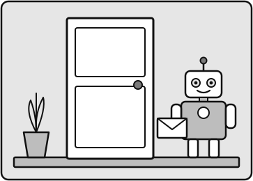{.w55}

**Write** a story about this picture. You can start like this: *One morning, there was a knock at the door.*

These questions can help you:

- Who opens the door?
- What does the robot want? What is in the envelope?
- What happens next?
- How does your story end?

### [[tick]] B &nbsp; A letter to a new friend

**Write** a letter to a student in your new class. Tell them about yourself. You can start like this: *Dear new friend,*

These ideas can help you:

- your family and your home
- what you like doing, and what you are good at
- what you want to learn at your new school

[[pagebreak]]

## Plan

You can write words or draw pictures to plan.

[[box:5:Plan]]

## Write here

[[lines:14]]

[[stop]]

[[pagebreak]]

# Part 4: Maths

You have 18 minutes. You can use a pencil, a rubber and a ruler. You cannot use a calculator.

You can ask your teacher to read a question to you. **Write** your answers in the boxes. You can use the working boxes.

## Section A: Number problems

[[cols:2]]

### 1 [[marks:1]]

4&nbsp;625 + 2&nbsp;378 =

[[answer]]

[[box:3:Working]]

### 2 [[marks:1]]

12 × 9 = [[answer]]

### 3 [[marks:1]]

**Round** 486&nbsp;350 to the nearest 10&nbsp;000.

[[answer]]

### 4 [[marks:1]]

**Circle** the largest number.

0.45&nbsp;&nbsp;&nbsp; 0.405&nbsp;&nbsp;&nbsp; 0.5&nbsp;&nbsp;&nbsp; 0.054

### 5 [[marks:1]]

857 ÷ 6 = [[answer:short]]

remainder [[answer:short]]

[[box:4:Working]]

### 6 [[marks:1]]

3&nbsp;406 × 23 = [[answer]]

[[box:4:Working]]

### 7 [[marks:1]]

**Write** the missing number.

234 = [[answer:short]]4

### 8 [[marks:1]]

23 + 16 = [[answer:short]]

[[/cols]]

### 9 [[marks:1]]

736 ÷ 23 = [[answer]]

[[box:5:Working]]

## Section B: Word problems and pictures

### 10 [[marks:2]]

This timetable shows three trains from Shanghai to Hangzhou.

| Station | Train 1 | Train 2 | Train 3 |
|---|:---:|:---:|:---:|
| Shanghai (leaves) | 07:50 | 09:35 | 11:10 |
| Jiaxing | 08:18 | 10:02 | 11:41 |
| Hangzhou (arrives) | 08:46 | 10:31 | 12:09 |

(a) What time does Train 2 arrive in Jiaxing? [[answer]]

(b) How many minutes does Train 3 take from Shanghai to Hangzhou? [[answer:short]] minutes

### 11 [[marks:1]]

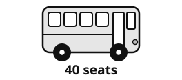{.w40 .right}

150 children go on a school trip. One bus can carry 40 children.

How many buses do they need?

[[answer:short]] buses

[[clear]]

### 12 [[marks:2]]

Jun buys 3 notebooks. One notebook costs ¥13.50.

He pays with a ¥50 note. How much change does he get?

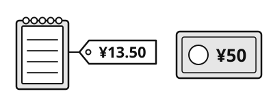{.w60}

[[box:3:Working]]

¥ [[answer]]

### 13 [[marks:1]]

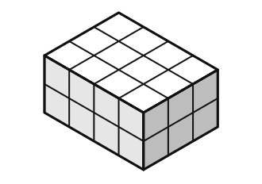{.w45 .right}

This cuboid is made of 1 cm cubes.

What is the **volume** of the cuboid?

[[answer:short]] cm³

[[clear]]

### 14 [[marks:2]]

(a) What is the **perimeter** of this shape?

[[answer:short]] cm

(b) What is the **area** of this shape?

[[answer:short]] cm²

[[box:4:Working]]

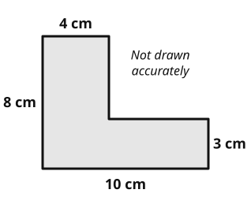{.w100}

### 15 [[marks:1]]

A bottle has 1.5 litres of water. Sofia fills 4 cups from the bottle. Each cup holds 250 ml.

How much water is left in the bottle? **Write** your answer in ml.

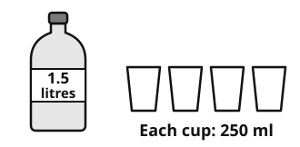{.w50}

[[answer]] ml

### 16 [[marks:1]]

**Circle** the **two** prime numbers.

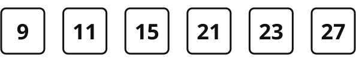{.w90}

### 17 [[marks:2]]

Work out the size of angle *x* and angle *y*. You do not need a protractor.

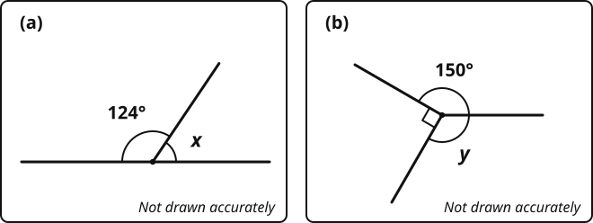{.w100}

(a) *x* = [[answer:short]] ° &nbsp; &nbsp; &nbsp; &nbsp; (b) *y* = [[answer:short]] °

### 18 [[marks:1]]

There are 100 children in Year 6. The table shows how they come to school.

| How they come to school | Number of children |
|---|:---:|
| walk | 38 |
| bus | 27 |
| car | ? |
| **Total** | **100** |

What **percentage** of the children come by car? [[answer:short]] %

### 19 [[marks:1]]

**Draw** the reflection of the shape in the mirror line. You can use a ruler.

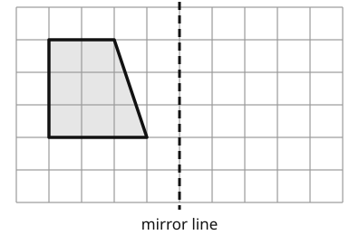{.w60}

### 20 [[marks:2]]

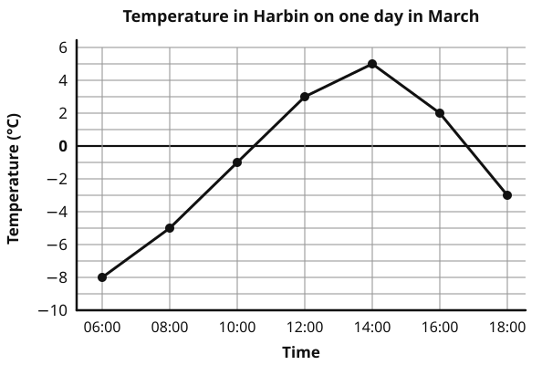{.w90}

(a) What was the temperature at 08:00? [[answer:short]] °C

(b) How many degrees **warmer** was it at 14:00 than at 06:00? [[answer:short]] degrees

[[stop]]

[[pagebreak]]

# Part 5: Science

You have 8 minutes. You can ask your teacher to read a question to you.

### 1 [[marks:1]]

This is the life cycle of a frog. One stage is missing.

**Tick** the picture of the missing stage.

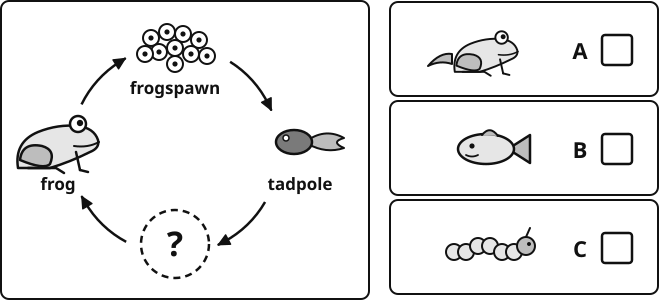{.w100}

### 2 [[marks:2]]

Some changes can be changed back. They are **reversible**.

Some changes cannot be changed back. They are **irreversible**.

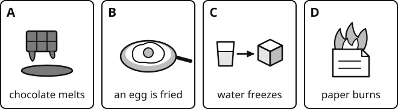{.w100}

**Write** the letters A, B, C and D in the table.

| Reversible (can be changed back) | Irreversible (cannot be changed back) |
|---|---|
|    |    |

### 3 [[marks:2]]

**Join** each mixture to the best way to separate it. Draw a line from dot to dot.

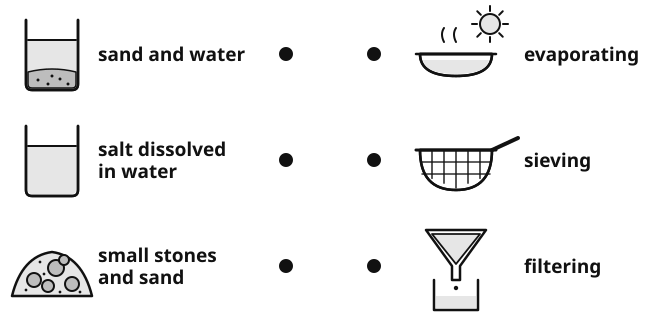{.w100}

### 4 [[marks:1]]

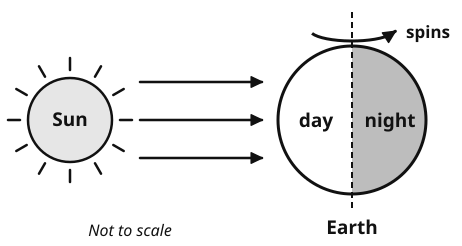{.w70}

Why do we have day and night? **Tick** one box.

 The Earth spins around once every day.

 The Sun moves around the Earth every day.

 The Moon covers the Sun at night.

 The Earth moves around the Sun once every day.

### 5 [[marks:1]]

Gear A turns clockwise. Which way does gear B turn? **Tick** one box.

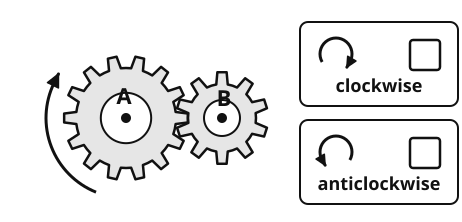{.w70}

### 6 [[marks:1]]

Mei drops a paper parachute. Two forces act on it.

**Write** the names of the two forces in boxes 1 and 2.

Use two of these words:

gravity

air resistance

magnetism

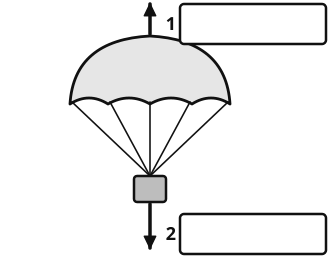{.w100}

### 7 [[marks:2]]

Mei makes four paper parachutes of different sizes. She drops each one and times how long it takes to reach the floor.

| Size of parachute | Time to fall (seconds) |
|---|:---:|
| 10 cm by 10 cm | 1.2 |
| 20 cm by 20 cm | 1.8 |
| 30 cm by 30 cm | 2.5 |
| 40 cm by 40 cm | 3.1 |

(a) What does the table show? **Tick** one box.

 The bigger the parachute, the longer it takes to fall.

 The bigger the parachute, the faster it falls.

 The size of the parachute makes no difference.

(b) Mei wants a fair test. **Write** one thing she must keep the same.

[[answer:full]]

[[stop:Thank you. You have finished. Please wait for your teacher.]]
