

# Year 7 Admission Assessment

[[namebox]]

## Welcome

These activities help us get to know you.

Do your best. It is fine if you cannot answer every question.

- **Read** each question carefully.
- In **Maths** and **Science**, you can ask your teacher to read a question to you.
- In **Listening**, **Reading** and **Writing**, your teacher cannot explain words. We want to see your English.
- You need a pencil, a rubber and a ruler. You cannot use a calculator.

## How to answer

[[example]]
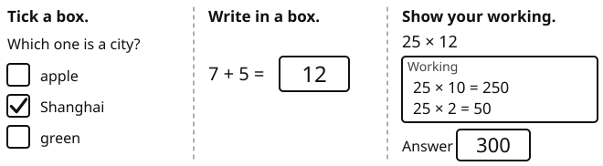{.w100}
[[/example]]

## The parts of this paper

| Part | What you do | Time |
|---|---|---|
| Listening | Listen to a phone message. Answer 8 questions. | 5 minutes |
| Reading | Read three texts. Answer the questions. | 12 minutes |
| Writing | Choose one task. Write about 20 lines. | 10 minutes |
| Break | Have a short rest. | 5 minutes |
| Maths | Answer the questions in Section A and Section B. | 20 minutes |
| Science | Answer 6 questions. | 8 minutes |
| Talk | Read some sentences aloud. Talk with a teacher about yourself and your plans. | 15 minutes |

[[pagebreak]]

# Listening

Your teacher will read a phone message **two times**.

Li Na is calling her friend Sofia about Saturday.

**Read** the questions now. Then **listen** and **answer** the questions.

### 1 [[marks:1]]
Where are Li Na and Sofia going on Saturday? **Tick** one box.

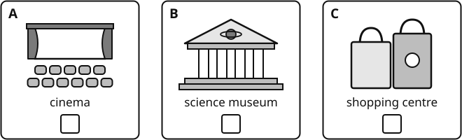{.w100}

### 2 [[marks:1]]
What time will they meet? **Tick** one box.

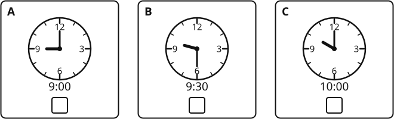{.w100}

### 3 [[marks:1]]
How will Sofia travel to the museum? **Tick** one box.

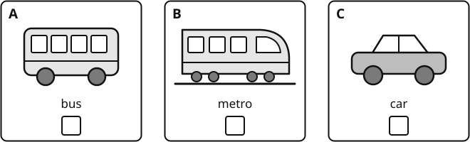{.w100}

### 4 [[marks:1]]
What must Sofia bring? **Tick** two boxes.

[[tick]] a student card &nbsp;&nbsp; [[tick]] an umbrella &nbsp;&nbsp; [[tick]] a packed lunch  
[[tick]] a camera &nbsp;&nbsp; [[tick]] money for the café

### 5 [[marks:1]]
Which metro exit should Sofia use? **Write** the number in the box.

Exit [[answer:short]]

### 6 [[marks:1]]
How much will Sofia pay for her ticket? **Write** the number in the box.

[[answer:short]] yuan

### 7 [[marks:1]]
Li Na says, "Please don't be late." Why? **Write** your answer.

[[lines:2]]

### 8 [[marks:1]]
Li Na tells Sofia about her brother. Why? **Write** your answer.

[[lines:2]]

[[stop]]

[[pagebreak]]

# Reading

**Read** the texts and **answer** the questions.

Do as much as you can. It is fine if you do not finish.

You have 12 minutes.

## Part A: A notice

**Read** the notice. Then **answer** questions 1 to 6.

{.w100}

[[cols:2]]

### 1 [[marks:1]]
Which day is the Chess Club? **Write** your answer in the box.

[[answer:wide]]

### 2 [[marks:1]]
Where does the Robotics Club meet? **Write** your answer in the box.

[[answer:wide]]

### 3 [[marks:1]]
What time do the clubs finish? **Write** your answer in the box.

[[answer:wide]]

### 4 [[marks:1]]
Which club meets two times every week? **Write** your answer in the box.

[[answer:wide]]

[[/cols]]

### 5 [[marks:3]]
**Tick** True or False for each sentence.

[[example]]
| Example | True | False |
|---|---|---|
| The Art Club meets on Friday. | ✓ | |
[[/example]]

| Sentence | True | False |
|---|---|---|
| a. The Drama Club meets in the library. | [[tick]] | [[tick]] |
| b. The Robotics Club costs 50 yuan. | [[tick]] | [[tick]] |
| c. You need a water bottle for the Chess Club. | [[tick]] | [[tick]] |

### 6 [[marks:1]]
Aisha loves acting and performing. Which club is best for her? **Write** your answer in the box.

[[answer:wide]]

[[pagebreak]]

## Part B: Kites

**Read** the text. Then **answer** questions 7 to 13.

[[passage]]
#### Kites

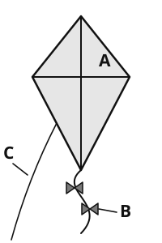{.w30 .right}

People in China have flown kites for more than two thousand years. The first kites were made of wood. Later, people made them from bamboo and silk. When paper was invented, kites became cheaper, and more people could make them.

Long ago, kites were not only toys. Soldiers sometimes used them to send messages. Today, most people fly kites for fun.

How does a kite fly? The wind pushes against the kite and lifts it into the sky. The person on the ground holds the string tightly. If the string is too loose, the kite falls down. The tail helps the kite to stay steady, so it does not spin round and round.

Weifang is a city in Shandong Province. It is famous for its kites. Every April, people from many countries come to Weifang for a big kite festival. Some of the kites are longer than a bus. Some look like dragons, fish or butterflies.

Do you want to fly a kite? Choose an open place, such as a park or a beach. Stay away from trees and electricity wires. A windy spring day is the best time.

[[clear]]
[[/passage]]

### 7 [[marks:1]]
What were the first kites made of? **Tick** one box.

[[tick]] wood &nbsp;&nbsp; [[tick]] paper &nbsp;&nbsp; [[tick]] silk

### 8 [[marks:1]]
For how long have people in China flown kites? **Write** your answer in the box.

[[answer:wide]]

### 9 [[marks:1]]
Look at the picture of the kite. Which letter shows the tail? **Write** the letter in the box.

[[answer:short]]

### 10 [[marks:1]]
What does the tail do? **Write** your answer.

[[lines:1]]

### 11 [[marks:2]]
**Tick** True or False for each sentence.

| Sentence | True | False |
|---|---|---|
| a. Soldiers sometimes used kites to send messages. | [[tick]] | [[tick]] |
| b. The kite festival in Weifang is in October. | [[tick]] | [[tick]] |

### 12 [[marks:1]]
The text says: "kites became **cheaper**". What does **cheaper** mean? **Tick** one box.

[[tick]] They cost less money. &nbsp;&nbsp; [[tick]] They were bigger. &nbsp;&nbsp; [[tick]] They were stronger.

### 13 [[marks:1]]
Why is an open place good for flying a kite? **Write** one reason.

[[lines:1]]

[[pagebreak]]

## Part C: A story

**Read** the story. Then **answer** questions 14 to 20.

[[passage]]
#### Mist

On his first morning at Riverside Middle School, Chen Yu stood at the classroom door and counted the faces. Thirty-one. Nobody looked up.

"You can sit next to Tom," said Ms Wang, pointing to an empty desk by the window. Tom was drawing something in the back of his maths book. He moved his pencil case to make space, but he did not say a word.

All morning, Chen Yu kept his eyes on the board. He copied down every word, even the ones he did not need. At lunch, he sat at the end of a long table and ate his rice very slowly, so that he would always look busy.

In the afternoon, rain began to stream down the windows. The class had art, and Ms Wang asked everyone to draw a place they loved. Chen Yu thought of his grandfather's tea garden in the hills outside Hangzhou: the neat rows of green bushes, the narrow stone steps, the white mist that hung over everything in the early morning. He drew until the bell rang.

"That's the best one in the room," said a voice. Tom was leaning over his shoulder. "How did you do the mist?"

Chen Yu showed him. You press lightly with the side of the pencil, then rub it gently with your finger. Tom tried it on the corner of his own page. His mist looked more like smoke from a factory chimney, and they both laughed.

"Do you want to come to art club tomorrow?" Tom asked. "We meet in the art room after lunch. It's mostly people who are bad at football."

Chen Yu was terrible at football. "Yes," he said. "I'd like that."

On the bus home, he watched the grey streets go past. Somehow, they did not look quite so grey any more.
[[/passage]]

### 14 [[marks:1]]
Where did Ms Wang ask Chen Yu to sit? **Write** your answer.

[[lines:1]]

### 15 [[marks:1]]
What did Ms Wang ask the class to draw? **Write** your answer.

[[lines:1]]

### 16 [[marks:1]]
At lunch, Chen Yu ate his rice very slowly "so that he would always look busy". Why did he want to look busy? **Write** your answer.

[[lines:2]]

### 17 [[marks:1]]
"Rain began to **stream** down the windows." What does **stream** mean here? **Tick** one box.

[[tick]] fall a little at a time &nbsp;&nbsp; [[tick]] flow fast, like a river &nbsp;&nbsp; [[tick]] stop suddenly

### 18 [[marks:2]]
How did Chen Yu feel on his first morning? **Write** one word. Then **write** one thing from the story that shows this.

He felt [[answer:wide]]

This shows it:

[[lines:2]]

### 19 [[marks:1]]
Tom says that the art club is "mostly people who are bad at football". Why do you think he says this? **Write** your answer.

[[lines:2]]

### 20 [[marks:1]]
Look at the last sentence of the story. Why do you think the writer says the streets "did not look quite so grey any more"? **Write** your answer.

[[lines:2]]

[[stop]]

[[pagebreak]]

# Writing

You have 10 minutes.

**Choose** one task. **Tick** the box for your task.

| [[tick]] **Task 1: A story** | [[tick]] **Task 2: Your opinion** |
|---|---|
| **Write** a story that begins: *"When Mei opened the box, she could not believe her eyes."* | *"The school summer holiday should be shorter."* Do you agree? **Write** your opinion. |
| Ideas: What was in the box? What happened next? How did the story end? | Ideas: Give reasons and examples. What do other people think? |

**Plan** your writing in the box. You can write notes.

[[box:6:Plan]]

**Write** your answer on the lines. Try to write about 20 lines.

[[lines:13]]

[[pagebreak]]

[[lines:10]]

**Check** your writing: capital letters, full stops, spelling. Does it make sense?

[[stop]]

[[pagebreak]]

# Maths

You have 20 minutes. You cannot use a calculator.

You can ask your teacher to read a question to you.

**Show** your working. You can get marks for your working.

## Section A: Number problems

**Work out** the answers. **Write** each answer in the box.

[[cols:2]]

### 1 [[marks:1]]
4506 + 2738 = [[answer]]

### 2 [[marks:1]]
346 × 27 = [[answer]]

[[box:4:Working]]

### 3 [[marks:2]]
a. 5 + 3 × 4 = [[answer:short]]

b. (18 − 6) ÷ 3 + 2 = [[answer:short]]

### 4 [[marks:2]]
864 ÷ 24 = [[answer]]

[[box:4:Working]]

### 5 [[marks:1]]
23 × 35 = [[answer]]

### 6 [[marks:1]]
34 ÷ 3 = [[answer]]

### 7 [[marks:1]]
**Write** 35 as a percentage.

[[answer:short]] %

### 8 [[marks:1]]
15% of 80 = [[answer]]

### 9 [[marks:1]]
−5 − 8 = [[answer]]

[[/cols]]

## Section B: Word problems and pictures

### 10 [[marks:1]]
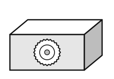{.w35 .right}

A box of mooncakes is a cuboid.

It is 20 cm long, 15 cm wide and 6 cm tall.

**Work out** the volume of the box.

[[answer]] cm³

[[clear]]

### 11 [[marks:2]]
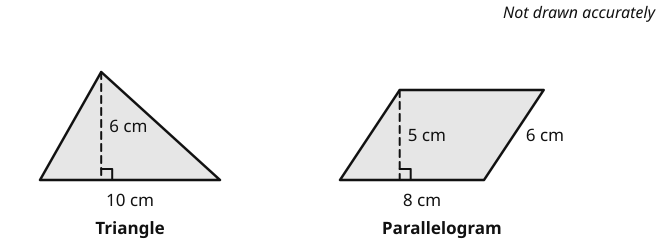{.w100}

a. **Work out** the area of the triangle. [[answer]] cm²

b. **Work out** the area of the parallelogram. [[answer]] cm²

### 12 [[marks:1]]
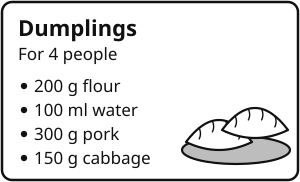{.w45 .right}

This recipe makes dumplings for 4 people.

Wang Hao makes dumplings for 6 people.

How much pork does he need?

[[answer]] g

### 13 [[marks:2]]
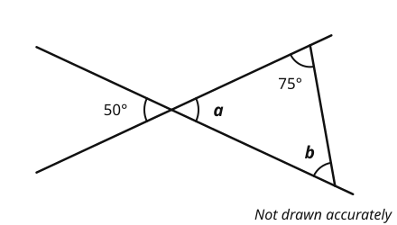{.w65}

Two straight lines cross. **Work out** the size of angle *a* and angle *b*.

*a* = [[answer:short]] ° &nbsp;&nbsp;&nbsp;&nbsp; *b* = [[answer:short]] °

### 14 [[marks:1]]
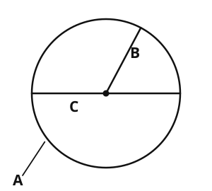{.w40 .right}

**Write** the letter A, B or C for each word.

radius [[answer:short]]

diameter [[answer:short]]

circumference [[answer:short]]

[[clear]]

### 15 [[marks:2]]
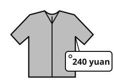{.w30 .right}

A jacket costs 240 yuan.

In a sale, the price goes down by 25%.

What is the new price of the jacket?

[[box:3:Working]]

[[answer]] yuan

### 16 [[marks:2]]
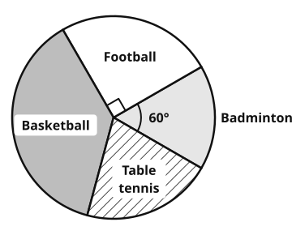{.w55 .right}

120 students chose their favourite sport.

The pie chart shows the results.

a. What fraction of the students chose football?

[[answer:short]]

b. How many students chose badminton?

[[answer:short]]

### 17 [[marks:2]]
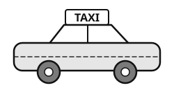{.w35 .right}

A taxi costs 10 yuan to start.

Then it costs 2 yuan for each km.

**Cost in yuan = 10 + 2 × number of km**

a. Mei goes 8 km by taxi. How much does she pay? [[answer:short]] yuan

b. Tom pays 40 yuan. How many km does he go? [[answer:short]] km

### 18 [[marks:2]]
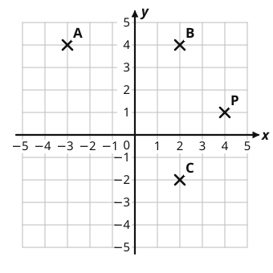{.w50 .right}

[[example]]
Point P is at (4, 1).
[[/example]]

a. **Write** the coordinates of point A.

( [[answer:short]] , [[answer:short]] )

b. A, B, C and D are the corners of a rectangle.

**Write** the coordinates of point D.

( [[answer:short]] , [[answer:short]] )

### 19 [[marks:2]]
Here are some patterns made with sticks.

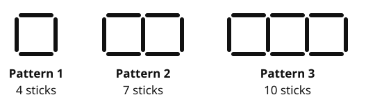{.w80}

a. How many sticks are in Pattern 5? [[answer:short]]

b. **Write** a rule for the number of sticks in Pattern *n*.

[[example]]
The numbers 5, 7, 9, 11, ... have the rule 2*n* + 3.
[[/example]]

Number of sticks in Pattern *n* = [[answer:wide]]

### 20 [[marks:2]]
Five friends read some books in May.

They read 4, 7, 3, 6 and 5 books.

a. **Work out** the mean number of books. [[answer:short]]

b. Sofia joins the group. Now the mean for the six friends is 6 books.

How many books did Sofia read? [[answer:short]]

[[box:3:Working]]

[[stop]]

[[pagebreak]]

# Science

You have 8 minutes.

You can ask your teacher to read a question to you.

### 1 [[marks:2]]
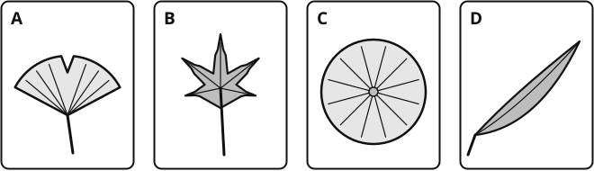{.w100}

**Use** the key to name each leaf.

| | Question | Yes | No |
|---|---|---|---|
| 1 | Is the leaf long and thin? | bamboo | Go to 2 |
| 2 | Is the leaf round? | lotus | Go to 3 |
| 3 | Is the leaf shaped like a fan? | ginkgo | maple |

[[example]]
Leaf D is long and thin. Leaf D is **bamboo**.
[[/example]]

**Write** the name of each leaf.

A [[answer]] &nbsp;&nbsp;&nbsp; B [[answer]] &nbsp;&nbsp;&nbsp; C [[answer]]

### 2 [[marks:1]]
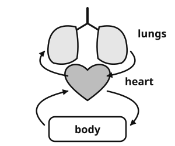{.w45 .right}

The heart pumps blood to the lungs.

In the lungs, the blood picks up a gas.

Which gas? **Tick** one box.

[[tick]] oxygen  
[[tick]] carbon dioxide  
[[tick]] nitrogen

### 3 [[marks:2]]
Jun sits, then runs, then sits again. The graph shows his heart rate.

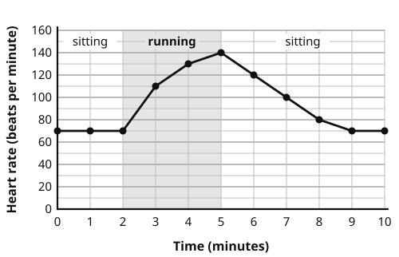{.w75}

a. What was Jun's heart rate at 4 minutes? [[answer:short]] beats per minute

b. Why does Jun's heart beat faster when he runs? **Explain** your answer.

[[lines:2]]

### 4 [[marks:2]]
a. **Write** the name of each circuit symbol in the box. Use these words: **bulb**, **cell**, **switch**.

{.w100}

b. In which circuit is the bulb the brightest? **Tick** one box.

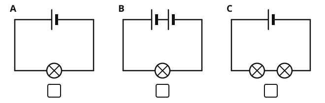{.w100}

### 5 [[marks:2]]
Mei makes a shadow with a torch and a card puppet. She moves the torch. She measures the height of the shadow.

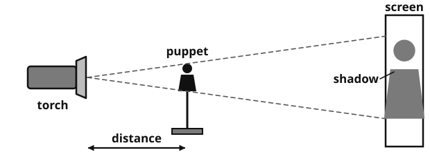{.w80}

| Distance from the torch to the puppet (cm) | 10 | 20 | 30 | 40 |
|---|---|---|---|---|
| **Height of the shadow (cm)** | 36 | 24 | 20 | 18 |

a. Mei wants a fair test. What must she keep the same? **Tick** one box.

[[tick]] the distance from the torch to the puppet  
[[tick]] the puppet she uses  
[[tick]] the height of the shadow

b. **Complete** the sentence.

When the torch moves further away from the puppet, the shadow gets [[answer:wide]]

### 6 [[marks:1]]
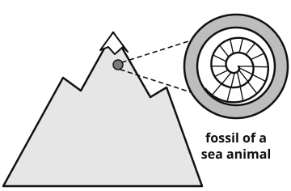{.w55 .right}

Scientists found fossils of sea animals in rocks near the top of a high mountain.

What does this tell us about these rocks a long time ago?

**Write** your answer.

[[lines:3]]

[[stop:Thank you. You have finished. Please wait for your teacher.]]
