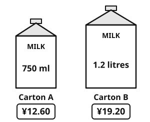
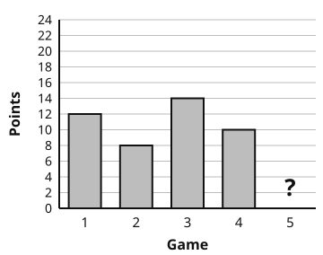
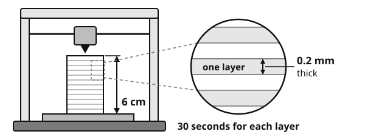
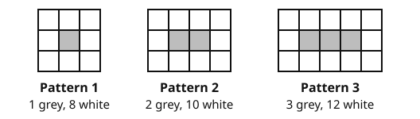

# Year 7 Admission Assessment Version 2, October 2026

[[namebox]]

## Welcome

These activities help us get to know you.

Do your best. It is fine if you cannot answer every question.

- **Read** each question carefully.
- In **Maths** and **Science**, you can ask your teacher to read a question to you.
- In **Listening**, **Reading** and **Writing**, your teacher cannot explain words. We want to see your English.
- You need a pencil, a rubber and a ruler. You cannot use a calculator.

## How to answer

[[example]]
{.w100}
[[/example]]

## The parts of this paper

| Part | What you do | Time |
|---|---|---|
| Listening | Listen to a message and a talk. Answer 16 questions. | about 12 minutes |
| Reading | Read three texts. Answer the questions. | 15 minutes |
| Writing | Choose one task. Write about 20 lines. | 10 minutes |
| Break | Have a short rest. | 5 minutes |
| Maths | Answer the questions in Section A, Section B and Section C. | 25 minutes |
| Science | Answer 6 questions. | 8 minutes |
| Talk | Read some sentences aloud. Talk with a teacher about yourself and your plans. | 15 minutes |

[[pagebreak]]

# Listening

## Part A: A phone message

Your teacher will read a phone message **two times**. Li Na is calling her friend Sofia about Saturday.

**Read** the questions now. Then **listen** and **answer** the questions.

### 1 [[marks:1]]
Where are Li Na and Sofia going on Saturday? **Tick** one box.

{.w85}

### 2 [[marks:1]]
What time will they meet? **Tick** one box.

{.w100}

### 3 [[marks:1]]
How will Sofia travel to the museum? **Tick** one box.

{.w85}

### 4 [[marks:1]]
What must Sofia bring? **Tick** two boxes.

[[tick]] a student card &nbsp;&nbsp; [[tick]] an umbrella &nbsp;&nbsp; [[tick]] a packed lunch  
[[tick]] a camera &nbsp;&nbsp; [[tick]] money for the café

### 5 [[marks:1]]
Which metro exit should Sofia use? **Write** the number in the box.

Exit [[answer:short]]

### 6 [[marks:1]]
How much will Sofia pay for her ticket? **Write** the number in the box.

[[answer:short]] yuan

### 7 [[marks:1]]
Li Na says, "Please don't be late." Why? **Write** your answer.

[[lines:2]]

### 8 [[marks:1]]
Li Na tells Sofia about her brother. Why? **Write** your answer.

[[lines:2]]

[[pagebreak]]

## Part B: A short talk

Your teacher will read a short talk **two times**. A science teacher is giving a lesson about deserts.

You have one minute to **read** questions 9 to 16. Then **listen** and **answer** the questions.

### 9 [[marks:1]]
A desert gets less than how much rain or snow in a year? **Write** the number in the box.

less than [[answer:short]] millimetres

### 10 [[marks:1]]
Which is the largest desert in the world? **Tick** one box.

[[tick]] the Sahara &nbsp;&nbsp; [[tick]] Antarctica &nbsp;&nbsp; [[tick]] the Namib

### 11 [[marks:1]]
The roots of a cactus spread out just below the surface of the ground. Why is this useful for the cactus? **Use** what the teacher says about rain. **Write** your answer.

[[lines:2]]

### 12 and 13 [[marks:2]]
**Complete** the notes. **Write** one, two or three words in each box.

[[example]]
Many desert animals are nocturnal. They look for food at night
[[/example]]

#### Notes: desert animals

**12** &nbsp; The fennec fox's big ears help it to lose [[answer:wide]]

**13** &nbsp; A camel's hump is full of [[answer:wide]]

### 14 [[marks:1]]
How does the beetle in the Namib Desert get water? **Write** the numbers 1, 2, 3 and 4 in the boxes to show the order.

[[example]]
2 I eat breakfast. &nbsp;&nbsp;&nbsp; 1 I get up. &nbsp;&nbsp;&nbsp; 3 I go to school.
[[/example]]

| Order | What the beetle does |
|---|---|
| [[answer:short]] | Drops of water collect on its back. |
| [[answer:short]] | It climbs to the top of a sand dune. |
| [[answer:short]] | The water rolls down into its mouth. |
| [[answer:short]] | It leans forward into the wind. |

### 15 [[marks:1]]
At the end, the teacher talks about people who say a desert is an empty place. What does she think about these people? **Tick** one box.

[[tick]] They are right. Very few things live in a desert.  
[[tick]] They have not looked carefully enough.  
[[tick]] They know more about deserts than scientists do.

### 16 [[marks:1]]
What is the talk mostly about? **Tick** one box.

[[tick]] why deserts are always hot and sandy  
[[tick]] how plants and animals survive with very little water  
[[tick]] why camels are the most important desert animals

[[stop]]

[[pagebreak]]

# Reading

**Read** the texts and **answer** the questions.

Do as much as you can. It is fine if you do not finish.

You have 15 minutes.

## Part A: A notice

**Read** the notice. Then **answer** questions 1 to 6.

{.w100}

[[cols:2]]

### 1 [[marks:1]]
Which day is the Chess Club? **Write** your answer in the box.

[[answer:wide]]

### 2 [[marks:1]]
Where does the Robotics Club meet? **Write** your answer in the box.

[[answer:wide]]

### 3 [[marks:1]]
What time do the clubs finish? **Write** your answer in the box.

[[answer:wide]]

### 4 [[marks:1]]
Which club meets two times every week? **Write** your answer in the box.

[[answer:wide]]

[[/cols]]

### 5 [[marks:3]]
**Tick** True or False for each sentence.

[[example]]
| Example | True | False |
|---|---|---|
| The Art Club meets on Friday. | ✓ | |
[[/example]]

| Sentence | True | False |
|---|---|---|
| a. The Drama Club meets in the library. | [[tick]] | [[tick]] |
| b. The Robotics Club costs 50 yuan. | [[tick]] | [[tick]] |
| c. You need a water bottle for the Chess Club. | [[tick]] | [[tick]] |

### 6 [[marks:1]]
Aisha loves acting and performing. Which club is best for her? **Write** your answer in the box.

[[answer:wide]]

[[pagebreak]]

## Part B: A story

**Read** the story. Then **answer** questions 7 to 13.

[[passage]]
#### Mist

On his first morning at Riverside Middle School, Chen Yu stood at the classroom door and counted the faces. Thirty-one. Nobody looked up.

"You can sit next to Tom," said Ms Wang, pointing to an empty desk by the window. Tom was drawing something in the back of his maths book. He moved his pencil case to make space, but he did not say a word.

All morning, Chen Yu kept his eyes on the board. He copied down every word, even the ones he did not need. At lunch, he sat at the end of a long table and ate his rice very slowly, so that he would always look busy.

In the afternoon, rain began to stream down the windows. The class had art, and Ms Wang asked everyone to draw a place they loved. Chen Yu thought of his grandfather's tea garden in the hills outside Hangzhou: the neat rows of green bushes, the narrow stone steps, the white mist that hung over everything in the early morning. He drew until the bell rang.

"That's the best one in the room," said a voice. Tom was leaning over his shoulder. "How did you do the mist?"

Chen Yu showed him. You press lightly with the side of the pencil, then rub it gently with your finger. Tom tried it on the corner of his own page. His mist looked more like smoke from a factory chimney, and they both laughed.

"Do you want to come to art club tomorrow?" Tom asked. "We meet in the art room after lunch. It's mostly people who are bad at football."

Chen Yu was terrible at football. "Yes," he said. "I'd like that."

On the bus home, he watched the grey streets go past. Somehow, they did not look quite so grey any more.
[[/passage]]

### 7 [[marks:1]]
Where did Ms Wang ask Chen Yu to sit? **Write** your answer.

[[lines:1]]

### 8 [[marks:1]]
What did Ms Wang ask the class to draw? **Write** your answer.

[[lines:1]]

### 9 [[marks:1]]
At lunch, Chen Yu ate his rice very slowly "so that he would always look busy". Why did he want to look busy? **Write** your answer.

[[lines:2]]

### 10 [[marks:1]]
"Rain began to **stream** down the windows." What does **stream** mean here? **Tick** one box.

[[tick]] fall a little at a time &nbsp;&nbsp; [[tick]] flow fast, like a river &nbsp;&nbsp; [[tick]] stop suddenly

### 11 [[marks:2]]
How did Chen Yu feel on his first morning? **Write** one word. Then **write** one thing from the story that shows this.

He felt [[answer:wide]]

This shows it:

[[lines:2]]

### 12 [[marks:1]]
Tom says that the art club is "mostly people who are bad at football". Why do you think he says this? **Write** your answer.

[[lines:2]]

### 13 [[marks:1]]
Look at the last sentence of the story. Why do you think the writer says the streets "did not look quite so grey any more"? **Write** your answer.

[[lines:2]]

[[pagebreak]]

## Part C: A harder story

**Part C is hard. Do as much as you can.**

**Read** the story. Then **answer** questions 14 to 20.

[[passage]]
#### The Long Black Case

It was Lin who first noticed Mr Gao, and it was Lin who decided that he was a spy.

The evidence, she insisted, was overwhelming. He had moved into the flat at the end of our corridor in the middle of the night, with no furniture that anyone could see. He never left the building before sunset, and he crept home at dawn, grey-faced and yawning, as though he had spent the night doing something that could not be done in daylight. Worst of all, he owned a long black case, almost as tall as I was, which he carried in both arms, as tenderly as if it were a newborn baby.

"Nobody needs a case like that," Lin whispered, "unless they have something to hide."

I was not entirely convinced. Still, I was eleven, and a spy on the thirtieth floor was far more thrilling than the maths homework that waited for me every evening. So, for three weeks, we became detectives. We timed his footsteps past our door. We pressed our ears to the wall. Lin kept a notebook in which she recorded every suspicious act in small, ferocious handwriting: *8:47 pm. Subject leaves with case. Subject is humming.*

"Humming," she said darkly, "is exactly what a spy would do."

By the end of the second week, she had four different theories about who he was working for, each one more elaborate than the last.

Then, on the last Saturday of the holidays, Mr Gao did something new. Instead of waiting for the lift, he took the stairs: not down, towards the street, but up, towards the roof garden, where nobody went after dark. Lin's eyes widened. Without a word, we followed, our hearts thudding louder than our footsteps.

The door at the top had been propped open with a brick. Beyond it, the city glittered in every direction, a restless sea of windows and headlights that stretched all the way to the hills. In the middle of the roof stood Mr Gao. The case lay open at his feet, and rising out of it, on three thin legs, was a telescope.

He did not seem surprised to see us. If anything, he looked pleased.

"Ah," he said. "The two who write everything down. Come and see what I have been hiding."

I put my eye to the cold metal. At first there was only blackness. Then he turned a small wheel, and a tiny, pale ball drifted into view, circled by a ring so thin and so perfect that it hardly seemed real. I had seen it in a hundred photographs, but never like this: the real thing, hanging in the darkness above our ordinary building.

"Saturn," said Mr Gao. "More than a billion kilometres away. People say there is nothing to see from the city, because the lights are too bright. They are wrong. You just have to be patient, and remember to look up."

Lin said nothing. For once, she did not write anything down either.

We stayed until the windows in the towers began to go dark, one by one. When we finally went back downstairs, Lin tore the pages out of her notebook, folded them into a tight square and dropped them into the bin beside the lift. She did not explain, and I did not ask.

The next evening, at 8:47, we were waiting by the door to the roof.
[[/passage]]

### 14 [[marks:1]]
"The evidence, she insisted, was **overwhelming**." What does **overwhelming** mean here? **Tick** one box.

[[tick]] very strong, so it is hard to argue with  
[[tick]] very small, so it is easy to miss  
[[tick]] very old, so it is hard to check

### 15 [[marks:1]]
Why does Lin think that Mr Gao is a spy? **Explain** two reasons in your own words.

Reason 1:

[[lines:1]]

Reason 2:

[[lines:1]]

### 16 [[marks:1]]
"Humming," Lin says darkly, "is exactly what a spy would do." What do you think the writer wants us to think about Lin's evidence? **Explain** your answer.

[[lines:2]]

### 17 [[marks:1]]
On the roof, Mr Gao "did not seem surprised to see us". What does this suggest? **Write** your answer. Then **write** the words from the story that show this.

This suggests that:

[[lines:1]]

The words that show this:

[[lines:1]]

### 18 [[marks:1]]
Why do you think Lin tore the pages out of her notebook? **Write** your answer. Then **write** the words from the story that show this.

I think that:

[[lines:1]]

The words that show this:

[[lines:1]]

### 19 [[marks:1]]
The story ends: "The next evening, at **8:47**, we were waiting by the door to the roof." Why do you think the writer chose the time 8:47? **Explain** your answer.

[[lines:2]]

### 20 [[marks:2]]
**Summarise** how the children's feelings about Mr Gao change during the story. **Write** two or three sentences in your own words.

[[lines:4]]

[[stop]]

[[pagebreak]]

# Writing

You have 10 minutes.

**Choose** one task. **Tick** the box for your task.

| [[tick]] **Task 1: A story** | [[tick]] **Task 2: Your opinion** |
|---|---|
| **Write** a story that begins: *"When Mei opened the box, she could not believe her eyes."* | *"The school summer holiday should be shorter."* Do you agree? **Write** your opinion. |
| Ideas: What was in the box? What happened next? How did the story end? | Ideas: Give reasons and examples. What do other people think? |

**Plan** your writing in the box. You can write notes.

[[box:6:Plan]]

**Write** your answer on the lines. Try to write about 20 lines.

[[lines:13]]

[[pagebreak]]

[[lines:10]]

**Check** your writing: capital letters, full stops, spelling. Does it make sense?

[[stop]]

[[pagebreak]]

# Maths

You have 25 minutes. You cannot use a calculator.

You can ask your teacher to read a question to you.

**Show** your working. You can get marks for your working.

## Section A: Fluency

**Work out** the answers. **Write** each answer in the box.

[[cols:2]]

### 1 [[marks:2]]
a. 234 + 156 = [[answer]]

b. 135 ÷ 223 = [[answer]]

[[box:4:Working]]

### 2 [[marks:1]]
4.8 ÷ 0.06 = [[answer]]

### 3 [[marks:1]]
3 × (2 + 4)² − 4³ ÷ 8 = [[answer]]

### 4 [[marks:1]]
(−3)² − 5 × (−2) = [[answer]]

### 5 [[marks:1]]
17.5% of 240 = [[answer]]

### 6 [[marks:1]]
**Simplify** 3(2*x* − 5) − 4*x*

[[answer:wide]]

### 7 [[marks:1]]
*a* = −3 and *b* = 4.

**Work out** the value of *a*² − 2*ab*

[[answer]]

### 8 [[marks:1]]
**Solve** 6 − 4*x* = 20

*x* = [[answer]]

### 9 [[marks:1]]
Here are the first four terms of a sequence.

23, &nbsp;20, &nbsp;17, &nbsp;14, &nbsp;...

**Write** an expression for the *n*th term.

[[answer:wide]]

[[/cols]]

[[keep]]

## Section B: Word questions

**Read** each question carefully. **Write** an equation, then **solve** it. **Show** your working.

[[example]]
**Example.** I think of a number. I multiply it by 4. Then I subtract 7. The answer is 25. What is my number?

**Write an equation.** Call my number *n*. &nbsp;&nbsp; 4*n* − 7 = 25

**Solve it.** 4*n* = 32, so *n* = 8. &nbsp;&nbsp; **Check:** 4 × 8 − 7 = 25. &nbsp;&nbsp; My number is **8**.
[[/example]]

[[/keep]]

### 10 [[marks:2]]
I think of a number. I add 6 to it. Then I multiply the answer by 3. The result is 51.

What is my number?

[[box:4:Working]]

My number is [[answer]]

### 11 [[marks:2]]
A pen costs ¥2.50 more than a pencil.

3 pens and 2 pencils cost ¥17.50 altogether.

How much does one pencil cost?

[[box:4:Working]]

One pencil costs ¥ [[answer]]

### 12 [[marks:2]]
The length of a rectangle is 5 cm more than its width.

The perimeter of the rectangle is 46 cm.

**Work out** the area of the rectangle.

[[box:4:Working]]

[[answer]] cm²

### 13 [[marks:2]]
Amir is 3 times as old as his sister Aisha.

5 years from now, Amir will be 2 times as old as Aisha.

How old is Amir now?

[[box:4:Working]]

Amir is [[answer]] years old.

## Section C: Applied problems

### 14 [[marks:2]]
{.w45 .right}

A shop sells milk in two sizes.

Which carton is better value for money? **Show** how you decide.

[[box:4:Working]]

Carton [[answer:short]] is better value.

### 15 [[marks:2]]
{.w55 .right}

Zhang Wei plays basketball. The bar chart shows his points in games 1 to 4.

Then he plays game 5. His mean for the 5 games is 2 points more than his mean for games 1 to 4.

How many points did he score in game 5?

[[box:4:Working]]

[[answer]] points

### 16 [[marks:3]]
{.w50 .right}

The diagram shows a folding stool from the side.

The legs AC and BD are straight. They cross at X.

The seat is a straight line through A and B.

XA = XB. Angle DXC = 50°.

**Work out** the size of angle *x* and angle *y*. **Give** a reason for each answer.

[[clear]]

*x* = [[answer:short]] ° &nbsp; Reason:

[[lines:2]]

*y* = [[answer:short]] ° &nbsp; Reason:

[[lines:1]]

### 17 [[marks:2]]
A 3D printer makes a model from thin layers of plastic. It prints one layer on top of another.

The model is 6 cm tall. Each layer is 0.2 mm thick. The printer takes 30 seconds to print each layer.

{.w90}

The printer starts printing the model at 09:45.

At what time does it finish the model?

[[box:4:Working]]

The printer finishes at [[answer]]

### 18 [[marks:3]]
Tom makes garden paths from grey tiles and white tiles.

{.w80}

a. How many white tiles are in Pattern 10? [[answer:short]]

b. Tom has 51 white tiles and lots of grey tiles. He makes one path that follows the pattern. What is the largest number of grey tiles his path can have? [[answer:short]]

[[box:4:Working]]

c. **Explain** why every pattern has an even number of white tiles.

[[lines:2]]

[[stop]]

[[pagebreak]]

# Science

You have 8 minutes.

You can ask your teacher to read a question to you.

### 1 [[marks:2]]
{.w100}

**Use** the key to name each leaf.

| | Question | Yes | No |
|---|---|---|---|
| 1 | Is the leaf long and thin? | bamboo | Go to 2 |
| 2 | Is the leaf round? | lotus | Go to 3 |
| 3 | Is the leaf shaped like a fan? | ginkgo | maple |

[[example]]
Leaf D is long and thin. Leaf D is **bamboo**.
[[/example]]

**Write** the name of each leaf.

A [[answer]] &nbsp;&nbsp;&nbsp; B [[answer]] &nbsp;&nbsp;&nbsp; C [[answer]]

### 2 [[marks:1]]
{.w45 .right}

The heart pumps blood to the lungs.

In the lungs, the blood picks up a gas.

Which gas? **Tick** one box.

[[tick]] oxygen  
[[tick]] carbon dioxide  
[[tick]] nitrogen

### 3 [[marks:2]]
Jun sits, then runs, then sits again. The graph shows his heart rate.

{.w75}

a. What was Jun's heart rate at 4 minutes? [[answer:short]] beats per minute

b. Why does Jun's heart beat faster when he runs? **Explain** your answer.

[[lines:2]]

### 4 [[marks:2]]
a. **Write** the name of each circuit symbol in the box. Use these words: **bulb**, **cell**, **switch**.

{.w100}

b. In which circuit is the bulb the brightest? **Tick** one box.

{.w100}

### 5 [[marks:2]]
Mei makes a shadow with a torch and a card puppet. She moves the torch. She measures the height of the shadow.

{.w80}

| Distance from the torch to the puppet (cm) | 10 | 20 | 30 | 40 |
|---|---|---|---|---|
| **Height of the shadow (cm)** | 36 | 24 | 20 | 18 |

a. Mei wants a fair test. What must she keep the same? **Tick** one box.

[[tick]] the distance from the torch to the puppet  
[[tick]] the puppet she uses  
[[tick]] the height of the shadow

b. **Complete** the sentence.

When the torch moves further away from the puppet, the shadow gets [[answer:wide]]

### 6 [[marks:1]]
{.w55 .right}

Scientists found fossils of sea animals in rocks near the top of a high mountain.

What does this tell us about these rocks a long time ago?

**Write** your answer.

[[lines:3]]

[[stop:Thank you. You have finished. Please wait for your teacher.]]
