

# Year 8 Admission Assessment

[[namebox]]

## Welcome

These activities help us get to know you.

Do your best. It is fine if you cannot answer every question.

- **Read** each question carefully.
- In **Maths** and **Science**, you can ask your teacher to read a question to you.
- In **Listening**, **Reading** and **Writing**, your teacher cannot explain words. We want to see your English.
- You need a pencil, a rubber and a ruler. You cannot use a calculator.

## How to answer

[[example]]
{.w100}
[[/example]]

## The parts of this paper

| Part | What you do | Time |
|---|---|---|
| Listening | Listen to two students talking. Answer 8 questions. | 5 minutes |
| Reading | Read three texts. Answer the questions. | 12 minutes |
| Writing | Choose one task. Write about 20 lines. | 10 minutes |
| Break | Have a short rest. | 5 minutes |
| Maths | Answer the questions in Section A and Section B. | 20 minutes |
| Science | Answer 7 questions. | 8 minutes |
| Talk | Read some sentences aloud. Talk with a teacher about yourself and your plans. | 15 minutes |

[[pagebreak]]

# Listening

Your teacher will read a conversation **two times**.

Two students, Mei and Amir, are talking about the school charity fair.

**Read** the questions now. Then **listen** and **answer** the questions.

### 1 [[marks:1]]
What will the class sell at the fair? **Tick** one box.

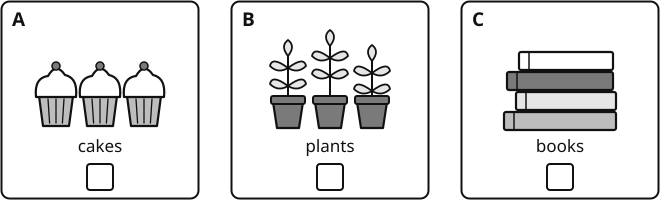{.w100}

### 2 [[marks:1]]
What time does the fair finish? **Tick** one box.

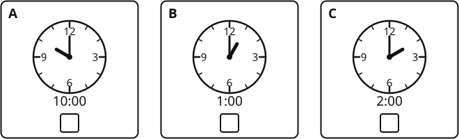{.w100}

### 3 [[marks:1]]
Where is the class stall this year? **Tick** one box.

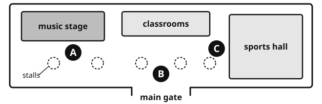{.w100}

[[tick]] A &nbsp;&nbsp;&nbsp;&nbsp; [[tick]] B &nbsp;&nbsp;&nbsp;&nbsp; [[tick]] C

### 4 [[marks:1]]
What will Amir do? **Tick** two boxes.

[[tick]] make the price signs &nbsp;&nbsp; [[tick]] buy the plants  
[[tick]] bring a table &nbsp;&nbsp; [[tick]] play the piano at the fair

### 5 [[marks:1]]
How many plants will Mei's aunt give the class? **Write** the number in the box.

[[answer:short]]

### 6 [[marks:1]]
The class sells all the plants. How much money will they give to the charity? **Write** the number in the box.

[[answer:short]] yuan

### 7 [[marks:1]]
Amir will leave the fair before it finishes. Why? **Write** your answer.

[[lines:2]]

### 8 [[marks:1]]
Why is the main gate a better place for the stall than last year's place? **Write** one reason.

[[lines:2]]

[[stop]]

[[pagebreak]]

# Reading

**Read** the texts and **answer** the questions.

Do as much as you can. It is fine if you do not finish.

You have 12 minutes.

## Part A: A notice

**Read** the notice. Then **answer** questions 1 to 6.

{.w100}

[[cols:2]]

### 1 [[marks:1]]
What time does the sports centre open on Saturday? **Write** your answer in the box.

[[answer:wide]]

### 2 [[marks:1]]
How much is a swimming ticket for a student? **Write** your answer in the box.

[[answer:wide]]

### 3 [[marks:1]]
Who can use the gym? **Write** your answer in the box.

[[answer:wide]]

### 4 [[marks:1]]
What do you need to use a locker? **Write** your answer in the box.

[[answer:wide]]

[[/cols]]

### 5 [[marks:3]]
**Tick** True or False for each sentence.

[[example]]
| Example | True | False |
|---|---|---|
| The centre has a gym. | ✓ | |
[[/example]]

| Sentence | True | False |
|---|---|---|
| a. The centre closes at 21:00 on Sunday. | [[tick]] | [[tick]] |
| b. A badminton court costs 40 yuan for one hour. | [[tick]] | [[tick]] |
| c. You can eat a snack in the pool area. | [[tick]] | [[tick]] |

### 6 [[marks:1]]
Li Na and Jun are 13. They both want to swim. They show their student cards. How much do they pay altogether? **Write** your answer in the box.

[[answer:wide]]

[[pagebreak]]

## Part B: A story

**Read** the story. Then **answer** questions 7 to 13.

[[passage]]
#### The Lucky Coin

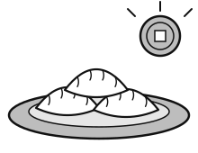{.w30 .right}

Every Spring Festival, Wang Hao's family made dumplings together. Grandma rolled out the dough. Dad chopped the pork and cabbage. Wang Hao and his little sister, Mei, folded the dumplings into small half-moons.

This year, Grandma took a shiny coin out of her pocket. "I will hide this inside one dumpling," she said. "The person who finds it will have good luck all year."

Wang Hao watched her carefully. He saw Grandma put the coin into a dumpling and give the top a little twist. "I will find that one," he thought.

When the dumplings were cooked, Wang Hao looked at every dumpling on the big plate. At last he found the one with the twist. He put it in his bowl and took a big bite. Cabbage. Pork. No coin.

Then Mei gave a shout. She held up the shiny coin, and everybody laughed and clapped.

Wang Hao looked at Grandma. She smiled and winked at him. "I made two dumplings with a twist," she said quietly.

Wang Hao was not cross. Mei looked so happy that he started to laugh too.

[[clear]]
[[/passage]]

### 7 [[marks:1]]
Who rolled out the dough? **Tick** one box.

[[tick]] Grandma &nbsp;&nbsp; [[tick]] Dad &nbsp;&nbsp; [[tick]] Mei

### 8 [[marks:1]]
What shape were the dumplings? **Write** your answer in the box.

[[answer:wide]]

### 9 [[marks:1]]
What will happen to the person who finds the coin? **Write** your answer.

[[lines:1]]

### 10 [[marks:2]]
**Write** the numbers 1, 2, 3 and 4 to show the order of the events in the story.

| Event | Order |
|---|---|
| Mei found the coin. | [[answer:short]] |
| Grandma put a coin in a dumpling. | [[answer:short]] |
| Wang Hao bit into the dumpling with the twist. | [[answer:short]] |
| The dumplings were cooked. | [[answer:short]] |

### 11 [[marks:1]]
"Wang Hao was not **cross**." What does **cross** mean here? **Tick** one box.

[[tick]] angry &nbsp;&nbsp; [[tick]] hungry &nbsp;&nbsp; [[tick]] tired

### 12 [[marks:1]]
Why did Wang Hao choose the dumpling with the twist? **Write** your answer.

[[lines:2]]

### 13 [[marks:1]]
Why do you think Grandma made two dumplings with a twist? **Write** your answer.

[[lines:2]]

[[pagebreak]]

## Part C: An article

**Read** the article. Then **answer** questions 14 to 20.

[[passage]]
#### Sleep: why teenagers need more of it

If you find it hard to get up for school, you are not lazy. You are probably just a teenager.

Scientists who study sleep have found that the body clock changes in the early teenage years. This clock is controlled partly by melatonin, a chemical that makes us feel sleepy. In younger children, the body releases melatonin early in the evening. In teenagers, it is released up to two hours later. This means that a thirteen-year-old may not feel tired until eleven o'clock at night, even though they will be exhausted when the alarm rings the next morning.

At the same time, teenagers need a lot of sleep: between eight and ten hours a night, according to most sleep experts. Their bodies and brains are still developing, and much of this happens while they sleep. During deep sleep, the brain also sorts and stores what we have learnt during the day. So a student who sleeps well after studying is likely to remember more than a student who stays up late to study for longer.

Unfortunately, modern life makes good sleep harder. Phones and tablets give out a kind of blue light that tells the brain it is still daytime, and messages and videos keep the mind busy. Many students also have long days, with homework and extra classes in the evening.

So what can you do? Sleep experts suggest a few simple habits. Go to bed and get up at about the same time every day, even at weekends. Put your phone in another room an hour before bed. Keep your bedroom cool, dark and quiet. If something is worrying you, write it down before you sleep, so your mind can let it go until the morning.

Some schools around the world have started the school day later, and many report that their students are more alert in lessons. Until that happens everywhere, the best thing you can do is protect your own sleep. Your brain will thank you.
[[/passage]]

### 14 [[marks:1]]
How many hours of sleep do teenagers need, according to the article? **Write** your answer in the box.

[[answer:wide]]

### 15 [[marks:1]]
Why might a thirteen-year-old not feel sleepy at ten o'clock at night? **Write** your answer.

[[lines:1]]

### 16 [[marks:1]]
"They will be **exhausted** when the alarm rings." What does **exhausted** mean? **Tick** one box.

[[tick]] very tired &nbsp;&nbsp; [[tick]] very hungry &nbsp;&nbsp; [[tick]] very late &nbsp;&nbsp; [[tick]] very happy

### 17 [[marks:2]]
Which two pieces of advice are in the article? **Tick** two boxes.

[[tick]] Drink a glass of warm milk before bed.  
[[tick]] Go to bed at about the same time every day.  
[[tick]] Study late at night before a test.  
[[tick]] Put your phone in another room an hour before bed.  
[[tick]] Sleep with a light on.

### 18 [[marks:1]]
The article says a student who sleeps well after studying will probably remember more. Why? **Write** your answer.

[[lines:2]]

### 19 [[marks:1]]
The writer begins: "If you find it hard to get up for school, you are not lazy." Why do you think the writer begins like this? **Write** your answer.

[[lines:2]]

### 20 [[marks:1]]
What is the main purpose of the article? **Tick** one box.

[[tick]] to tell a funny story &nbsp;&nbsp; [[tick]] to explain a problem and give advice  
[[tick]] to sell a new phone &nbsp;&nbsp; [[tick]] to complain about schools

[[stop]]

[[pagebreak]]

# Writing

You have 10 minutes.

**Choose** one task. **Tick** the box for your task.

| [[tick]] **Task 1: A description** | [[tick]] **Task 2: A speech** |
|---|---|
| **Describe** a busy place you know well. For example: a train station at Spring Festival, a night market, or a sports match. | Many students throw away food in the school canteen. **Write** a speech for your class. Persuade students to waste less food. |
| Ideas: What can you see, hear and smell? Who is there? How does it make you feel? | Ideas: Why is wasting food a problem? What can students do? Use strong reasons and examples. |

**Plan** your writing in the box. You can write notes.

[[box:6:Plan]]

**Write** your answer on the lines. Try to write about 20 lines.

[[lines:13]]

[[pagebreak]]

[[lines:10]]

**Check** your writing: capital letters, full stops, spelling. Does it make sense?

[[stop]]

[[pagebreak]]

# Maths

You have 20 minutes. You cannot use a calculator.

You can ask your teacher to read a question to you.

**Show** your working. You can get marks for your working.

## Section A: Number problems

**Work out** the answers. **Write** each answer in the box.

[[cols:2]]

### 1 [[marks:1]]
3.7 + 12.45 = [[answer]]

### 2 [[marks:2]]
a. −8 + 3 = [[answer:short]]

b. (−4) × (−6) = [[answer:short]]

### 3 [[marks:1]]
**Write** the highest common factor (HCF) of 18 and 24.

[[answer:short]]

### 4 [[marks:1]]
**Write** 60 as a product of prime factors.

[[example]]
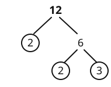{.w50 .right}

Example:

12 = 2 × 2 × 3

[[clear]]
[[/example]]

[[box:3:Working]]

60 = [[answer]]

### 5 [[marks:1]]
23 + 14 = [[answer]]

### 6 [[marks:2]]
a. **Simplify** 3*a* + 5*b* − *a* + 2*b*

[[answer:wide]]

b. *a* = 5 and *b* = −2. **Work out** 3*a* + 4*b*

[[answer:short]]

### 7 [[marks:1]]
**Solve** 5*x* − 7 = 18

*x* = [[answer:short]]

### 8 [[marks:1]]
**Solve** 4*x* + 3 = *x* + 15

*x* = [[answer:short]]

[[box:3:Working]]

[[/cols]]

## Section B: Word problems and pictures

### 9 [[marks:1]]
At 6 am, the temperature in Harbin was −18 °C.

By midday, it was 7 degrees warmer.

What was the temperature at midday?

[[answer:short]] °C

### 10 [[marks:2]]
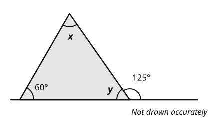{.w65}

The bottom side of the triangle is part of a straight line. **Work out** angle *y* and angle *x*.

*y* = [[answer:short]] ° &nbsp;&nbsp;&nbsp;&nbsp; *x* = [[answer:short]] °

### 11 [[marks:3]]
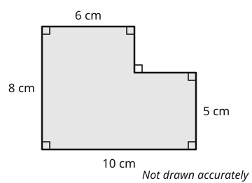{.w55 .right}

All the corners are right angles.

a. **Work out** the area of the shape.

[[answer:short]] &nbsp; [[scale:cm,cm²,cm³]]

b. **Work out** the perimeter of the shape.

[[answer:short]] &nbsp; [[scale:cm,cm²,cm³]]

**Tick** the correct unit for each answer.

### 12 [[marks:2]]
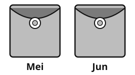{.w40 .right}

Grandma gives Mei and Jun 120 yuan.

They share it in the ratio 3 : 5.

Mei gets the smaller share.

How much does each person get?

Mei [[answer:short]] yuan

Jun [[answer:short]] yuan

### 13 [[marks:1]]
Bus A leaves the bus station every 6 minutes.

Bus B leaves the bus station every 8 minutes.

Both buses leave at 8:00.

When will they next leave at the same time?

[[answer:short]]

### 14 [[marks:2]]
Here is a spinner with 8 equal parts.

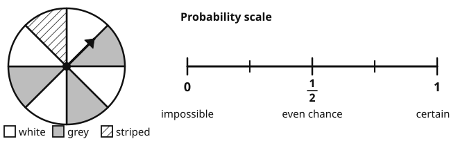{.w100}

[[example]]
An event that will **certainly** happen has a probability of 1.
[[/example]]

a. **Draw** an arrow on the probability scale to show the probability that the spinner lands on **white**.

b. **Write** the probability that the spinner lands on **grey**. [[answer:short]]

### 15 [[marks:2]]
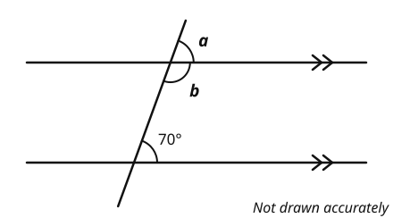{.w65}

The two lines with arrows are parallel. **Work out** angle *a* and angle *b*.

*a* = [[answer:short]] ° &nbsp;&nbsp;&nbsp;&nbsp; *b* = [[answer:short]] °

### 16 [[marks:1]]
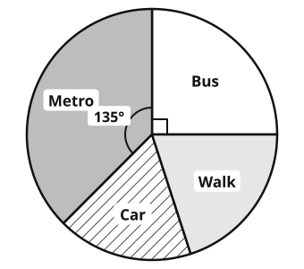{.w50 .right}

40 students travel to school.

The pie chart shows how they travel.

The angle for metro is 135°.

How many students travel by metro?

[[answer:short]]

[[box:3:Working]]

### 17 [[marks:2]]
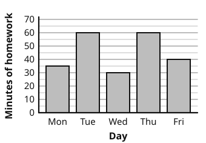{.w55 .right}

The bar chart shows how many minutes Zhang Wei spent on homework each day.

**Complete** the table.

| | Minutes |
|---|---|
| Mode | [[answer:short]] |
| Median | [[answer:short]] |
| Range | [[answer:short]] |
| Mean | [[answer:short]] |

### 18 [[marks:2]]
Hexagon tables are put in a row. A chair goes at every free side.

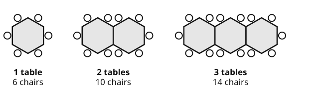{.w100}

a. How many chairs are needed for 10 tables in a row? [[answer:short]]

b. **Write** a rule for the number of chairs for *n* tables in a row.

Number of chairs = [[answer:wide]]

### 19 [[marks:2]]
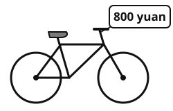{.w35 .right}

A bike costs 800 yuan.

Next month, the price will go up by 15%.

What will the new price be?

[[box:3:Working]]

[[answer]] yuan

[[stop]]

[[pagebreak]]

# Science

You have 8 minutes.

You can ask your teacher to read a question to you.

### 1 [[marks:2]]
a. **Write** solid, liquid or gas in the box under each picture.

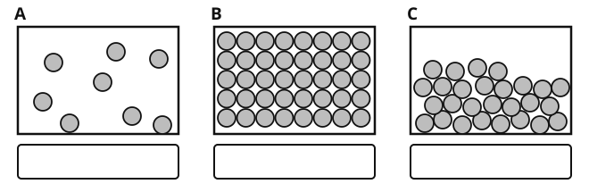{.w100}

b. Ice is heated and it melts. What happens to the energy of its particles? **Tick** one box.

[[tick]] It increases. &nbsp;&nbsp; [[tick]] It decreases. &nbsp;&nbsp; [[tick]] It stays the same.

### 2 [[marks:1]]
Mei looks at cells with a microscope. She draws an animal cell and a plant cell.

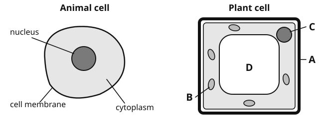{.w100}

**Write** the letter of one part that the plant cell has and the animal cell does **not** have.

[[answer:short]]

### 3 [[marks:1]]
Aisha has a mixture of sand and salt. She wants to get dry salt.

**Write** 1, 2 and 3 in the boxes to put the steps in order.

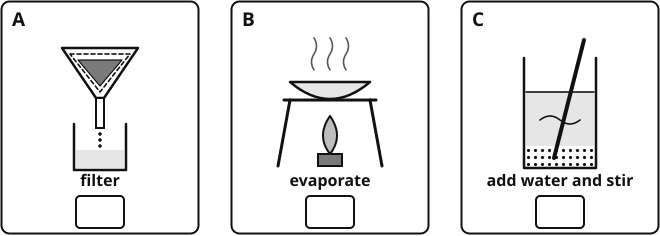{.w100}

### 4 [[marks:2]]
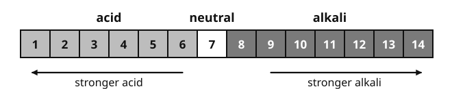{.w100}

| Substance | lemon juice | vinegar | pure water | toothpaste | soap |
|---|---|---|---|---|---|
| **pH** | 2 | 3 | 7 | 9 | 10 |

a. Which substance in the table is the strongest acid? [[answer:wide]]

b. **Write** the name of one alkali in the table. [[answer:wide]]

### 5 [[marks:2]]
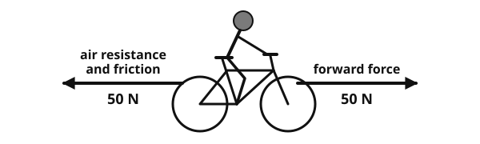{.w90}

a. The two forces are balanced. What happens to the girl's speed? **Tick** one box.

[[tick]] It goes up. &nbsp;&nbsp; [[tick]] It stays the same. &nbsp;&nbsp; [[tick]] It goes down.

b. She travels 100 m in 20 seconds. **Work out** her speed.

**speed = distance ÷ time** &nbsp;&nbsp; [[answer:short]] m/s

### 6 [[marks:1]]
These pictures show three sound waves. Which one is the **loudest** sound? **Tick** one box.

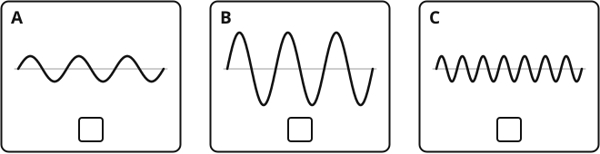{.w100}

### 7 [[marks:1]]
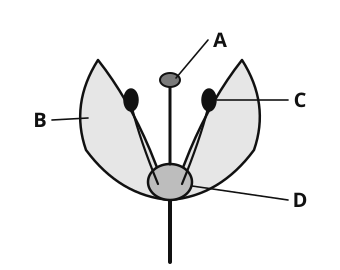{.w50 .right}

This picture shows the parts of a flower.

Which part makes **pollen**?

**Write** the letter in the box.

[[answer:short]]

[[stop:Thank you. You have finished. Please wait for your teacher.]]
