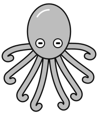
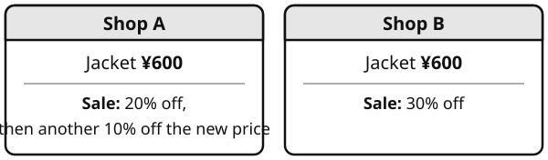
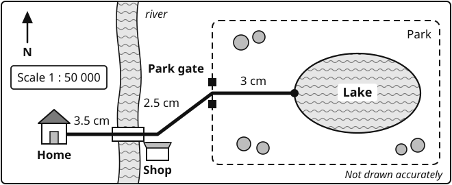
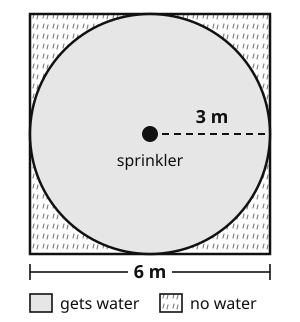

# Year 8 Admission Assessment Version 2, October 2026

[[namebox]]

## Welcome

These activities help us get to know you.

Do your best. It is fine if you cannot answer every question.

- **Read** each question carefully.
- In **Maths** and **Science**, you can ask your teacher to read a question to you.
- In **Listening**, **Reading** and **Writing**, your teacher cannot explain words. We want to see your English.
- You need a pencil, a rubber and a ruler. You cannot use a calculator.

## How to answer

[[example]]
{.w100}
[[/example]]

## The parts of this paper

| Part | What you do | Time |
|---|---|---|
| Listening | Listen to a conversation and a short talk. Answer 16 questions. | about 12 minutes |
| Reading | Read three texts. Answer the questions. | 15 minutes |
| Writing | Choose one task. Write about 20 lines. | 10 minutes |
| Break | Have a short rest. | 5 minutes |
| Maths | Answer the questions in Sections A, B and C. | 25 minutes |
| Science | Answer 7 questions. | 8 minutes |
| Talk | Read some sentences aloud. Talk with a teacher about yourself and your plans. | 15 minutes |

[[pagebreak]]

# Listening

There are two parts. Part B is harder. Do as much as you can.

## Part A: Two students talking

Your teacher will read a conversation **two times**.

Two students, Mei and Amir, are talking about the school charity fair.

**Read** the questions now. Then **listen** and **answer** the questions.

### 1 [[marks:1]]
What will the class sell at the fair? **Tick** one box.

{.w100}

### 2 [[marks:1]]
What time does the fair finish? **Tick** one box.

{.w100}

### 3 [[marks:1]]
Where is the class stall this year? **Tick** one box.

{.w100}

[[tick]] A &nbsp;&nbsp;&nbsp;&nbsp; [[tick]] B &nbsp;&nbsp;&nbsp;&nbsp; [[tick]] C

### 4 [[marks:1]]
What will Amir do? **Tick** two boxes.

[[tick]] make the price signs &nbsp;&nbsp; [[tick]] buy the plants &nbsp;&nbsp; [[tick]] bring a table &nbsp;&nbsp; [[tick]] play the piano

[[cols:2]]

### 5 [[marks:1]]
How many plants will Mei's aunt give the class? **Write** the number in the box.

[[answer:short]]

### 6 [[marks:1]]
The class sells all the plants. How much money will they give to the charity? **Write** the number in the box.

[[answer:short]] yuan

[[/cols]]

### 7 [[marks:1]]
Amir will leave the fair before it finishes. Why? **Write** your answer.

[[lines:2]]

### 8 [[marks:1]]
Why is the main gate a better place for the stall than last year's place? **Write** one reason.

[[lines:2]]

[[stop]]

[[pagebreak]]

## Part B: A short talk

Your teacher will read a talk **two times**.

Dr Lin, a scientist, is talking to a class about noise in cities.

**Read** questions 9 to 16 now. You have one minute. Then **listen** and **answer** the questions.

### 9 [[marks:1]]
How loud is a normal conversation? **Write** the number in the box.

[[answer:short]] decibels

### 10 [[marks:1]]
A sound goes up by 10 decibels. How much louder does it seem to our ears? **Tick** one box.

[[tick]] about twice as loud &nbsp;&nbsp; [[tick]] about ten times as loud &nbsp;&nbsp; [[tick]] about a hundred times as loud

### 11 [[marks:1]]
A sudden sound reaches your ears. What happens next? **Write** 2, 3 and 4 in the boxes to show the order. Number 1 is done for you.

| What happens | Order |
|---|---|
| A sudden sound reaches your ears. | **1** |
| Your heart beats faster. | [[answer:short]] |
| Your body releases stress hormones. | [[answer:short]] |
| Your brain treats the sound as a warning of danger. | [[answer:short]] |

### 12 and 13 [[marks:2]]
**Complete** the notes. **Write** one, two or three words in each gap.

[[example]]
You hear: "Our class will visit the science museum on Friday."

You write: Class visit: science museum, on Friday
[[/example]]

#### Notes: the Munich airport study

1992: the city of Munich moved its airport. Researchers tested children near the old airport and the new airport.

Near the new airport: the children's reading and **(12)** [[answer]] became worse.

Near the old airport: the children's reading and memory **(13)** [[answer]] .

### 14 [[marks:1]]
What does Dr Lin think about electric cars? **Tick** one box.

[[tick]] She thinks they are the best way to make cities quieter.  
[[tick]] She thinks they help, but other changes may help more.  
[[tick]] She thinks they make cities noisier.

### 15 [[marks:1]]
In the new park, the noise is only a little lower than before. Why do visitors feel calmer there? **Use** ideas from different parts of the talk. **Write** your answer.

[[lines:2]]

### 16 [[marks:1]]
What is the main purpose of Dr Lin's talk? **Tick** one box.

[[tick]] to explain how scientists measure sound  
[[tick]] to compare the noise in different cities in Europe  
[[tick]] to show that noise harms health, and that cities do not have to be so noisy  
[[tick]] to argue that electric cars will solve the problem of noise

[[stop]]

[[pagebreak]]

# Reading

**Read** the texts and **answer** the questions.

Do as much as you can. It is fine if you do not finish.

You have 15 minutes.

## Part A: A notice

**Read** the notice. Then **answer** questions 1 to 6.

{.w100}

[[cols:2]]

### 1 [[marks:1]]
What time does the sports centre open on Saturday? **Write** your answer in the box.

[[answer:wide]]

### 2 [[marks:1]]
How much is a swimming ticket for a student? **Write** your answer in the box.

[[answer:wide]]

### 3 [[marks:1]]
Who can use the gym? **Write** your answer in the box.

[[answer:wide]]

### 4 [[marks:1]]
What do you need to use a locker? **Write** your answer in the box.

[[answer:wide]]

[[/cols]]

### 5 [[marks:3]]
**Tick** True or False for each sentence.

[[example]]
| Example | True | False |
|---|---|---|
| The centre has a gym. | ✓ | |
[[/example]]

| Sentence | True | False |
|---|---|---|
| a. The centre closes at 21:00 on Sunday. | [[tick]] | [[tick]] |
| b. A badminton court costs 40 yuan for one hour. | [[tick]] | [[tick]] |
| c. You can eat a snack in the pool area. | [[tick]] | [[tick]] |

### 6 [[marks:1]]
Li Na and Jun are 13. They both want to swim. They show their student cards. How much do they pay altogether? **Write** your answer in the box.

[[answer:wide]]

[[pagebreak]]

## Part B: An article

**Read** the article. Then **answer** questions 7 to 13.

[[passage]]
#### Sleep: why teenagers need more of it

If you find it hard to get up for school, you are not lazy. You are probably just a teenager.

Scientists who study sleep have found that the body clock changes in the early teenage years. This clock is controlled partly by melatonin, a chemical that makes us feel sleepy. In younger children, the body releases melatonin early in the evening. In teenagers, it is released up to two hours later. This means that a thirteen-year-old may not feel tired until eleven o'clock at night, even though they will be exhausted when the alarm rings the next morning.

At the same time, teenagers need a lot of sleep: between eight and ten hours a night, according to most sleep experts. Their bodies and brains are still developing, and much of this happens while they sleep. During deep sleep, the brain also sorts and stores what we have learnt during the day. So a student who sleeps well after studying is likely to remember more than a student who stays up late to study for longer.

Unfortunately, modern life makes good sleep harder. Phones and tablets give out a kind of blue light that tells the brain it is still daytime, and messages and videos keep the mind busy. Many students also have long days, with homework and extra classes in the evening.

So what can you do? Sleep experts suggest a few simple habits. Go to bed and get up at about the same time every day, even at weekends. Put your phone in another room an hour before bed. Keep your bedroom cool, dark and quiet. If something is worrying you, write it down before you sleep, so your mind can let it go until the morning.

Some schools around the world have started the school day later, and many report that their students are more alert in lessons. Until that happens everywhere, the best thing you can do is protect your own sleep. Your brain will thank you.
[[/passage]]

### 7 [[marks:1]]
How many hours of sleep do teenagers need, according to the article? **Write** your answer in the box.

[[answer:wide]]

### 8 [[marks:1]]
Why might a thirteen-year-old not feel sleepy at ten o'clock at night? **Write** your answer.

[[lines:1]]

### 9 [[marks:1]]
"They will be **exhausted** when the alarm rings." What does **exhausted** mean? **Tick** one box.

[[tick]] very tired &nbsp;&nbsp; [[tick]] very hungry &nbsp;&nbsp; [[tick]] very late &nbsp;&nbsp; [[tick]] very happy

### 10 [[marks:2]]
Which two pieces of advice are in the article? **Tick** two boxes.

[[tick]] Drink a glass of warm milk before bed.  
[[tick]] Go to bed at about the same time every day.  
[[tick]] Study late at night before a test.  
[[tick]] Put your phone in another room an hour before bed.  
[[tick]] Sleep with a light on.

### 11 [[marks:1]]
The article says a student who sleeps well after studying will probably remember more. Why? **Write** your answer.

[[lines:2]]

### 12 [[marks:1]]
The writer begins: "If you find it hard to get up for school, you are not lazy." Why do you think the writer begins like this? **Write** your answer.

[[lines:2]]

### 13 [[marks:1]]
What is the main purpose of the article? **Tick** one box.

[[tick]] to tell a funny story &nbsp;&nbsp; [[tick]] to explain a problem and give advice  
[[tick]] to sell a new phone &nbsp;&nbsp; [[tick]] to complain about schools

[[pagebreak]]

## Part C: A feature article

Part C is hard. Do as much as you can.

**Read** the article. Then **answer** questions 14 to 20.

[[passage]]
#### The Alien in the Rock Pool

{.w20 .right}

One morning in 2016, staff at an aquarium in New Zealand arrived at work to find that one of their residents had vanished. Inky, an octopus about the size of a football, had squeezed through a narrow gap at the top of his tank, slid across the floor in the dark and slipped into a drainpipe that led to the sea. He was never seen again.

Stories like this delight newspapers, but they also raise a serious question. How can an animal with no bones, no shell and a body made mostly of soft muscle be so ingenious?

Part of the answer lies in its extraordinary nervous system. A common octopus has around 500 million nerve cells, far more than almost any other animal without a backbone. Yet only about a third of them are in its head. The rest are spread along its eight arms, so each arm can touch, taste and react on its own. Scientists have watched an arm find a piece of food and begin passing it towards the mouth with very little direction from the brain. For an octopus, thinking is not something that happens only in the head.

This is a strange way to build a mind, and that is precisely what fascinates scientists. Humans, apes, dogs and even crows are fairly closely related, so it is hardly surprising that their intelligence works in similar ways. The octopus, by contrast, sits on a completely different branch of the tree of life. Our last shared ancestor was probably a tiny, worm-like creature that lived more than 500 million years ago and had only the simplest network of nerves. Whatever cleverness the octopus possesses, it developed separately from ours. Some researchers have suggested that studying it may be the closest we will ever come to meeting an alien.

And what cleverness it is. In laboratories, octopuses have learnt to unscrew jars to reach the food inside. Off the coast of Indonesia, veined octopuses have been filmed collecting halves of coconut shells, carrying them awkwardly across the seabed and fitting them together to make a portable shelter. Keepers report that some octopuses take a dislike to particular people, greeting them with a jet of cold water whenever they approach the tank. Many octopuses can change the colour and even the texture of their skin in under a second, melting into rock or coral, even though most scientists believe they cannot see colour at all.

The article continues on the next page.

[[clear]]
[[/passage]]

[[pagebreak]]

[[passage]]
Perhaps most remarkable of all, octopuses achieve this in a very short life. Most species live for only a year or two, and young octopuses never meet their parents. Nobody shows them how to hunt, hide or escape. Each one has to work out the world for itself, almost from nothing.

For centuries, we have judged animal intelligence by asking how closely an animal resembles us. Can it use tools? Can it recognise faces? Can it solve puzzles? The octopus passes many of these tests, but it also exposes how narrow the tests are. If octopuses set an intelligence test for us, it is not obvious that we would pass. A creature that thinks with its arms, matches colours it cannot see and lives almost entirely alone may be clever in ways we have barely begun to imagine.

Several countries have recently extended their animal welfare laws to protect octopuses from unnecessary harm. It may seem a small step. Yet it could also be a sign that, after a long history of looking down on creatures that are not like us, we are slowly learning a little humility.
[[/passage]]

### 14 [[marks:1]]
Look at the first paragraph. Inky "**squeezed**" through a gap, "**slid**" across the floor and "**slipped**" into a drainpipe. What do these three verbs suggest about the way he moved? **Write** your answer.

[[lines:2]]

### 15 [[marks:1]]
Look at the paragraph that begins "Part of the answer". **Explain** in your own words what is unusual about an octopus's arms.

[[lines:2]]

### 16 [[marks:1]]
Look at the paragraph that begins "And what cleverness it is". **Find** and **copy** one word that means "able to be carried around".

[[answer:wide]]

### 17 [[marks:1]]
"Some octopuses take a dislike to particular people, greeting them with a jet of cold water whenever they approach the tank."

What does this suggest octopuses are able to do? **Explain** which words show this.

[[lines:2]]

### 18 [[marks:1]]
"Perhaps most remarkable of all, octopuses achieve this in a very short life."

Why does the writer think this is so remarkable? **Use** evidence from that paragraph.

[[lines:3]]

### 19 [[marks:1]]
Look at the last two paragraphs. What does the writer think about the way people usually judge how clever an animal is? **Use** evidence from the text.

[[lines:3]]

### 20 [[marks:2]]
**Summarise** how an octopus's mind is different from a human mind. **Write** two or three points in your own words.

[[lines:4]]

[[stop]]

[[pagebreak]]

# Writing

You have 10 minutes.

**Choose** one task. **Tick** the box for your task.

| [[tick]] **Task 1: A description** | [[tick]] **Task 2: A speech** |
|---|---|
| **Describe** a busy place you know well. For example: a train station at Spring Festival, a night market, or a sports match. | Many students throw away food in the school canteen. **Write** a speech for your class. Persuade students to waste less food. |
| Ideas: What can you see, hear and smell? Who is there? How does it make you feel? | Ideas: Why is wasting food a problem? What can students do? Use strong reasons and examples. |

**Plan** your writing in the box. You can write notes.

[[box:6:Plan]]

**Write** your answer on the lines. Try to write about 20 lines.

[[lines:13]]

[[pagebreak]]

[[lines:10]]

**Check** your writing: capital letters, full stops, spelling. Does it make sense?

[[stop]]

[[pagebreak]]

# Maths

You have 25 minutes. You cannot use a calculator.

You can ask your teacher to read a question to you.

**Show** your working. You can get marks for your working.

There are three sections: A, B and C. Do as much as you can.

## Section A: Fluency

**Work out** the answers. **Write** each answer in the box.

### 1 [[marks:1]]
**Write** 360 as a product of prime factors. **Give** your answer in index form.

[[example]]
Example: &nbsp; 72 = 2 × 2 × 2 × 3 × 3 = 23 × 32
[[/example]]

[[box:2:Working]]

360 = [[answer:wide]]

[[cols:2]]

### 2 [[marks:2]]
a. **Write** the highest common factor (HCF) of 84 and 120.

[[answer:short]]

b. **Write** the lowest common multiple (LCM) of 84 and 120.

[[answer:short]]

[[box:2:Working]]

### 3 [[marks:1]]
**Write** these numbers in order of size. Start with the smallest.

25 &nbsp;&nbsp; 0.38 &nbsp;&nbsp; 37% &nbsp;&nbsp; 38

Smallest first:

[[answer:short]] [[answer:short]] [[answer:short]] [[answer:short]]

[[/cols]]

[[cols:2]]

### 4 [[marks:1]]
**Expand** and **simplify**

3(2*x* − 5) − 2(*x* − 4)

[[answer:mid]]

### 5 [[marks:1]]
**Factorise** fully

12*x*2 − 18*xy*

[[answer:mid]]

[[/cols]]

[[cols:2]]

### 6 [[marks:1]]
**Solve** 4(2*x* − 3) = 3(*x* + 6)

[[box:3:Working]]

*x* = [[answer:short]]

### 7 [[marks:1]]
**Solve** 11 − 3*x* > 2

[[box:3:Working]]

[[answer:mid]]

[[/cols]]

[[cols:2]]

### 8 [[marks:1]]
**Simplify** (*y*4)3 ÷ *y*5

[[answer:short]]

### 9 [[marks:1]]
**Work out** (4 × 105) × (3 × 103)

**Give** your answer in standard form.

[[example]]
Example: &nbsp; 35 000 = 3.5 × 104 in standard form.
[[/example]]

[[answer:mid]]

[[/cols]]

## Section B: Word questions

These questions are in words only. **Read** each question carefully. **Decide** what to do.

You can **write** an equation, then **solve** it.

[[example]]
**Example: write an equation, then solve it.**

I think of a number. I multiply it by 4, then I subtract 7. The answer is 33. What is my number?

Let the number be *n*.

Equation: &nbsp; 4*n* − 7 = 33

Solve: &nbsp; 4*n* = 40, so *n* = 10

My number is **10**.

[[/example]]

[[cols:2]]

### 10 [[marks:2]]
The three angles in a triangle are *x*°, 2*x*° and (*x* + 20)°.

**Work out** the size of the largest angle.

[[box:4:Working]]

[[answer:short]] °

### 11 [[marks:2]]
Three consecutive even numbers add up to 114.

(Consecutive even numbers follow each other, like 6, 8 and 10.)

What is the largest of the three numbers?

[[box:4:Working]]

[[answer:short]]

[[/cols]]

[[cols:2]]

### 12 [[marks:2]]
Amir and Sofia share some money in the ratio 3 : 5.

Sofia gets ¥24 more than Amir.

How much money is there altogether?

[[box:4:Working]]

¥ [[answer:short]]

### 13 [[marks:2]]
Mei draws a rectangle. Its length is 3 times its width.

Then she draws a square. The side of the square is 4 cm shorter than the length of the rectangle. It is 4 cm longer than the width of the rectangle.

**Work out** the area of the rectangle.

[[box:4:Working]]

[[answer:short]] cm²

[[/cols]]

## Section C: Applied problems

### 14 [[marks:2]]
The same jacket costs ¥600 in two shops. Both shops have a sale.

{.w75}

Mei says, "The sale price is the same in both shops."

Is Mei correct? **Show** your working.

[[box:3:Working]]

**Tick** one box. &nbsp; [[tick]] Yes &nbsp;&nbsp; [[tick]] No &nbsp;&nbsp; **Explain** your answer.

[[lines:2]]

### 15 [[marks:2]]
A bag has only red, blue and green counters. Li Na takes one counter without looking.

The table shows the probability of each colour.

| Colour | red | blue | green |
|---|---|---|---|
| Probability | 0.3 | 0.45 | ? |

a. **Work out** the probability that the counter is green. &nbsp; [[answer:short]]

b. There are 15 green counters in the bag. How many counters are in the bag altogether? &nbsp; [[answer:short]]

[[box:2:Working]]

### 16 [[marks:3]]
{.w100}

The map shows Chen Yu's route from her home to the lake. The lengths are measured on the map.

The scale of the map is 1 : 50 000.

Chen Yu cycles at an average speed of 15 km/h. She leaves home at 9:40.

At what time does she arrive at the lake?

[[box:8:Working]]

[[answer:short]]

### 17 [[marks:3]]
Mei asks 20 students, "How many books did you read last month?" The table shows her results.

| Number of books | 0 | 1 | 2 | 3 | 4 |
|---|---|---|---|---|---|
| Number of students | 1 | 5 | 6 | 5 | 3 |

a. **Work out** the mean number of books that these students read.

[[box:3:Working]]

[[answer:short]]

b. Jun says, "The mean is 2, because (0 + 1 + 2 + 3 + 4) ÷ 5 = 2."

**Explain** why Jun is wrong.

[[lines:2]]

### 18 [[marks:2]]
{.w45 .right}

A sprinkler stands in the centre of a square lawn. Each side of the lawn is 6 m.

The sprinkler waters a circle with a radius of 3 m.

**Use** π = 3.14.

**Show** that more than three quarters of the lawn gets water.

[[box:6:Working]]

[[stop]]

[[pagebreak]]

# Science

You have 8 minutes.

You can ask your teacher to read a question to you.

### 1 [[marks:2]]
a. **Write** solid, liquid or gas in the box under each picture.

{.w100}

b. Ice is heated and it melts. What happens to the energy of its particles? **Tick** one box.

[[tick]] It increases. &nbsp;&nbsp; [[tick]] It decreases. &nbsp;&nbsp; [[tick]] It stays the same.

### 2 [[marks:1]]
Mei looks at cells with a microscope. She draws an animal cell and a plant cell.

{.w100}

**Write** the letter of one part that the plant cell has and the animal cell does **not** have.

[[answer:short]]

### 3 [[marks:1]]
Aisha has a mixture of sand and salt. She wants to get dry salt.

**Write** 1, 2 and 3 in the boxes to put the steps in order.

{.w100}

### 4 [[marks:2]]
{.w100}

| Substance | lemon juice | vinegar | pure water | toothpaste | soap |
|---|---|---|---|---|---|
| **pH** | 2 | 3 | 7 | 9 | 10 |

a. Which substance in the table is the strongest acid? [[answer:wide]]

b. **Write** the name of one alkali in the table. [[answer:wide]]

### 5 [[marks:2]]
{.w90}

a. The two forces are balanced. What happens to the girl's speed? **Tick** one box.

[[tick]] It goes up. &nbsp;&nbsp; [[tick]] It stays the same. &nbsp;&nbsp; [[tick]] It goes down.

b. She travels 100 m in 20 seconds. **Work out** her speed.

**speed = distance ÷ time** &nbsp;&nbsp; [[answer:short]] m/s

### 6 [[marks:1]]
These pictures show three sound waves. Which one is the **loudest** sound? **Tick** one box.

{.w100}

### 7 [[marks:1]]
{.w50 .right}

This picture shows the parts of a flower.

Which part makes **pollen**?

**Write** the letter in the box.

[[answer:short]]

[[stop:Thank you. You have finished. Please wait for your teacher.]]
