

# Year 9 Admission Assessment

[[namebox]]

## Welcome

These activities help us get to know you.
Do your best.
It is fine if you cannot answer every question.
Your teacher will tell you when to start each part.

## How to answer

[[example]]
**Tick** one box.

Which one is a fruit?  a chair [[tick]]  an apple ✓  a bus [[tick]]

**Write** your answer in the box.

12 + 8 = 20

**Show** your working. You can get marks for your working, even if your answer is wrong.

Working
4 × 25 = 100, &nbsp; 100 + 30 = 130

[[/example]]

## The parts of this paper

| Part | What you do | Time |
|---|---|---|
| **Listening** | Listen to a conversation. Answer 8 questions. | 5 minutes |
| **Reading** | Read three texts. Answer the questions. | 12 minutes |
| **Writing** | Write a story or an article. | 10 minutes |
| Break | | 3 to 5 minutes |
| **Maths** | Number problems, word problems and pictures. | 20 minutes |
| **Science** | Questions with pictures, tables and graphs. | 8 minutes |

You may use a pencil, a rubber and a ruler.
You may **not** use a calculator.

[[pagebreak]]

# Listening

Your teacher will read a conversation **two times**.
**Listen** carefully.
You have one minute to read the questions first.
You can answer while you listen, or after.

### 1 [[marks:1]]
What is the new exhibition about?
**Tick** one picture.

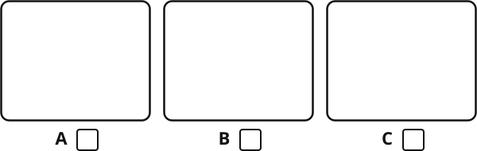{.w90}

### 2 [[marks:1]]
What time do they meet at the school gate?
**Tick** one clock.

{.w90}

### 3 [[marks:1]]
What will the weather be like in the afternoon?
**Tick** one picture.

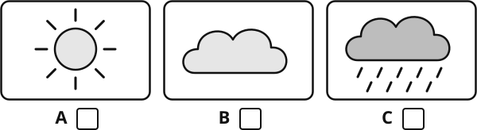{.w90}

### 4 [[marks:1]]
How much does lunch in the museum café cost?

[[answer:short]] yuan

### 5 [[marks:1]]
What must everyone bring to get a free ticket?

[[answer:wide]]

### 6 [[marks:1]]
What time do they get back?

[[answer]]

### 7 [[marks:1]]
Mei says, "Most of the day is inside, anyway."
What does she mean?
**Tick** one.

[[tick]] The rain will not be a big problem.

[[tick]] They will not go to the museum.

[[tick]] Tom must stay at home.

### 8 [[marks:1]]
Why does Mei tell Tom about Jun?

[[lines:2]]

[[pagebreak]]

# Reading

There are three parts: **A**, **B** and **C**.
Each part is harder than the one before.
**Do as much as you can. It is fine if you do not finish.**
You have 12 minutes. When you finish, wait for your teacher.

## Part A

**Read** the poster. Then **answer** questions 1 to 7.

{.w100}

### 1 [[marks:1]]
Which activity is on Tuesday and Thursday? [[answer:wide]]

### 2 [[marks:1]]
How much does table tennis cost? [[answer]]

### 3 [[marks:1]]
Which activity is free? [[answer:wide]]

### 4 [[marks:1]]
What must you bring to swimming? [[answer:wide]]

### 5 [[marks:2]]
**Tick** True or False for each sentence.

[[example]]
| Sentence | True | False |
|---|---|---|
| The centre is open every day. | ✓ | [[tick]] |
[[/example]]

| Sentence | True | False |
|---|---|---|
| Basketball is on Saturday. | [[tick]] | [[tick]] |
| Climbing finishes at 16:00. | [[tick]] | [[tick]] |
| You can book on the app. | [[tick]] | [[tick]] |
| Yoga is in the evening. | [[tick]] | [[tick]] |

### 6 [[marks:1]]
Wang Hao is 12 years old. Can he go climbing?
**Tick** one. Then **write** why.

[[tick]] Yes  [[tick]] No

Why? [[answer:wide]]

### 7 [[marks:1]]
Li Na is free only on Saturday mornings.
Which activity can she do? [[answer:wide]]

[[pagebreak]]

## Part B

**Read** the text. Then **answer** questions 8 to 14.

[[passage]]
#### Why Do Pandas Eat All Day?

Giant pandas live in the mountain forests of central China. They are famous for their black and white fur, but they are also famous for something else: they eat almost nothing except bamboo.

This is surprising, because a panda's body is really made for eating meat. Its stomach and intestines are short and simple, like a bear's. Animals that eat only plants, such as cows, have much longer and more complicated digestive systems. As a result, pandas get very little energy from their food. To survive, an adult panda must eat for up to 14 hours a day. It can eat more than 12 kilograms of bamboo in a single day.

Pandas have a special way of holding bamboo. A bone in their wrist has grown longer and works like a thumb. With this "thumb", a panda can grip a stem tightly while it bites.

Because bamboo gives them so little energy, pandas try not to waste it. They move slowly and rest a lot.

Baby pandas are tiny. A newborn cub weighs only about 100 to 200 grams, which is about the weight of an apple. Its mother is about 900 times heavier.

For many years, giant pandas were in danger. Today, thanks to protected forests and careful work by scientists, their numbers are slowly growing.
[[/passage]]

### 8 [[marks:1]]
Where do giant pandas live?

[[answer:full]]

### 9 [[marks:1]]
For how many hours a day can an adult panda eat?

[[answer:short]] hours

### 10 [[marks:1]]
Why must pandas eat for so many hours?

[[lines:2]]

### 11 [[marks:1]]
What does a panda use to hold bamboo?

[[answer:full]]

### 12 [[marks:1]]
**Find** and **copy** one word from the text that means "very small".

[[answer]]

### 13 [[marks:2]]
**Tick** the **two** sentences that are true.

[[tick]] Pandas eat a lot of meat.

[[tick]] A panda's stomach is like a cow's stomach.

[[tick]] Pandas move slowly to save energy.

[[tick]] A newborn panda weighs about the same as an apple.

[[tick]] There are fewer pandas every year.

### 14 [[marks:1]]
Why are the numbers of pandas growing today?

[[lines:2]]

[[pagebreak]]

## Part C

**Read** the story. Then **answer** questions 15 to 21.

[[passage]]
#### Halfway Up

From the ground, the climbing wall had looked easy. Now, eight metres up, Mei was not so sure.

Her right hand was on a small red hold, no bigger than a coin. Her left foot rested on a ledge so narrow that only her toes fitted on it. Below her, the sports hall had gone strangely quiet. She could hear her own breathing, fast and loud.

"You're doing great, Mei!" That was Coach Zhang, who was holding her rope. His voice sounded very far away.

Mei looked up. The next hold was a blue one, just out of reach. To get it, she would have to let go with one hand and push up hard with her legs. For one terrible second, she would be holding on with almost nothing.

She had done this move a hundred times at training, two metres above a soft mat. It was exactly the same move. That was what she told herself. Her body did not believe her.

Her arms began to shake. Sweat made her fingers slippery. She thought about the other girls in the competition, who had all reached the top. She thought about how easy it would be to shout "Lower me down!" and float gently back to the floor. Nobody would really blame her.

Then a small voice called out from somewhere near the door. "Go on, Mei!"

It was Bo, her little brother. He was six, and he was standing on a chair so that he could see. Mum was holding on to the back of his T-shirt. He was waving a sign made from a cereal box. In wobbly letters, it said: MEI CAN FLY.

Mei almost laughed. Something tight in her chest seemed to loosen. She breathed out slowly, bent her knees and pushed.

Her fingers closed around the blue hold.

Five moves later, she slapped the top of the wall, and the quiet hall exploded into noise.
[[/passage]]

### 15 [[marks:1]]
How high up the wall is Mei at the start of the story? [[answer]]

### 16 [[marks:1]]
"Her body did not believe her." What does this sentence mean?
**Tick** one.

[[tick]] Mei's body was too tired to climb.

[[tick]] Mei knew the move was easy, but she still felt afraid.

[[tick]] Mei did not know how to do the move.

### 17 [[marks:2]]
**Write** two things from the text that show Mei was frightened.

1. [[answer:full]]
2. [[answer:full]]

### 18 [[marks:1]]
The writer tells us that the other girls "had all reached the top".
Why do you think the writer tells us this?

[[lines:2]]

### 19 [[marks:1]]
Why did Mei almost laugh when she saw Bo's sign?

[[lines:2]]

### 20 [[marks:1]]
"the quiet hall exploded into noise"
What does "exploded" mean in this sentence?

[[answer:full]]

### 21 [[marks:1]]
How do Mei's feelings change from the start of the story to the end?

[[lines:2]]

[[pagebreak]]

# Writing

**Choose one** task: A or B.
**Tick** the box for the task you choose.
**Plan** your ideas in the plan box. Then **write** on the lines.
You have 10 minutes. Write as much as you can.

### Task A: a story [[tick]]

**Write** a story that begins with this sentence:

> When I opened my bag, I found something that was not mine.

Ideas: What did you find? Whose was it? What did you do? How did the story end?

### Task B: an article [[tick]]

Your school magazine asks this question:

> Should every school day include one hour of sport?

**Write** an article for the magazine. Give your opinion and at least two reasons.

Ideas: health, friends, time for study, examples from your own life.

---

#### Plan

[[box:8:Notes and ideas (this part is not marked)]]

[[pagebreak]]

#### Your writing

Task A [[tick]]  Task B [[tick]]

[[lines:22]]

[[pagebreak]]

# Maths

You have 20 minutes. Do as much as you can.
**Write** your answer in the box. **Show** your working in the working box.
Your teacher can read any question to you.
You may **not** use a calculator.

## Section A: Number problems

[[example]]
**What the maths words mean**
**Expand:** 3(*x* + 2) = 3*x* + 6
**Factorise:** 10*a* + 15 = 5(2*a* + 3)
**Solve:** *x* + 3 = 10, so *x* = 7
[[/example]]

### 1 [[marks:2]]
**Work out**

(a) &nbsp; −7 + 12 = [[answer:short]]  (b) &nbsp; −3 × 6 = [[answer:short]]

### 2 [[marks:1]]
**Work out** &nbsp; 24 − 32

[[answer:short]]

### 3 [[marks:2]]
(a) **Expand** &nbsp; 4(2*x* − 3)  [[answer:wide]]

(b) **Factorise** &nbsp; 6*y* + 15  [[answer:wide]]

### 4 [[marks:2]]
**Solve** &nbsp; 3(*x* + 4) = *x* + 20

[[box:3:Working]]

*x* = [[answer]]

### 5 [[marks:1]]
**Solve** &nbsp; 2*x* − 1 ≤ 9

[[answer]]

### 6 [[marks:1]]
**Expand and simplify** &nbsp; (*x* + 3)(*x* + 5)

[[answer:wide]]

## Section B: Word problems and pictures

### 7 [[marks:1]]
There are 40 students in a class.
35% of the students walk to school.
How many students walk to school?

[[answer]]

### 8 [[marks:2]]
5 notebooks cost ¥35.
How much do 8 notebooks cost?

[[box:2:Working]]

¥ [[answer]]

### 9 [[marks:2]]
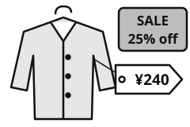{.w35 .right}

A jacket costs ¥240.

In a sale, the price goes down by 25%.

What is the sale price?

[[clear]]

[[box:2:Working]]

¥ [[answer]]

### 10 [[marks:2]]
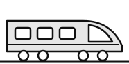{.w30 .right}

A train travels at 300 km per hour.

How far does it travel in 2 hours 30 minutes?

[[clear]]

[[box:2:Working]]

[[answer]] km

### 11 [[marks:1]]
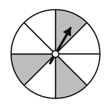{.w35 .right}

This spinner has 8 equal parts.

**Write** the probability that the spinner lands on **grey**.

Give your answer as a fraction.

[[answer:short]]

[[clear]]

### 12 [[marks:2]]
The two lines with arrows are parallel.

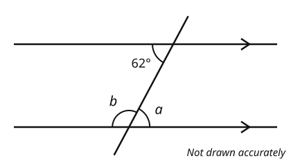{.w65}

**Work out** the size of angle *a* and angle *b*.

*a* = [[answer:short]] °  *b* = [[answer:short]] °

### 13 [[marks:2]]
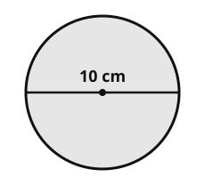{.w35 .right}

The diameter of this circle is 10 cm.

Use π = 3.14.

(a) **Work out** the circumference.

[[answer]] cm

(b) **Work out** the area.

[[answer]] cm²

[[clear]]

### 14 [[marks:1]]
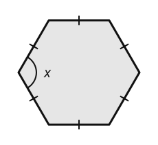{.w35 .right}

This is a regular hexagon.

**Work out** the size of angle *x*.

*x* = [[answer:short]] °

[[clear]]

### 15 [[marks:2]]
**Work out** the volume of this triangular prism.

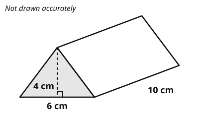{.w65}

[[box:2:Working]]

[[answer]] cm³

### 16 [[marks:2]]
20 students say how many books they read in the holiday.

| Number of books | Number of students |
|---|---|
| 0 | 2 |
| 1 | 3 |
| 2 | 8 |
| 3 | 5 |
| 4 | 2 |

**Work out** the mean number of books.

Working

[[answer]]

[[clear]]

### 17 [[marks:2]]
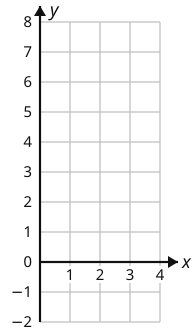{.w35 .right}

(a) **Complete** the table for *y* = 2*x* − 1.

<table class="vt">
<tr><th><i>x</i></th><td>0</td><td>1</td><td>2</td><td>3</td><td>4</td></tr>
<tr><th><i>y</i></th><td>−1</td><td></td><td></td><td></td><td>7</td></tr>
</table>

(b) **Draw** the graph of *y* = 2*x* − 1 on the grid.

Use a ruler.

[[clear]]

### 18 [[marks:2]]
A park is a rectangle. It is 12 m long and 5 m wide.

A straight path goes from one corner to the opposite corner.

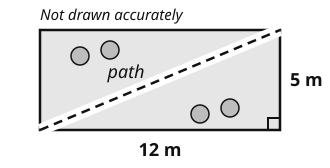{.w50}

**Work out** the length of the path.

[[box:2:Working]]

[[answer]] m

[[pagebreak]]

# Science

You have 8 minutes. Do as much as you can.
Your teacher can read any question to you.

### 1 [[marks:2]]
This is a food web. An arrow means "is eaten by".

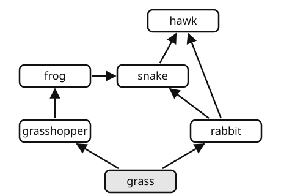{.w65}

(a) **Write** the name of the producer. [[answer]]

(b) The number of frogs goes down. What happens to the number of grasshoppers?

[[tick]] It goes up.  [[tick]] It goes down.  [[tick]] It stays the same.

**Explain** why.

[[lines:1]]

### 2 [[marks:1]]
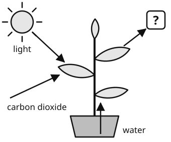{.w50 .right}

Plants make glucose by photosynthesis.

A gas comes out of the leaf (**?** in the picture).

**Complete** the word equation.

carbon dioxide + water

→ glucose + [[answer]]

[[clear]]

### 3 [[marks:1]]
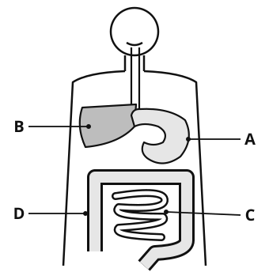{.w50 .right}

This is the human digestive system.

Where is most digested food absorbed into the blood?

**Write** the letter.

[[answer:short]]

[[clear]]

### 4 [[marks:2]]
Each circle is an atom. Atoms of different elements have different shading.

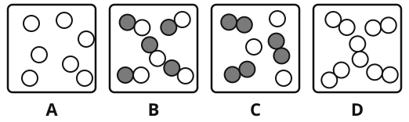{.w80}

(a) Which box shows a **compound**? **Write** the letter. [[answer:short]]

(b) Which box shows a **mixture**? **Write** the letter. [[answer:short]]

### 5 [[marks:1]]
Wang Hao puts two chemicals in a flask. He closes the flask, so nothing can get in or out. The chemicals react.

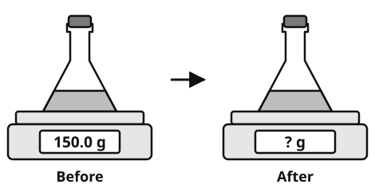{.w70}

What does the balance read **after** the reaction? [[answer]] g

### 6 [[marks:1]]
This is a series circuit. Ammeter 1 reads 0.3 A.

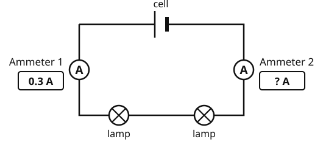{.w80}

What does ammeter 2 read? [[answer]] A

### 7 [[marks:2]]
Wang Hao makes an electromagnet. He changes the number of turns of wire on the nail. He counts how many paper clips the nail picks up.

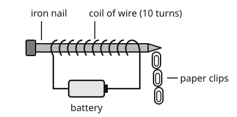{.w60}

| Number of turns of wire | 10 | 20 | 30 | 40 |
|---|---|---|---|---|
| Number of paper clips | 3 | 6 | 9 | ? |

(a) **Write** one thing he must keep the same to make it a fair test.

[[lines:1]]

(b) **Predict** the number of paper clips for 40 turns. [[answer:short]]

[[stop:Thank you. You have finished. Please wait for your teacher.]]
