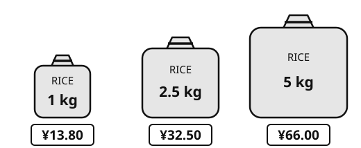
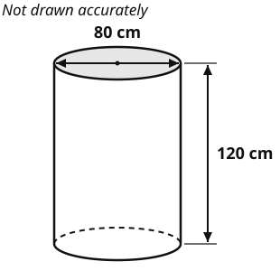
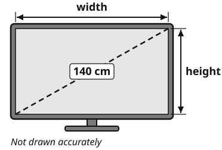

# Year 9 Admission Assessment

**Version 2, October 2026**

[[namebox]]

## Welcome

These activities help us get to know you.
Do your best.
It is fine if you cannot answer every question.
Your teacher will tell you when to start each part.

## How to answer

[[example]]
**Tick** one box.

Which one is a fruit?  a chair [[tick]]  an apple ✓  a bus [[tick]]

**Write** your answer in the box.

12 + 8 = 20

**Show** your working. You can get marks for your working, even if your answer is wrong.

Working
4 × 25 = 100, &nbsp; 100 + 30 = 130

[[/example]]

## The parts of this paper

<table class="parts">
<colgroup><col style="width:16%"><col style="width:66%"><col style="width:18%"></colgroup>
<tr><th>Part</th><th>What you do</th><th>Time</th></tr>
<tr><td><b>Listening</b></td><td>A conversation and a short talk. Answer 16 questions.</td><td>10 minutes</td></tr>
<tr><td><b>Reading</b></td><td>Read three texts. Answer the questions.</td><td>15 minutes</td></tr>
<tr><td><b>Writing</b></td><td>Write a story or an article.</td><td>10 minutes</td></tr>
<tr><td>Break</td><td></td><td>5 minutes</td></tr>
<tr><td><b>Maths</b></td><td>Fluency, word questions and applied problems.</td><td>25 minutes</td></tr>
<tr><td><b>Science</b></td><td>Questions with pictures, tables and graphs.</td><td>8 minutes</td></tr>
</table>

You may use a pencil, a rubber and a ruler.
You may use a calculator **only** in Maths Section C.

# Listening

There are two parts: **A** and **B**.
Your teacher will read each part **two times**.
Before each part, you have one minute to read the questions.
**Listen** carefully. You can answer while you listen, or after.

## Part A

You will hear two friends talking.

### 1 [[marks:1]]
What is the new exhibition about?
**Tick** one picture.

{.w90}

### 2 [[marks:1]]
What time do they meet at the school gate?
**Tick** one clock.

{.w90}

### 3 [[marks:1]]
What will the weather be like in the afternoon?
**Tick** one picture.

{.w90}

### 4 [[marks:1]]
How much does lunch in the museum café cost?

[[answer:short]] yuan

### 5 [[marks:1]]
What must everyone bring to get a free ticket?

[[answer:wide]]

### 6 [[marks:1]]
What time do they get back?

[[answer]]

### 7 [[marks:1]]
Mei says, "Most of the day is inside, anyway."
What does she mean?
**Tick** one.

[[tick]] The rain will not be a big problem.

[[tick]] They will not go to the museum.

[[tick]] Tom must stay at home.

### 8 [[marks:1]]
Why does Mei tell Tom about Jun?

[[lines:2]]

## Part B {.newpage}

You will hear a short talk about tea. A scientist, Dr Lin, is talking to a class.
You have one minute to read questions 9 to 16 first.
**Part B is harder. Do as much as you can.**

### 9 [[marks:1]]
What is the main purpose of Dr Lin's talk?
**Tick** one.

[[tick]] To tell the story of the emperor Shennong.

[[tick]] To explain where tea came from and why there are different kinds.

[[tick]] To show that green tea is better than black tea.

### 10 [[marks:1]]
Dr Lin tells the story of the emperor Shennong.
What does she think about this story?
**Tick** one.

[[tick]] It is the best evidence we have about where tea began.

[[tick]] It is a nice story, but it may not be true.

[[tick]] Historians have proved that it is wrong.

### 11 [[marks:1]]
Lu Yu wrote the first book about tea. When did he write it?

more than [[answer:short]] years ago

### 12 [[marks:1]]
When did Dutch traders bring the first tea to Europe?

in the early [[answer]]

### 13 and 14 [[marks:2]]
**Complete** the notes.
**Write** one to three words in each gap.

[[example]]
**Example**
Green tea, black tea and oolong all come from the same plant .
[[/example]]

#### Notes: the science of tea

**13** &nbsp; Pickers take only the top two leaves and the [[answer]] .

**14** &nbsp; Oxidation: chemicals in a crushed leaf react with [[answer]] in the air.

### 15 [[marks:1]]
How is black tea made?
**Write** 2, 3 and 4 in the boxes to show the order of the steps.
Step 1 is done for you.

1 The leaves are withered: they are spread out until they go soft.

[[answer:step]] The leaves are dried.

[[answer:step]] The leaves are left in warm air.

[[answer:step]] The leaves are rolled to break them.

### 16 [[marks:1]]
In English, people say "tea", not "cha".
**Use** the talk to **explain** why.

[[lines:2]]

# Reading

There are three parts: **A**, **B** and **C**.
Each part is harder than the one before.
**Do as much as you can. It is fine if you do not finish.**
You have 15 minutes. When you finish, wait for your teacher.

## Part A

**Read** the poster. Then **answer** questions 1 to 7.

{.w100}

### 1 [[marks:1]]
Which activity is on Tuesday and Thursday? [[answer:wide]]

### 2 [[marks:1]]
How much does table tennis cost? [[answer]]

### 3 [[marks:1]]
Which activity is free? [[answer:wide]]

### 4 [[marks:1]]
What must you bring to swimming? [[answer:wide]]

### 5 [[marks:2]]
**Tick** True or False for each sentence.

[[example]]
| Sentence | True | False |
|---|---|---|
| The centre is open every day. | ✓ | [[tick]] |
[[/example]]

| Sentence | True | False |
|---|---|---|
| Basketball is on Saturday. | [[tick]] | [[tick]] |
| Climbing finishes at 16:00. | [[tick]] | [[tick]] |
| You can book on the app. | [[tick]] | [[tick]] |
| Yoga is in the evening. | [[tick]] | [[tick]] |

### 6 [[marks:1]]
Wang Hao is 12 years old. Can he go climbing?
**Tick** one. Then **write** why.

[[tick]] Yes  [[tick]] No

Why? [[answer:wide]]

### 7 [[marks:1]]
Li Na is free only on Saturday mornings.
Which activity can she do? [[answer:wide]]

## Part B {.newpage}

**Read** the story. Then **answer** questions 8 to 14.

[[passage]]
#### Halfway Up

From the ground, the climbing wall had looked easy. Now, eight metres up, Mei was not so sure.

Her right hand was on a small red hold, no bigger than a coin. Her left foot rested on a ledge so narrow that only her toes fitted on it. Below her, the sports hall had gone strangely quiet. She could hear her own breathing, fast and loud.

"You're doing great, Mei!" That was Coach Zhang, who was holding her rope. His voice sounded very far away.

Mei looked up. The next hold was a blue one, just out of reach. To get it, she would have to let go with one hand and push up hard with her legs. For one terrible second, she would be holding on with almost nothing.

She had done this move a hundred times at training, two metres above a soft mat. It was exactly the same move. That was what she told herself. Her body did not believe her.

Her arms began to shake. Sweat made her fingers slippery. She thought about the other girls in the competition, who had all reached the top. She thought about how easy it would be to shout "Lower me down!" and float gently back to the floor. Nobody would really blame her.

Then a small voice called out from somewhere near the door. "Go on, Mei!"

It was Bo, her little brother. He was six, and he was standing on a chair so that he could see. Mum was holding on to the back of his T-shirt. He was waving a sign made from a cereal box. In wobbly letters, it said: MEI CAN FLY.

Mei almost laughed. Something tight in her chest seemed to loosen. She breathed out slowly, bent her knees and pushed.

Her fingers closed around the blue hold.

Five moves later, she slapped the top of the wall, and the quiet hall exploded into noise.
[[/passage]]

### 8 [[marks:1]]
How high up the wall is Mei at the start of the story? [[answer]]

### 9 [[marks:1]]
"Her body did not believe her." What does this sentence mean?
**Tick** one.

[[tick]] Mei's body was too tired to climb.

[[tick]] Mei knew the move was easy, but she still felt afraid.

[[tick]] Mei did not know how to do the move.

### 10 [[marks:2]]
**Write** two things from the text that show Mei was frightened.

1. [[answer:full]]
2. [[answer:full]]

### 11 [[marks:1]]
The writer tells us that the other girls "had all reached the top".
Why do you think the writer tells us this?

[[lines:2]]

### 12 [[marks:1]]
Why did Mei almost laugh when she saw Bo's sign?

[[lines:2]]

### 13 [[marks:1]]
"the quiet hall exploded into noise"
What does "exploded" mean in this sentence?

[[answer:full]]

### 14 [[marks:1]]
How do Mei's feelings change from the start of the story to the end?

[[lines:2]]

## Part C {.newpage}

**Read** the text. Then **answer** questions 15 to 21.
In this text, a woman remembers a summer from her childhood.
**Part C is hard. Do as much as you can.**

[[passage]]
#### Before the Cranes Came

Every summer until I was twelve, I was sent to stay with my grandmother in Willow Lane, a narrow seam of grey brick that ran between two of the busiest roads in the city. From the main road you would never have guessed it was there. You turned past a shop selling phone cases, ducked under a tangle of electric cables, and suddenly the roar of the traffic fell away, as if someone had closed a heavy door behind you.

Grandmother's house was the fourth on the left. It had one room downstairs, one room upstairs, and a courtyard no bigger than a dining table, where she grew chives and spring onions in chipped enamel basins. Everything in the lane happened in public. Neighbours washed vegetables on their doorsteps, argued over games of chess, and hung their washing on lines strung from wall to wall, so that a trip to the shop meant ducking under other people's shirts. At the time, I found it all slightly embarrassing. My school friends lived in towers with lifts and security guards; I spent my holidays in a place where everyone knew what you had eaten for breakfast.

The notice went up in the spring of my twelfth year. It was pasted, a little crooked, on the wall beside the public tap, and it explained in polite official language that Willow Lane would be "redeveloped". Grandmother read it twice, folded her arms, and announced that it was about time. "Proper pipes," she told the neighbours. "Hot water that comes out of the wall. Imagine." She said it so often, and so loudly, that I believed her.

That last summer, she was busier than I had ever seen her. She scrubbed the courtyard as though important visitors were expected. She gave away her bicycle, her wooden stools and most of her basins, and she refused every offer of help. Yet every evening, when the heat finally lifted, she carried a folding chair to the end of the lane and sat there until it was dark, watching the swifts slice through the air above the rooftops. She never said what she was looking at, and I never thought to ask.

On moving day, forty years of her life fitted into the back of a small van, with room to spare. The new flat was on the twenty-third floor. It had white walls, a balcony and a view so wide that the old district looked like a child's model, already half swallowed by building sites. Grandmother praised everything: the lift, the shower, the gas cooker that lit with a single click. She praised it all in the same bright voice that she used for my first attempts at cooking, which should have told me something.
[[/passage]]

The text continues on the next page.

[[pagebreak]]

[[passage]]
#### Before the Cranes Came (continued)

It was months before I noticed the balcony. She had lined it with the three enamel basins she had kept, and in them, against everyone's advice, she was growing chives, which leaned bravely into the wind. Beside the basins sat a single grey brick. When I asked her about it, she shrugged and said it was useful for holding the door open. The balcony door, as far as I could see, had never needed holding.

I am older now than my mother was then, and I have lived in several flats with lifts. I understand things about that summer that I could not understand at twelve: that cheerfulness can be a kind of hard work, and that a person can be pleased and heartbroken at the same time. The cranes came and went. Where Willow Lane used to be, there is now a shopping centre with a fountain that plays music on the hour. I have been inside only once. I stood beside the fountain for a long time, trying to work out where the fourth house on the left had been, and found that I could not.
[[/passage]]

### 15 [[marks:1]]
"Everything in the lane happened in public."
**Explain** in your own words what this means.

[[lines:2]]

### 16 [[marks:1]]
"She said it so often, and so loudly, that I believed her."
What does this suggest about Grandmother's real feelings?
**Explain** how the words show this.

[[lines:3]]

### 17 [[marks:1]]
"when the heat finally lifted"
What does "lifted" mean in this phrase?

[[answer:full]]

### 18 [[marks:1]]
"the old district looked like a child's model, already half swallowed by building sites"
What does the word "swallowed" suggest about what is happening to the old district?

[[lines:2]]

### 19 [[marks:1]]
Why do you think Grandmother kept the grey brick?
**Give** one piece of evidence from the text.

[[lines:3]]

### 20 [[marks:1]]
How does the writer feel about Willow Lane now, as an adult?
**Explain** your answer with evidence from the text.

[[lines:3]]

### 21 [[marks:2]]
**Summarise** how Grandmother dealt with leaving Willow Lane.
**Write** two or three points in your own words.

[[lines:4]]

# Writing

**Choose one** task: A or B.
**Tick** the box for the task you choose.
**Plan** your ideas in the plan box. Then **write** on the lines.
You have 10 minutes. Write as much as you can.

### Task A: a story [[tick]]

**Write** a story that begins with this sentence:

> When I opened my bag, I found something that was not mine.

Ideas: What did you find? Whose was it? What did you do? How did the story end?

### Task B: an article [[tick]]

Your school magazine asks this question:

> Should every school day include one hour of sport?

**Write** an article for the magazine. Give your opinion and at least two reasons.

Ideas: health, friends, time for study, examples from your own life.

---

#### Plan

[[box:8:Notes and ideas (this part is not marked)]]

#### Your writing {.newpage}

Task A [[tick]]  Task B [[tick]]

[[lines:22]]

# Maths

You have 25 minutes. Do as much as you can.
There are three sections: **A**, **B** and **C**.
**Write** your answer in the box. **Show** your working in the working box.
Your teacher can read any question to you.
**Sections A and B:** you may **not** use a calculator.
**Section C:** you **may** use a calculator.

## Section A: Fluency (no calculator)

[[example]]
**What the maths words mean**
**Simplify:** 3*a* + 5*a* = 8*a*
**Expand:** 3(*x* + 2) = 3*x* + 6
**Factorise:** *x*² + 5*x* = *x*(*x* + 5)
**Standard form:** 4500 = 4.5 × 103
**Make *x* the subject:** *y* = *x* + 4, so *x* = *y* − 4
[[/example]]

### 1 [[marks:2]]
(a) **Write** 2−3 as a fraction.  [[answer:short]]

(b) **Simplify** &nbsp; (2*x*3)2  [[answer]]

### 2 [[marks:2]]
**Work out** &nbsp; (3 × 104) × (5 × 10−7)
**Give** your answer in standard form.

[[box:2:Working]]

[[answer:wide]]

### 3 [[marks:2]]
**Expand and simplify** &nbsp; (2*x* − 3)(*x* + 4)

[[box:2:Working]]

[[answer:wide]]

### 4 [[marks:1]]
**Factorise** &nbsp; *x*² − 2*x* − 15

[[answer:wide]]

### 5 [[marks:2]]
**Solve** the simultaneous equations.

2<i>x</i> + 3<i>y</i> = 7 5<i>x</i> − 2<i>y</i> = 8

[[box:4:Working]]

*x* = [[answer:short]]  *y* = [[answer:short]]

### 6 [[marks:1]]
**Make** *x* the subject of the formula &nbsp; <i>y</i> = 3<i>x</i> − 25

[[box:2:Working]]

*x* = [[answer:wide]]

## Section B: Word questions (no calculator)

These questions are in words only. **Read** each one carefully.
You can **write** an equation, then **solve** it.

[[example]]
**Example: write an equation, then solve it**
Mei is 3 years older than Jun. Their ages add up to 29. How old is Jun?
Let Jun's age be *j*. Then Mei's age is *j* + 3.
**Equation:** *j* + (*j* + 3) = 29
**Solve:** 2*j* + 3 = 29, so 2*j* = 26, so *j* = 13
**Answer:** Jun is 13 years old.
[[/example]]

### 7 [[marks:2]]
A printer prints 84 pages in 6 minutes.
It always prints at the same speed.
How long does it take to print 210 pages?

[[box:2:Working]]

[[answer]] minutes

### 8 [[marks:2]]
In a sale, every price is reduced by 20%.
Amir pays ¥96 for a pair of trainers in the sale.
What was the price of the trainers before the sale?

[[box:2:Working]]

¥ [[answer]]

### 9 [[marks:2]]
3 pens and 2 notebooks cost ¥26 altogether.
1 pen and 4 notebooks cost ¥32 altogether.
All the pens are the same price. All the notebooks are the same price.
**Work out** the cost of one pen and the cost of one notebook.

[[box:4:Working]]

One pen: ¥ [[answer:short]]  One notebook: ¥ [[answer:short]]

### 10 [[marks:2]]
A rectangle is 3 cm longer than it is wide.
Its area is 40 cm².
The width of the rectangle is *w* cm.
**Write** an equation in *w*. Then **solve** it to find the width.

[[box:4:Working]]

Equation: [[answer:wide]]

Width = [[answer:short]] cm

## Section C: Applied problems (you may use a calculator)

Each problem has more than one step. **Show** your working.

### 11 [[marks:2]]
A shop sells rice in three sizes.

{.w75}

Which bag is the best value for money? **Show** how you decide.

[[box:3:Working]]

**Tick** one.  [[tick]] 1 kg  [[tick]] 2.5 kg  [[tick]] 5 kg

### 12 [[marks:2]]
Li Na has ¥5000. She wants to save it for 4 years.
She can choose one of two bank accounts.

| | Account A | Account B |
|---|---|---|
| Interest | 3% **simple** interest per year | 2.6% **compound** interest per year |
| How it works | Each year, the bank adds 3% of the ¥5000 that she put in. | Each year, the bank adds 2.6% of the money in the account at that time. |

Which account gives Li Na more money after 4 years? **Show** your working.

[[box:3:Working]]

**Tick** one.  [[tick]] Account A  [[tick]] Account B

### 13 [[marks:2]]
A bike hire company charges a fixed fee, plus an amount for each hour.
The graph shows the cost of hiring one bike.

{.w60}

(a) **Work out** the gradient of the line.  [[answer:short]]

(b) **Explain** what the gradient tells you about the cost of hiring a bike.

[[lines:1]]

### 14 [[marks:3]]
{.w40 .right}

A water tank is a cylinder.

The diameter is 80 cm and the height is 120 cm.

The tank is empty. Water flows in at 15 litres per minute.

How long does it take to fill the tank?

**Give** your answer to the nearest minute.

1 litre = 1000 cm³

[[clear]]

[[box:3:Working]]

[[answer]] minutes

### 15 [[marks:3]]
TV screens are measured along the diagonal.
This TV screen has a diagonal of 140 cm.
The width and the height of the screen are in the ratio 16 : 9.

{.w45}

**Show that** the width of the screen is about 122 cm.

[[box:4:Working]]

# Science

You have 8 minutes. Do as much as you can.
Your teacher can read any question to you.

### 1 [[marks:2]]
This is a food web. An arrow means "is eaten by".

{.w65}

(a) **Write** the name of the producer. [[answer]]

(b) The number of frogs goes down. What happens to the number of grasshoppers?

[[tick]] It goes up.  [[tick]] It goes down.  [[tick]] It stays the same.

**Explain** why.

[[lines:1]]

### 2 [[marks:1]]
{.w50 .right}

Plants make glucose by photosynthesis.

A gas comes out of the leaf (**?** in the picture).

**Complete** the word equation.

carbon dioxide + water

→ glucose + [[answer]]

[[clear]]

### 3 [[marks:1]]
{.w50 .right}

This is the human digestive system.

Where is most digested food absorbed into the blood?

**Write** the letter.

[[answer:short]]

[[clear]]

### 4 [[marks:2]]
Each circle is an atom. Atoms of different elements have different shading.

{.w80}

(a) Which box shows a **compound**? **Write** the letter. [[answer:short]]

(b) Which box shows a **mixture**? **Write** the letter. [[answer:short]]

### 5 [[marks:1]]
Wang Hao puts two chemicals in a flask. He closes the flask, so nothing can get in or out. The chemicals react.

{.w70}

What does the balance read **after** the reaction? [[answer]] g

### 6 [[marks:1]]
This is a series circuit. Ammeter 1 reads 0.3 A.

{.w80}

What does ammeter 2 read? [[answer]] A

### 7 [[marks:2]]
Wang Hao makes an electromagnet. He changes the number of turns of wire on the nail. He counts how many paper clips the nail picks up.

{.w60}

| Number of turns of wire | 10 | 20 | 30 | 40 |
|---|---|---|---|---|
| Number of paper clips | 3 | 6 | 9 | ? |

(a) **Write** one thing he must keep the same to make it a fair test.

[[lines:1]]

(b) **Predict** the number of paper clips for 40 turns. [[answer:short]]

[[stop:Thank you. You have finished. Please wait for your teacher.]]
