

# Year 10 Admission Assessment

[[namebox]]

## Welcome

These activities help us get to know you.
Do your best.
It is fine if you cannot answer every question.
Your teacher will tell you when to start each part.

## How to answer

[[example]]
**Tick** one box.

Which one is a fruit?  a chair [[tick]]  an apple ✓  a bus [[tick]]

**Write** your answer in the box.

12 + 8 = 20

**Show** your working. You can get marks for your working, even if your answer is wrong.

Working
4 × 25 = 100, &nbsp; 100 + 30 = 130

[[/example]]

## The parts of this paper

| Part | What you do | Time |
|---|---|---|
| **Listening** | Listen to a short talk. Answer 8 questions. | 5 minutes |
| **Reading** | Read three texts. Answer the questions. | 12 minutes |
| **Writing** | Write a description or an article. | 10 minutes |
| Break | | 3 to 5 minutes |
| **Maths** | Number problems, word problems and pictures. | 20 minutes |
| **Science** | Questions with pictures, tables and graphs. | 8 minutes |

You may use a pencil, a rubber and a ruler.
You may **not** use a calculator.

# Listening

Your teacher will read a short talk **two times**.
**Listen** carefully.
You have one minute to read the questions first.
You can answer while you listen, or after.

### 1 [[marks:1]]
What does Dr Liu's company design?
**Tick** one picture.

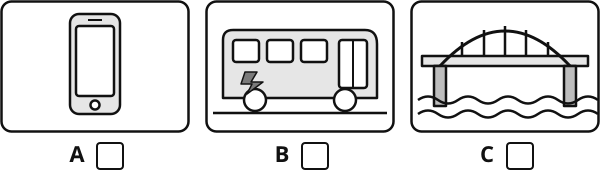{.w90}

### 2 [[marks:1]]
What was Dr Liu's favourite subject at school?
**Tick** one.

[[tick]] Art  [[tick]] Maths  [[tick]] Physics

### 3 [[marks:1]]
What did Dr Liu do at the weekends when she was young?
**Tick** one picture.

{.w90}

### 4 [[marks:1]]
How many years did she study at university? [[answer:short]]

### 5 [[marks:1]]
How many people are in her team? [[answer:short]]

### 6 [[marks:1]]
How far can the newest bus travel before it needs charging? [[answer]] km

### 7 [[marks:1]]
Dr Liu says, "My parents weren't always happy about that!"
Why do you think her parents were not happy?

[[lines:2]]

### 8 [[marks:1]]
Why does Dr Liu tell the students that her first battery design failed every test?

[[lines:2]]

# Reading

There are three parts: **A**, **B** and **C**.
Each part is harder than the one before.
**Do as much as you can. It is fine if you do not finish.**
You have 12 minutes. When you finish, wait for your teacher.

## Part A

**Read** the menu. Then **answer** questions 1 to 7.

![Menu of Lotus Café. Opening hours: Monday to Friday 7:30 to 20:00; Saturday and Sunday 9:00 to 21:00. Noodles and rice: beef noodle soup, spicy, 32 yuan; tomato and egg noodles, vegetarian, 24 yuan; chicken fried rice, 28 yuan; vegetable fried rice, vegetarian, 22 yuan; spicy tofu with rice, vegetarian and spicy, 26 yuan. Snacks: pork dumplings (8), 18 yuan; spring rolls (4), vegetarian, 15 yuan. Drinks: milk tea 14 yuan, orange juice 16 yuan, water 5 yuan. Key: a leaf means vegetarian (no meat or fish), a chilli means spicy. Student deal: any noodle dish and any drink for 35 yuan, Monday to Friday, 14:00 to 17:00, show your student card. Allergies? Please tell our staff before you order.](diagrams/y10_e01_read_menu.svg){.w100}

### 1 [[marks:1]]
What time does the café open on Sunday? [[answer]]

### 2 [[marks:1]]
How much is the beef noodle soup? [[answer]]

### 3 [[marks:2]]
**Tick** the **two** dishes that are vegetarian.

[[tick]] Beef noodle soup

[[tick]] Tomato and egg noodles

[[tick]] Chicken fried rice

[[tick]] Spring rolls

[[tick]] Pork dumplings

### 4 [[marks:1]]
Aisha is vegetarian. She does not like spicy food.
**Write** one dish from "Noodles and rice" that she can choose.

[[answer:wide]]

### 5 [[marks:1]]
When can you get the student deal? **Write** the days and the times.

[[answer:wide]]

### 6 [[marks:1]]
What must you show to get the student deal? [[answer:wide]]

### 7 [[marks:1]]
You have an allergy. What should you do? [[answer:full]]

## Part B {.newpage}

**Read** the story. Then **answer** questions 8 to 15.

[[passage]]
#### The Mooncake Lesson

Sofia had lived in Hangzhou for three months, but she still felt like a visitor.

On the afternoon before the Mid-Autumn Festival, there was a knock at the door. It was Mrs Chen from the flat next door. She was holding a large bag of flour and smiling.

"Your mother says you have never made mooncakes," she said. "Come. I will teach you."

Sofia was not sure. She was terrible at cooking. Last week she had burnt a pan of rice so badly that the whole flat smelt of smoke. But Mrs Chen was already walking back to her door, so Sofia followed.

Mrs Chen's kitchen was small and warm. Her grandson, Jun, was sitting at the table with a wooden mould. He was eleven, and he looked bored. "Grandma makes me help every year," he said.

Mrs Chen showed Sofia how to wrap sweet bean paste in a thin layer of dough. Sofia's first mooncake split open. Her second one was lopsided. Jun laughed, but not unkindly. "Mine looked like that last year," he said. "Press it into the mould. Slowly."

The third mooncake came out perfect, with a flower pattern on top. Sofia stared at it. Then she grinned.

That evening, the three of them sat on the balcony and looked at the full moon. Sofia ate a mooncake she had made herself. It was a little too sweet, but it was the best thing she had eaten since she arrived.

For the first time, Hangzhou felt a little bit like home.
[[/passage]]

### 8 [[marks:1]]
How long had Sofia lived in Hangzhou? [[answer]]

### 9 [[marks:1]]
What was Mrs Chen holding when she came to the door? [[answer:wide]]

### 10 [[marks:1]]
Why was Sofia not sure about making mooncakes?

[[answer:full]]

### 11 [[marks:1]]
Why do you think Jun looked bored?

[[answer:full]]

### 12 [[marks:1]]
"Jun laughed, but not unkindly."
What does this tell you about Jun?

[[answer:full]]

### 13 [[marks:1]]
**Write** 1, 2, 3 and 4 to show the order of these events. Number 1 is done for you.

| Event | Order |
|---|---|
| The third mooncake came out perfect. | [[answer:short]] |
| Mrs Chen knocked on the door. | 1 |
| They looked at the full moon. | [[answer:short]] |
| Sofia's first mooncake split open. | [[answer:short]] |

### 14 [[marks:1]]
**Find** and **copy** one word that shows Sofia was happy with her third mooncake. [[answer]]

### 15 [[marks:1]]
At the end, why did Hangzhou feel "a little bit like home"?

[[answer:full]]

## Part C {.newpage}

**Read** the article. Then **answer** questions 16 to 22.

[[passage]]
#### Ten Minutes of Nothing

*By Zhang Yiran, Year 11*

When did you last do nothing at all? I do not mean sleeping, and I do not mean scrolling through videos. I mean sitting still, with no screen, no music and no plan, and simply letting your mind wander.

If you are like most teenagers I know, you probably cannot remember. The moment we feel even slightly bored (in a queue, on the bus, while a video is loading) our hands reach for our phones. Boredom feels like a problem, and our phones offer an instant solution.

I would like to suggest that boredom is not a problem at all. In fact, it may be one of the most useful feelings we have.

Psychologists describe boredom as a kind of signal. It tells us that what we are doing is not satisfying, and it pushes us to look for something better. When we fill every empty moment with a screen, we never hear that signal. We stay busy, but we are not really choosing what to do with our time.

There is also evidence that a wandering mind can be a creative one. In one study, a group of adults spent fifteen minutes copying numbers from a long list. Afterwards, they were asked to think of as many uses as possible for two plastic cups. They came up with more ideas than a group who had skipped the boring task. The researchers believe that boredom gives the mind time to make unexpected connections.

Of course, nobody enjoys being bored for hours, and I am not suggesting that we throw our phones into the nearest river. My suggestion is much smaller: try ten minutes of nothing each day. Leave your phone in your bag on the way home. Look out of the window. Notice where your thoughts go.

The first few minutes will feel strange, perhaps even uncomfortable. But you may be surprised by what your mind does when you finally give it some space.
[[/passage]]

### 16 [[marks:1]]
What does the writer say most teenagers do when they feel bored?

[[answer:full]]

### 17 [[marks:1]]
What does "instant" mean in "our phones offer an instant solution"? **Tick** one.

[[tick]] expensive  [[tick]] immediate  [[tick]] difficult  [[tick]] boring

### 18 [[marks:1]]
According to psychologists, what does boredom tell us?

[[answer:full]]

### 19 [[marks:1]]
In the study, what did the bored group do better than the other group?

[[answer:full]]

### 20 [[marks:2]]
**Tick** Fact or Opinion for each sentence.

[[example]]
**Example:** Hangzhou is a city in China.  Fact ✓  Opinion [[tick]]
[[/example]]

| Sentence | Fact | Opinion |
|---|---|---|
| In one study, a group of adults spent fifteen minutes copying numbers. | [[tick]] | [[tick]] |
| Boredom is not a problem at all. | [[tick]] | [[tick]] |
| The bored group came up with more ideas than the other group. | [[tick]] | [[tick]] |
| Boredom may be one of the most useful feelings we have. | [[tick]] | [[tick]] |

### 21 [[marks:1]]
"I am not suggesting that we throw our phones into the nearest river."
Why does the writer include this sentence?

[[lines:2]]

### 22 [[marks:1]]
The article begins with a question: "When did you last do nothing at all?"
Why do you think the writer begins in this way?

[[lines:2]]

# Writing

**Choose one** task: A or B.
**Tick** the box for the task you choose.
**Plan** your ideas in the plan box. Then **write** on the lines.
You have 10 minutes. Write as much as you can.

### Task A: a description [[tick]]

**Describe** a busy place you know well. For example: a market, a train station or a festival.

Help the reader to see, hear and smell the place.

Ideas: the people, the sounds, the smells, the colours, how the place makes you feel.

### Task B: an article [[tick]]

Some people say:

> Every student should spend one week each year volunteering in their community, for example in a library, a park or a home for older people.

Do you agree? **Write** an article for the school website. Give your opinion, with reasons and examples.

---

#### Plan

[[box:8:Notes and ideas (this part is not marked)]]

#### Your writing {.newpage}

Task A [[tick]]  Task B [[tick]]

[[lines:22]]

# Maths

You have 20 minutes. Do as much as you can.
**Write** your answer in the box. **Show** your working in the working box.
Your teacher can read any question to you.
You may **not** use a calculator.

## Section A: Number problems

[[example]]
**What the maths words mean**
**Standard form:** 3500 = 3.5 × 103
**Expand:** 3(*x* + 2) = 3*x* + 6
**Make *a* the subject:** *b* = *a* + 2, so *a* = *b* − 2
**Solve:** *x* + 3 = 10, so *x* = 7
[[/example]]

### 1 [[marks:1]]
**Work out** &nbsp; −8 − 3 × (−4)  [[answer:short]]

### 2 [[marks:1]]
**Write** 4 600 000 in standard form.  [[answer]]

### 3 [[marks:1]]
**Simplify** &nbsp; *x*5 × *x*3 ÷ *x*2  [[answer]]

### 4 [[marks:1]]
**Make** *x* **the subject** of &nbsp; *y* = 3*x* − 5

[[answer:wide]]

### 5 [[marks:2]]
**Expand and simplify** &nbsp; (*x* + 4)(*x* − 2)

[[box:2:Working]]

[[answer:wide]]

### 6 [[marks:2]]
**Solve** these simultaneous equations.

2*x* + *y* = 11
*x* − *y* = 1

[[box:3:Working]]

*x* = [[answer:short]]  *y* = [[answer:short]]

### 7 [[marks:1]]
**Solve** &nbsp; *x*2 − 5*x* + 6 = 0

[[box:2:Working]]

*x* = [[answer:short]] or *x* = [[answer:short]]

## Section B: Word problems and pictures

### 8 [[marks:1]]
A school has 1200 students.
15% of the students come to school by bus.
How many students come to school by bus?

[[answer]]

### 9 [[marks:2]]
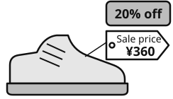{.w35 .right}

In a sale, all prices go down by 20%.

The sale price of these trainers is ¥360.

What was the price **before** the sale?

[[clear]]

[[box:2:Working]]

¥ [[answer]]

### 10 [[marks:2]]
Li Na puts ¥5000 in a bank.
The bank pays 4% compound interest each year.
How much money does she have after 2 years?

[[box:2:Working]]

¥ [[answer]]

### 11 [[marks:2]]
{.w30 .right}

A train leaves Hangzhou at 08:50.

It arrives in Beijing at 13:20.

The train travels 1260 km.

**Work out** the average speed of the train in km per hour.

[[clear]]

[[box:2:Working]]

[[answer]] km per hour

### 12 [[marks:2]]
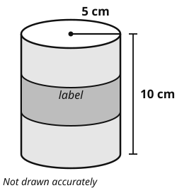{.w40 .right}

This tin is a cylinder.
The radius is 5 cm. The height is 10 cm.
Use π = 3.14.

(a) The label goes once around the tin.
**Work out** the length of the label.

[[answer]] cm

(b) **Work out** the volume of the tin.

[[answer]] cm³

[[clear]]

### 13 [[marks:2]]
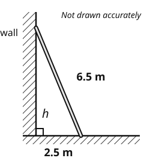{.w35 .right}

A ladder is 6.5 m long.
It leans against a wall.
The foot of the ladder is 2.5 m from the wall.

**Work out** the height, *h*, that the ladder reaches up the wall.

Working

*h* = [[answer]] m

[[clear]]

### 14 [[marks:2]]
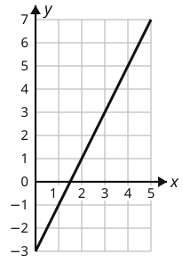{.w30 .right}

Look at the straight line on the grid.

**Write** the equation of the line in the form *y* = *mx* + *c*.

Working

*y* = [[answer]]

[[clear]]

### 15 [[marks:2]]
20 students say how long their journey to school takes.

| Time, *t* minutes | Number of students |
|---|---|
| 0 < *t* ≤ 10 | 4 |
| 10 < *t* ≤ 20 | 8 |
| 20 < *t* ≤ 30 | 5 |
| 30 < *t* ≤ 40 | 3 |

**Work out** an estimate of the mean journey time.

Working

[[answer]] minutes

[[clear]]

### 16 [[marks:2]]
Triangles A and B are similar. Matching angles are marked.

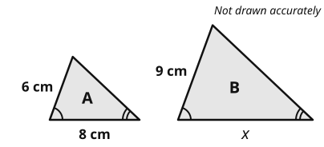{.w60}

**Work out** the length *x*.

[[box:2:Working]]

*x* = [[answer]] cm

### 17 [[marks:2]]
The probability that Jun's bus is late on any day is 0.2.

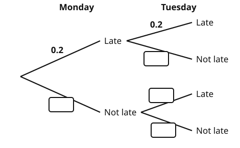{.w70}

(a) **Complete** the tree diagram. Write a number in each empty box.

(b) **Work out** the probability that the bus is late on Monday **and** on Tuesday. [[answer]]

### 18 [[marks:2]]
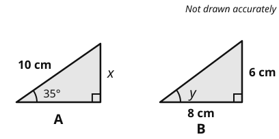{.w60}

Use these values.

<table class="vt">
<tr><th></th><th>35°</th><th>37°</th><th>53°</th></tr>
<tr><th>sin</th><td>0.57</td><td>0.60</td><td>0.80</td></tr>
<tr><th>cos</th><td>0.82</td><td>0.80</td><td>0.60</td></tr>
<tr><th>tan</th><td>0.70</td><td>0.75</td><td>1.33</td></tr>
</table>

(a) **Work out** the length *x* in triangle A.  *x* = [[answer]] cm

(b) **Work out** the size of angle *y* in triangle B.  *y* = [[answer:short]] °

# Science

You have 8 minutes. Do as much as you can.
Your teacher can read any question to you.

### 1 [[marks:1]]
These are three specialised cells.

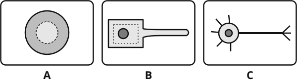{.w90}

Which cell takes in water from the soil? **Write** the letter. [[answer:short]]

### 2 [[marks:2]]
Jun cycles from home to school. This graph shows his journey.

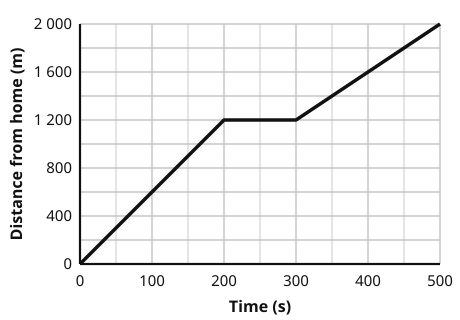{.w70}

(a) What is Jun doing between 200 s and 300 s? [[answer:wide]]

(b) **Work out** Jun's speed in the first 200 s. Use: speed = distance ÷ time.

[[answer]] m/s

### 3 [[marks:1]]
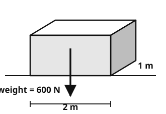{.w50 .right}

A box weighs 600 N.
Its base is 2 m long and 1 m wide.

**Work out** the pressure of the box on the floor.

Use: pressure = force ÷ area.

[[answer]] N/m²

[[clear]]

### 4 [[marks:3]]
Sofia investigates how light affects photosynthesis. She puts a lamp at different distances from some pondweed. She counts the bubbles of gas in one minute.

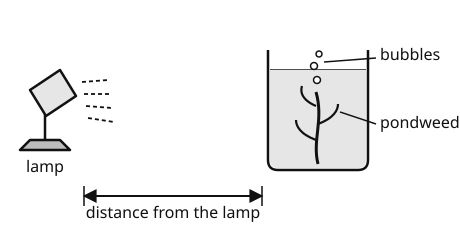{.w70}

| Distance from the lamp (cm) | 10 | 20 | 30 | 40 |
|---|---|---|---|---|
| Number of bubbles in one minute | 52 | 31 | 17 | 9 |

(a) **Describe** the pattern in the results.

[[lines:1]]

(b) **Write** one variable Sofia must keep the same.

[[lines:1]]

(c) Sofia counted the bubbles only once at each distance. **Suggest** one way to improve her method.

[[lines:1]]

### 5 [[marks:1]]
This diagram shows the energy transfers in an electric fan.

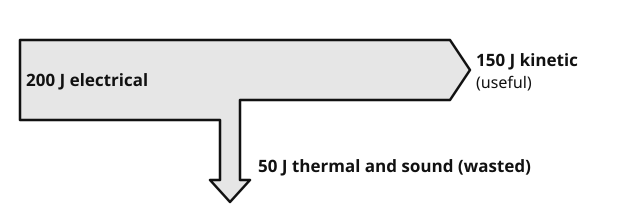{.w90}

**Work out** the efficiency of the fan. Use: efficiency = useful energy out ÷ total energy in.

[[answer]]

### 6 [[marks:1]]
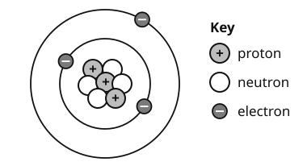{.w55 .right}

This diagram shows an atom.

What is the **mass number** of this atom?

[[answer:short]]

[[clear]]

### 7 [[marks:1]]
Hydrogen reacts with oxygen to make water.

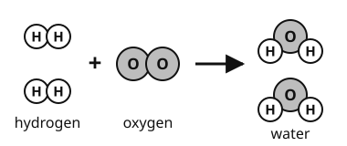{.w50}

**Write** the missing number to balance the equation.

[[answer:short]] H2 + O2 → 2H2O

[[stop:Thank you. You have finished. Please wait for your teacher.]]
