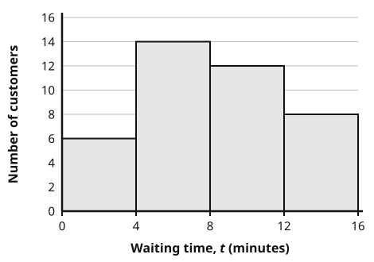
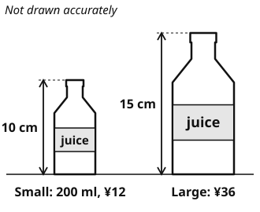
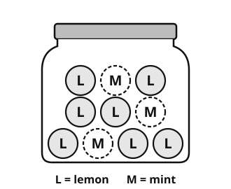
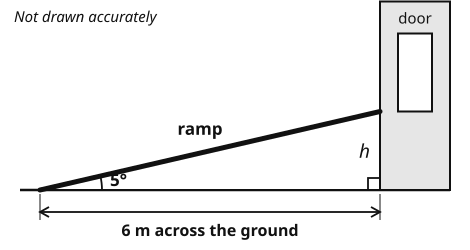
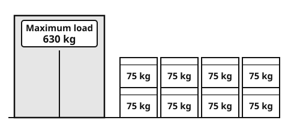

# Year 10 Admission Assessment

Version 2, October 2026

[[namebox]]

## Welcome

These activities help us get to know you.
Do your best.
It is fine if you cannot answer every question.
Your teacher will tell you when to start each part.

## How to answer

[[example]]
**Tick** one box.

Which one is a fruit?  a chair [[tick]]  an apple ✓  a bus [[tick]]

**Write** your answer in the box.

12 + 8 = 20

**Show** your working. You can get marks for your working, even if your answer is wrong.

Working
4 × 25 = 100, &nbsp; 100 + 30 = 130

[[/example]]

## The parts of this paper

| Part | What you do | Time |
|---|---|---|
| **Listening** | Listen to two talks. Answer 16 questions. | 10 minutes |
| **Reading** | Read three texts. Answer the questions. | 15 minutes |
| **Writing** | Write a description or an article. | 10 minutes |
| Break | | 5 minutes |
| **Maths** | Fluency, word questions and applied problems. | 25 minutes |
| **Science** | Questions with pictures, tables and graphs. | 8 minutes |
| Interview | Talk with a teacher and read some sentences aloud. | 15 minutes |

You may use a pencil, a rubber and a ruler.
You may use a calculator **only** in Maths Section C.

# Listening

There are two parts: **A** and **B**.
Your teacher will read each part **two times**.
**Listen** carefully.
Before each part, you have one minute to read the questions.
You can answer while you listen, or after.

## Part A

You will hear a short talk. **Answer** questions 1 to 8.

### 1 [[marks:1]]
What does Dr Liu's company design?
**Tick** one picture.

{.w90}

### 2 [[marks:1]]
What was Dr Liu's favourite subject at school?
**Tick** one.

[[tick]] Art  [[tick]] Maths  [[tick]] Physics

### 3 [[marks:1]]
What did Dr Liu do at the weekends when she was young?
**Tick** one picture.

{.w90}

### 4 [[marks:1]]
How many years did she study at university? [[answer:short]]

### 5 [[marks:1]]
How many people are in her team? [[answer:short]]

### 6 [[marks:1]]
How far can the newest bus travel before it needs charging? [[answer]] km

### 7 [[marks:1]]
Dr Liu says, "My parents weren't always happy about that!"
Why do you think her parents were not happy?

[[lines:2]]

### 8 [[marks:1]]
Why does Dr Liu tell the students that her first battery design failed every test?

[[lines:2]]

## Part B {.newpage}

You will hear a talk by **Professor Zhou Lan**. She is a scientist who studies the climate of cities.
Your teacher will read the talk **two times**.
You have one minute to read questions 9 to 16 first.

### 9 [[marks:1]]
In the largest cities, on the hottest nights, how much warmer can the city centre be than the countryside?

[[answer:short]] degrees

### 10 and 11 [[marks:2]]
**Complete** the notes. **Write** one to three words in each gap.

[[example]]
**Example:** Roads, concrete and dark roofs absorb the sun's energy in the day. They release it after sunset.
[[/example]]

#### Notes: why are cities hotter?

**10** &nbsp; Plants cool the air. Water travels up from the soil, [[answer]] from the leaves and carries heat away.

**11** &nbsp; Waste heat comes from traffic and from [[answer:wide]].

### 12 [[marks:1]]
A green roof has four layers.
**Write** 1, 2, 3 and 4 to show the order of the layers. 1 is the **bottom** layer.

| Layer | Order |
|---|---|
| soil | [[answer:short]] |
| plants | [[answer:short]] |
| a waterproof layer | [[answer:short]] |
| a drainage layer | [[answer:short]] |

### 13 [[marks:1]]
Professor Zhou's team tested two roofs on a July afternoon.
What temperature did the surface of the **dark** roof reach?  [[answer:short]] °C

### 14 [[marks:1]]
Professor Zhou talks about a "vicious circle".
**Explain** how a green roof on a building could help to break this circle.

[[lines:2]]

### 15 [[marks:1]]
Builders often say that green roofs are too expensive.
What does Professor Zhou think about this? **Tick** one.

[[tick]] She agrees that green roofs cost too much to build.

[[tick]] She thinks they forget the cost of a city that is too hot.

[[tick]] She thinks they should build white roofs instead.

[[tick]] She thinks they do not know how green roofs are built.

### 16 [[marks:1]]
What is the main purpose of Professor Zhou's talk? **Tick** one.

[[tick]] To warn that cities will soon be too hot for people to live in.

[[tick]] To explain a problem in cities and suggest how the school could help.

[[tick]] To show that green roofs are cheaper than white roofs in the end.

[[tick]] To report the results of her team's research in Hangzhou.

# Reading

There are three parts: **A**, **B** and **C**.
Each part is harder than the one before.
**Do as much as you can. It is fine if you do not finish.**
You have 15 minutes. When you finish, wait for your teacher.

## Part A

**Read** the menu. Then **answer** questions 1 to 7.

![Menu of Lotus Café. Opening hours: Monday to Friday 7:30 to 20:00; Saturday and Sunday 9:00 to 21:00. Noodles and rice: beef noodle soup, spicy, 32 yuan; tomato and egg noodles, vegetarian, 24 yuan; chicken fried rice, 28 yuan; vegetable fried rice, vegetarian, 22 yuan; spicy tofu with rice, vegetarian and spicy, 26 yuan. Snacks: pork dumplings (8), 18 yuan; spring rolls (4), vegetarian, 15 yuan. Drinks: milk tea 14 yuan, orange juice 16 yuan, water 5 yuan. Key: a leaf means vegetarian (no meat or fish), a chilli means spicy. Student deal: any noodle dish and any drink for 35 yuan, Monday to Friday, 14:00 to 17:00, show your student card. Allergies? Please tell our staff before you order.](diagrams/y10_e01_read_menu.svg){.w100}

### 1 [[marks:1]]
What time does the café open on Sunday? [[answer]]

### 2 [[marks:1]]
How much is the beef noodle soup? [[answer]]

### 3 [[marks:2]]
**Tick** the **two** dishes that are vegetarian.

[[tick]] Beef noodle soup

[[tick]] Tomato and egg noodles

[[tick]] Chicken fried rice

[[tick]] Spring rolls

[[tick]] Pork dumplings

### 4 [[marks:1]]
Aisha is vegetarian. She does not like spicy food.
**Write** one dish from "Noodles and rice" that she can choose.

[[answer:wide]]

### 5 [[marks:1]]
When can you get the student deal? **Write** the days and the times.

[[answer:wide]]

### 6 [[marks:1]]
What must you show to get the student deal? [[answer:wide]]

### 7 [[marks:1]]
You have an allergy. What should you do? [[answer:full]]

## Part B {.newpage}

**Read** the article. Then **answer** questions 8 to 14.

[[passage]]
#### Ten Minutes of Nothing

*By Zhang Yiran, Year 11*

When did you last do nothing at all? I do not mean sleeping, and I do not mean scrolling through videos. I mean sitting still, with no screen, no music and no plan, and simply letting your mind wander.

If you are like most teenagers I know, you probably cannot remember. The moment we feel even slightly bored (in a queue, on the bus, while a video is loading) our hands reach for our phones. Boredom feels like a problem, and our phones offer an instant solution.

I would like to suggest that boredom is not a problem at all. In fact, it may be one of the most useful feelings we have.

Psychologists describe boredom as a kind of signal. It tells us that what we are doing is not satisfying, and it pushes us to look for something better. When we fill every empty moment with a screen, we never hear that signal. We stay busy, but we are not really choosing what to do with our time.

There is also evidence that a wandering mind can be a creative one. In one study, a group of adults spent fifteen minutes copying numbers from a long list. Afterwards, they were asked to think of as many uses as possible for two plastic cups. They came up with more ideas than a group who had skipped the boring task. The researchers believe that boredom gives the mind time to make unexpected connections.

Of course, nobody enjoys being bored for hours, and I am not suggesting that we throw our phones into the nearest river. My suggestion is much smaller: try ten minutes of nothing each day. Leave your phone in your bag on the way home. Look out of the window. Notice where your thoughts go.

The first few minutes will feel strange, perhaps even uncomfortable. But you may be surprised by what your mind does when you finally give it some space.
[[/passage]]

### 8 [[marks:1]]
What does the writer say most teenagers do when they feel bored?

[[answer:full]]

### 9 [[marks:1]]
What does "instant" mean in "our phones offer an instant solution"? **Tick** one.

[[tick]] expensive  [[tick]] immediate  [[tick]] difficult  [[tick]] boring

### 10 [[marks:1]]
According to psychologists, what does boredom tell us?

[[answer:full]]

### 11 [[marks:1]]
In the study, what did the bored group do better than the other group?

[[answer:full]]

### 12 [[marks:2]]
**Tick** Fact or Opinion for each sentence.

[[example]]
**Example:** Hangzhou is a city in China.  Fact ✓  Opinion [[tick]]
[[/example]]

| Sentence | Fact | Opinion |
|---|---|---|
| In one study, a group of adults spent fifteen minutes copying numbers. | [[tick]] | [[tick]] |
| Boredom is not a problem at all. | [[tick]] | [[tick]] |
| The bored group came up with more ideas than the other group. | [[tick]] | [[tick]] |
| Boredom may be one of the most useful feelings we have. | [[tick]] | [[tick]] |

### 13 [[marks:1]]
"I am not suggesting that we throw our phones into the nearest river."
Why does the writer include this sentence?

[[lines:2]]

### 14 [[marks:1]]
The article begins with a question: "When did you last do nothing at all?"
Why do you think the writer begins in this way?

[[lines:2]]

## Part C {.newpage}

**Part C is hard. Do as much as you can.**
**Read** the article. Then **answer** questions 15 to 21.
The paragraphs are numbered.

[[passage]]
#### Can This Be Saved?

*By Lin Qiao*

1 My desk lamp died on a Tuesday evening, in the middle of a sentence I was rather proud of. It flickered twice, buzzed indignantly, and went dark. My father glanced in from the doorway. "Just order another one," he said. "They're cheap."

2 He was right, of course. A new lamp would have cost less than a cinema ticket and arrived the next morning. Instead, I carried it to a repair café in an old community hall, where a retired electrician called Mr Fang peered into its base, tutted, and replaced a small, blackened switch. The whole operation took eleven minutes. The lamp is still on my desk, and I am still faintly ridiculous about how pleased I am.

3 I tell this story because it seems to me that, somewhere along the way, we quietly stopped believing that things can be fixed. When a zip breaks, we buy a new jacket. When a screen cracks, we upgrade. Our cupboards fill with objects that work perfectly well apart from one small, maddening fault, and eventually they make their way to a landfill site, where they will outlast every one of us. Without quite noticing, we have become a society of replacers.

4 Some of this is not our fault. Many products are now designed in ways that make repair almost impossible: cases are glued rather than screwed together, spare parts are never sold, and the instruction manual has been replaced by a cheerful warning that opening the device will cancel your guarantee. Manufacturers insist that this is about safety and elegant design. Perhaps. It is certainly also about selling us the same object twice.

5 Nevertheless, it would be too easy to blame the companies alone. The deeper problem, I suspect, is a habit of mind. We have learnt to treat newness as a kind of virtue, and anything old as faintly embarrassing. A patched elbow or a re-glued chair leg, which my grandmother would have regarded as a small triumph, now looks to many people like a sign of poverty or neglect. She darned socks until they were more darn than sock, and she would have been baffled by the idea of throwing away anything that could still be coaxed back to life.

6 I would argue the opposite. A mended object carries a story. The tiny scratch on my lamp, where Mr Fang's screwdriver slipped, reminds me of our conversation about the factory where he trained, and of his dry remark that "nothing is broken until you stop being curious about it". You do not get that from a delivery van: a new lamp, however elegant, arrives with no history at all.

7 There is a practical argument, too. Every object we keep for longer is one fewer that has to be mined, manufactured, packaged and shipped across the world. Repairing a lamp will not save the planet, and I am not naive enough to pretend otherwise. But habits are contagious. The volunteers at the repair café told me that people who bring one broken thing usually return with another, and then with a neighbour.

8 Critics will say that repair is a luxury for those with time to spare, and they have a point. Not everyone can give up a Saturday afternoon to watch a stranger rewire a toaster. That is precisely why repair should not depend on the goodwill of retired electricians. Schools could teach basic mending alongside cooking and computing. Shops could be required to stock spare parts for as long as they sell a product. Cities could fund repair cafés in the same way that they fund libraries: as places where knowledge is shared rather than sold.

9 None of this means giving up new things altogether. It simply asks us to pause before we throw something away, and to ask a question that earlier generations asked without thinking: can this be saved?

10 My lamp, for the record, is shining as I write. It is not the newest lamp in the world, nor the most beautiful. But it is mine, it works, and every time I switch it on, it reminds me that broken is not the same as finished.
[[/passage]]

### 15 [[marks:1]]
**Paragraph 1.** The writer says that the lamp "died" and "buzzed indignantly".
**Explain** the effect of describing the lamp in this way.

[[lines:2]]

### 16 [[marks:1]]
**Paragraphs 2 and 6.** What impression do you get of Mr Fang?
**Write** one word or phrase about him. Then **copy** a short quotation that shows it.

Mr Fang is: [[answer:wide]]

Quotation: [[answer:full]]

### 17 [[marks:1]]
**Paragraph 4.** Manufacturers say that products are hard to repair because of "safety and elegant design".
Does the writer believe them? **Explain** your answer and give evidence from the text.

[[lines:2]]

### 18 [[marks:1]]
**Paragraph 5.** The writer says that the deeper problem is "a habit of mind".
**Explain**, in your own words, what the writer means.

[[lines:2]]

### 19 [[marks:1]]
**Paragraph 7.** "But habits are contagious."
What does "contagious" mean here? **Tick** one.

[[tick]] dangerous to your health

[[tick]] passed quickly from one person to another

[[tick]] very hard to stop

[[tick]] expensive to keep

### 20 [[marks:1]]
Which sentence best describes the writer's view? **Tick** one.

[[tick]] Companies are completely to blame for the things that we throw away.

[[tick]] Everyone should stop buying new things and only mend old ones.

[[tick]] We should try to mend things first, and mending should be made easier.

[[tick]] Repair cafés are only useful for people who have plenty of free time.

### 21 [[marks:2]]
**Summarise** the reasons the writer gives for mending things instead of throwing them away.
**Use your own words.** **Write** two or three points.

[[lines:4]]

# Writing

**Choose one** task: A or B.
**Tick** the box for the task you choose.
**Plan** your ideas in the plan box. Then **write** on the lines.
You have 10 minutes. Write as much as you can.

### Task A: a description [[tick]]

**Describe** a busy place you know well. For example: a market, a train station or a festival.

Help the reader to see, hear and smell the place.

Ideas: the people, the sounds, the smells, the colours, how the place makes you feel.

### Task B: an article [[tick]]

Some people say:

> Every student should spend one week each year volunteering in their community, for example in a library, a park or a home for older people.

Do you agree? **Write** an article for the school website. Give your opinion, with reasons and examples.

---

#### Plan

[[box:8:Notes and ideas (this part is not marked)]]

#### Your writing {.newpage}

Task A [[tick]]  Task B [[tick]]

[[lines:22]]

# Maths

You have 25 minutes. Do as much as you can.
**Write** your answer in the box. **Show** your working in the working box.
Your teacher can read any question to you.
**Sections A and B:** you may **not** use a calculator.
**Section C:** you **may** use a scientific calculator.

## Section A: Fluency

No calculator

[[example]]
**What the maths words mean**
**Simplify fully:** write it as simply as you can, for example 2<i>x</i> + 4<i>x</i> + 2 = 2
**Surd form:** keep the square root in your answer, for example √12 = 2√3
**Make *a* the subject:** *b* = *a* + 2, so *a* = *b* − 2
**f(*x*) = 2*x* + 1** means "double *x*, then add 1". So f(3) = 7.
**fg(*x*)** means "do g first, then do f". **f−1(*x*)** is the **inverse** of f: it undoes f.
[[/example]]

### 1 [[marks:1]]
**Write** &nbsp; √48 − 6√3 &nbsp; in the form *k*√3.  [[answer]]

### 2 [[marks:1]]
**Work out** &nbsp; 27−2/3.  **Give** your answer as a fraction.  [[answer:short]]

### 3 [[marks:2]]
**Simplify fully** &nbsp; 2<i>x</i>2 + 5<i>x</i> − 3<i>x</i>2 − 9

[[box:3:Working]]

[[answer:wide]]

### 4 [[marks:2]]
**Make** *x* **the subject** of &nbsp; *y* = 2<i>x</i> + 3<i>x</i> − 1

[[box:3:Working]]

*x* = [[answer:wide]]

### 5 [[marks:2]]
f(*x*) = 3*x* − 1  g(*x*) = *x*2 + 2

(a) **Work out** fg(2).  [[answer:short]]

(b) **Find** f−1(*x*).  f−1(*x*) = [[answer]]

### 6 [[marks:2]]
**Solve** &nbsp; 3<i>x</i> + 1 + 2<i>x</i> = 1

**Give** your answers in surd form.

[[box:5:Working]]

*x* = [[answer]]  or  *x* = [[answer]]

## Section B: Word questions {.newpage}

No calculator

The questions in this section are in words only.
**Read** each question carefully. Decide what to do.

[[example]]
**Write an equation, then solve it.**
Three consecutive numbers add up to 87. Find the numbers.
(Consecutive numbers come one after another, like 5, 6 and 7.)

Let the smallest number be *n*. The numbers are *n*, *n* + 1 and *n* + 2.
**Equation:** *n* + (*n* + 1) + (*n* + 2) = 87
**Solve:** 3*n* + 3 = 87, so 3*n* = 84, so *n* = 28.
**Answer:** the numbers are 28, 29 and 30.
[[/example]]

### 7 [[marks:2]]
The price of a concert ticket goes up by 15%.
The new price is ¥230.
**Work out** the price before it went up.

[[box:2:Working]]

¥ [[answer]]

### 8 [[marks:2]]
At a museum, 3 adult tickets and 4 student tickets cost ¥290 altogether.
2 adult tickets and 5 student tickets cost ¥275 altogether.
**Write** two equations, then **solve** them.
**Find** the cost of one adult ticket and the cost of one student ticket.

[[box:4:Working]]

Adult ticket: ¥ [[answer:short]]  Student ticket: ¥ [[answer:short]]

### 9 [[marks:2]]
A rectangle has a perimeter of 34 cm.
Its area is 60 cm².
**Write** an equation, then **solve** it.
**Find** the length and the width of the rectangle.

[[box:4:Working]]

Length: [[answer:short]] cm  Width: [[answer:short]] cm

### 10 [[marks:2]]
Pump A can fill an empty water tank in 4 hours.
Pump B can fill the same tank in 6 hours.
Both pumps are switched on at the same time.
How long do the two pumps take to fill the empty tank together?
**Give** your answer in hours and minutes.

[[box:3:Working]]

[[answer:short]] hours  [[answer:short]] minutes

## Section C: Applied problems {.newpage}

You may use a scientific calculator

**Show** your working. You can get marks for your working, even if your answer is wrong.

### 11 [[marks:2]]
{.w55 .right}

A café records how long 40 customers wait for their food.
The chart shows the results.

**Work out** an estimate of the mean waiting time.

Working

[[answer]] minutes

[[clear]]

### 12 [[marks:2]]
A new laptop costs ¥6000.
Its value goes down by 12% every year.
After how many whole years is the laptop first worth **less than** ¥3000?
You can use the table.

<table class="dep">
<tr><th>Year</th><th>0</th><th>1</th><th>2</th><th>3</th><th>4</th><th>5</th><th>6</th><th>7</th></tr>
<tr><th>Value (¥)</th><td>6000</td><td>5280</td><td></td><td></td><td></td><td></td><td></td><td></td></tr>
</table>

[[answer:short]] years

### 13 [[marks:2]]
{.w50 .right}

These two bottles of juice are mathematically similar.

The small bottle is 10&nbsp;cm tall.
It holds 200&nbsp;ml. It costs ¥12.
The large bottle is 15&nbsp;cm tall.
It costs ¥36.

Which bottle is better value? **Show** how you decide.

Working

**Tick** one.  Small bottle [[tick]]  Large bottle [[tick]]

[[clear]]

### 14 [[marks:2]]
{.w45 .right}

A jar has 10 sweets.
7 are lemon (L) and 3 are mint (M).
Jun takes a sweet at random and eats it.
Then he takes another sweet at random.

**Work out** the probability that the two sweets are the **same** flavour.

Working

[[answer]]

[[clear]]

### 15 [[marks:2]]
This is a rule for wheelchair ramps:

> A ramp must not be steeper than **1 in 12**. For every 12 m across the ground, it can rise at most 1 m.

{.w70}

This ramp goes 6 m across the ground. It makes an angle of 5° with the ground.
Does this ramp follow the rule? **Explain** your answer.

[[box:3:Working]]

**Tick** one.  Yes, it follows the rule. [[tick]]  No, it is too steep. [[tick]]

### 16 [[marks:2]]
{.w50 .right}

A lift can carry a maximum load of 630 kg.
There are eight boxes.
Each box has a mass of 75&nbsp;kg, correct to the nearest 5&nbsp;kg.

Can the lift **always** carry all eight boxes at the same time? **Explain** your answer.

Working

**Tick** one.  Yes [[tick]]  No [[tick]]

[[clear]]

# Science

You have 8 minutes. Do as much as you can.
Your teacher can read any question to you.

### 1 [[marks:1]]
These are three specialised cells.

{.w90}

Which cell takes in water from the soil? **Write** the letter. [[answer:short]]

### 2 [[marks:2]]
Jun cycles from home to school. This graph shows his journey.

{.w70}

(a) What is Jun doing between 200 s and 300 s? [[answer:wide]]

(b) **Work out** Jun's speed in the first 200 s. Use: speed = distance ÷ time.

[[answer]] m/s

### 3 [[marks:1]]
{.w50 .right}

A box weighs 600 N.
Its base is 2 m long and 1 m wide.

**Work out** the pressure of the box on the floor.

Use: pressure = force ÷ area.

[[answer]] N/m²

[[clear]]

### 4 [[marks:3]]
Sofia investigates how light affects photosynthesis. She puts a lamp at different distances from some pondweed. She counts the bubbles of gas in one minute.

{.w70}

| Distance from the lamp (cm) | 10 | 20 | 30 | 40 |
|---|---|---|---|---|
| Number of bubbles in one minute | 52 | 31 | 17 | 9 |

(a) **Describe** the pattern in the results.

[[lines:1]]

(b) **Write** one variable Sofia must keep the same.

[[lines:1]]

(c) Sofia counted the bubbles only once at each distance. **Suggest** one way to improve her method.

[[lines:1]]

### 5 [[marks:1]]
This diagram shows the energy transfers in an electric fan.

{.w90}

**Work out** the efficiency of the fan. Use: efficiency = useful energy out ÷ total energy in.

[[answer]]

### 6 [[marks:1]]
{.w55 .right}

This diagram shows an atom.

What is the **mass number** of this atom?

[[answer:short]]

[[clear]]

### 7 [[marks:1]]
Hydrogen reacts with oxygen to make water.

{.w50}

**Write** the missing number to balance the equation.

[[answer:short]] H2 + O2 → 2H2O

[[stop:Thank you. You have finished. Please wait for your teacher.]]
