

# Year 11 Admission Assessment: Optional sciences

Version 3.1, October 2026

[[namebox]]

## Which sciences?

**Do only the sciences your teacher tells you to do.**
Each science has 15 marks and takes 15 minutes.
Your teacher ticks the sciences you do today:

Biology [[tick]] Chemistry [[tick]] Physics [[tick]]

## How to answer

[[example]]
**Tick** one box.

Which one is a gas?  ice [[tick]]  water ✓  steam [[tick]]

**Write** your answer in the box.

5 × 20 = 100

**Show** your working. You can get marks for your working, even if your answer is wrong.

Working
speed = 100 ÷ 20 = 5 m/s

[[/example]]

Write all your answers in English.
Your teacher can read any question to you in English.
Do as much as you can. It is fine if you do not finish.
Later questions may be on topics you know, so look at every question.

| Science | What is in it | Marks | Time |
|---|---|---|---|
| **Biology** | Cells, enzymes, food, transport in plants and humans, breathing. | 15 | 15 minutes |
| **Chemistry** | Particles, atoms, the periodic table, bonding, acids, equations and masses. | 15 | 15 minutes |
| **Physics** | Forces, motion, density, energy, heating and cooling, waves and light. | 15 | 15 minutes |

Calculator: only in Chemistry question 7 and in the whole of the Physics section.

# Biology

You have 15 minutes. Do as much as you can.
Your teacher can read any question to you.
No calculator in this section.

### 1 [[marks:2]]
This is a plant cell.

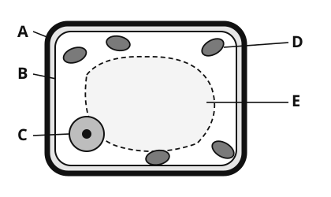{.w50}

(a) Which part contains chlorophyll for photosynthesis? **Write** the letter. [[answer:short]]

(b) Which part controls what enters and leaves the cell? **Write** the letter. [[answer:short]]

### 2 [[marks:2]]
Chen Yu tests three foods, A, B and C. The table shows the results.

| Food | Iodine solution | Benedict's solution (heated) | Biuret solution |
|---|---|---|---|
| A | blue-black | stays blue | purple |
| B | stays orange-brown | brick red | stays blue |
| C | stays orange-brown | stays blue | purple |

(a) Which food contains **both** starch and protein? **Write** the letter. [[answer:short]]

(b) Food B turns Benedict's solution brick red. What does this show about food B?

[[lines:1]]

### 3 [[marks:2]]
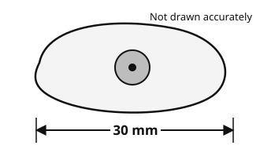{.w50 .right}

This is a drawing of a cheek cell.
The drawing is 30 mm long.
The real cell is 0.05 mm long.

**Work out** the magnification of the drawing.
Use: magnification = length of drawing ÷ real length.

[[clear]]

[[box:2:Working]]

Magnification = × [[answer]]

### 4 [[marks:2]]
The diagram shows a cross-section of a plant stem. One vascular bundle is drawn larger. It has two tissues, X and Y.

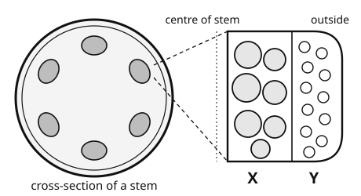{.w65}

(a) Which tissue carries water from the roots to the leaves? **Write** the letter. [[answer:short]]

(b) **Name** the process in which water vapour is lost from the leaves. [[answer:wide]]

### 5 [[marks:2]]
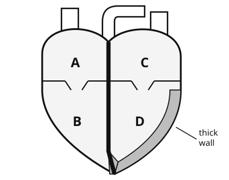{.w35 .right}

The diagram shows the human heart from the front.
The left side of the heart is on the **right** of the diagram.

(a) Which letter is the left ventricle? [[answer:short]]

(b) Which chamber pumps blood to the lungs? **Write** the letter. [[answer:short]]

[[clear]]

### 6 [[marks:3]]
The graph shows how temperature affects an enzyme-controlled reaction.

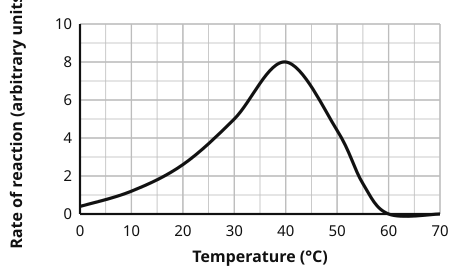{.w45}

(a) At which temperature does the enzyme work fastest? [[answer:short]] °C

(b) **Explain** why the rate of reaction is zero at 60 °C.

[[lines:2]]

### 7 [[marks:2]]
Mei counts her breaths in one minute, at rest and after running, three times each.

| | Trial 1 | Trial 2 | Trial 3 | Mean |
|---|---|---|---|---|
| At rest (breaths per minute) | 14 | 16 | 15 | 15 |
| After running (breaths per minute) | 29 | 31 | 45 | |

(a) One result after running is anomalous (it does not fit the pattern). **Circle** it in the table.

(b) **Work out** the mean breathing rate after running. Leave out the anomalous result.

[[answer:short]] breaths per minute

[[stop:Stop. This is the end of Biology. Wait for your teacher.]]

# Chemistry

You have 15 minutes. Do as much as you can.
Your teacher can read any question to you.
You may use a calculator in **question 7 only**.

### 1 [[marks:1]]
The diagrams show the particles in a substance in three states.

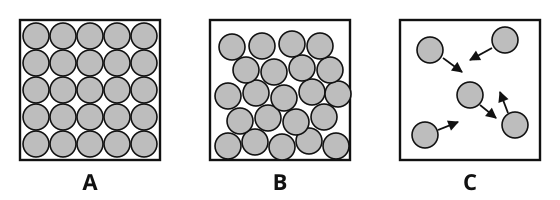{.w80}

Which diagram shows a gas? **Write** the letter. [[answer:short]]

### 2 [[marks:2]]
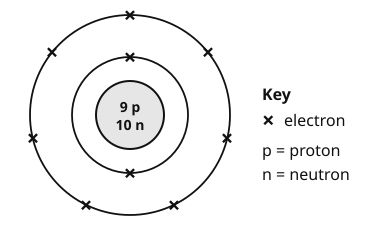{.w45 .right}

This diagram shows an atom of an element.

(a) What is the **mass number** of this atom? [[answer:short]]

(b) Which **group** of the periodic table is this element in? [[answer:short]]

[[clear]]

### 3 [[marks:2]]
This is an outline of part of the periodic table. Four elements are marked with letters. The letters are not the symbols of the elements.

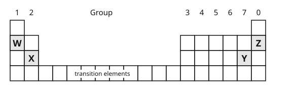{.w65}

(a) Which letter is a noble gas? [[answer:short]]

(b) Which letter is a metal that reacts very quickly with water? [[answer:short]]

### 4 [[marks:2]]
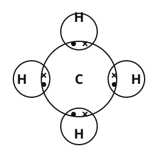{.w35 .right}

This is a dot-and-cross diagram of a molecule of methane, CH4.

(a) What **type of bonding** holds the atoms together in methane? [[answer:wide]]

(b) How many **pairs of electrons** are shared in one molecule of methane? [[answer:short]]

[[clear]]

### 5 [[marks:2]]
The pH of four solutions, A, B, C and D, is shown on the scale.

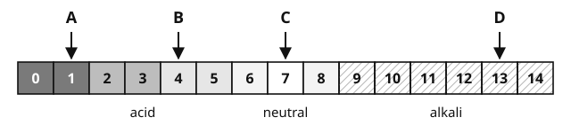{.w90}

(a) Which solution is the most alkaline? **Write** the letter. [[answer:short]]

(b) Solution A is hydrochloric acid. **Complete** the word equation.

hydrochloric acid + sodium hydroxide → [[answer:wide]] + water

### 6 [[marks:2]]
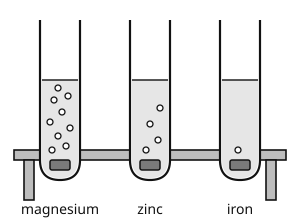{.w35 .right}

Li Na puts a piece of a metal into dilute hydrochloric acid and counts the bubbles of gas in one minute. She does this for three metals.

| Metal | Trial 1 | Trial 2 | Trial 3 |
|---|---|---|---|
| magnesium | 58 | 61 | 60 |
| zinc | 24 | 26 | 25 |
| iron | 6 | 7 | 5 |

(a) Which variable does Li Na **change** in this investigation? [[answer:wide]]

(b) **Write** one variable Li Na must keep the same.

[[lines:1]]

[[clear]]

### 7 [[marks:4]]

You may use a calculator in this question.

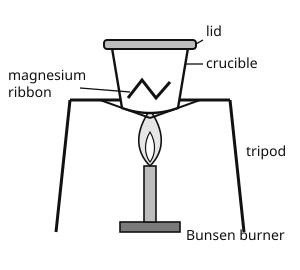{.w40 .right}

Zhang Wei heats 12 g of magnesium in a crucible. It burns and makes magnesium oxide.

2Mg + O2 → 2MgO

(a) **Explain** why the mass of the solid in the crucible is **greater** after heating.

[[lines:2]]

[[clear]]

(b) **Work out** the mass of magnesium oxide made from 12 g of magnesium.
Relative atomic masses: Mg = 24, O = 16.

[[box:3:Working]]

Mass of magnesium oxide = [[answer]] g

[[stop:Stop. This is the end of Chemistry. Wait for your teacher.]]

# Physics

You have 15 minutes. Do as much as you can.
Your teacher can read any question to you.
You may use a calculator in this section.

#### Formulae you may need

<table>
<tr><td>speed = distance ÷ time</td><td>density = mass ÷ volume</td></tr>
<tr><td>acceleration = change in speed ÷ time</td><td>pressure = force ÷ area</td></tr>
<tr><td>weight = mass × g (g = 10 N/kg)</td><td>work done = force × distance</td></tr>
<tr><td>gravitational potential energy = mass × g × height</td><td>kinetic energy = ½ × mass × speed²</td></tr>
<tr><td>power = energy ÷ time</td><td>wave speed = frequency × wavelength</td></tr>
<tr><td>efficiency = useful energy out ÷ total energy in</td><td>resultant force = forces one way minus forces the other way</td></tr>
</table>

### 1 [[marks:1]]
Two forces act on a box.

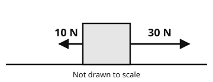{.w50}

**Write** the size and direction of the resultant force. [[answer]] N, to the [[answer:short]]

### 2 [[marks:2]]
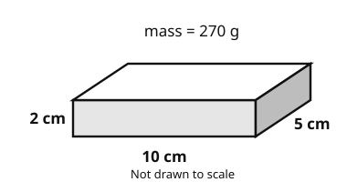{.w45 .right}

A metal block is 10 cm long, 5 cm wide and 2 cm high.
Its mass is 270 g.

**Work out** the density of the metal.

[[clear]]

[[box:2:Working]]

Density = [[answer]] g/cm³

### 3 [[marks:3]]
Tom rides an electric scooter. The graph shows his speed for 12 seconds.

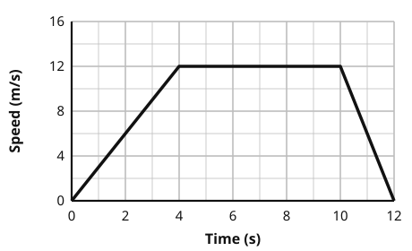{.w50}

(a) **Describe** Tom's motion between 4 s and 10 s.

[[lines:1]]

(b) **Work out** Tom's acceleration in the first 4 seconds.

[[box:2:Working]]

Acceleration = [[answer]] m/s²

### 4 [[marks:2]]
Sofia fills two identical metal cans with hot water. One can is painted black; the other is shiny. She measures the temperature of the water every 5 minutes.

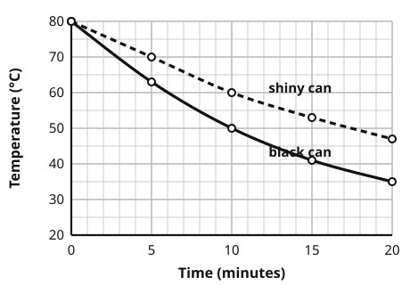{.w50}

(a) What is the temperature of the water in the **black** can after 10 minutes? [[answer:short]] °C

(b) Which surface is the better **emitter** of thermal radiation? **Tick** one box.

black [[tick]]  shiny [[tick]]

### 5 [[marks:2]]
The diagram shows a wave on a rope.

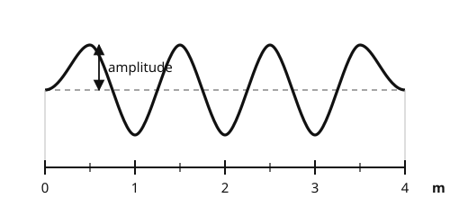{.w70}

(a) What is the **wavelength** of the wave? [[answer:short]] m

(b) The frequency of the wave is 5 Hz. **Work out** the speed of the wave.

[[answer:short]] m/s

### 6 [[marks:3]]
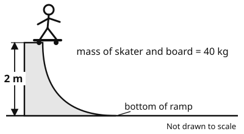{.w55 .right}

Wang Hao and his skateboard have a mass of 40 kg.
He stands at the top of a ramp, 2 m above the ground.

(a) **Work out** his gravitational potential energy at the top of the ramp. Use g = 10 N/kg.

[[answer]] J

(b) At the bottom of the ramp his kinetic energy is 650 J.
**Explain** why his kinetic energy at the bottom is less than his gravitational potential energy at the top.

[[clear]]

[[lines:2]]

### 7 [[marks:2]]
Aisha investigates reflection in a plane mirror. She shines a ray of light at the mirror and measures the angles.

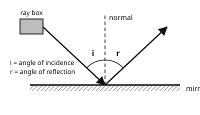{.w55 .left}

| Angle of incidence, i | Angle of reflection, r |
|---|---|
| 20° | 20° |
| 30° | 31° |
| 40° | 40° |
| 50° | 49° |

[[clear]]

(a) **Write** a conclusion from these results.

[[lines:1]]

(b) Two of the results do not fit the conclusion exactly. **Suggest** one way Aisha could make her measurements more accurate.

[[lines:1]]

[[stop:Stop. This is the end of Physics. Thank you. Wait for your teacher.]]
