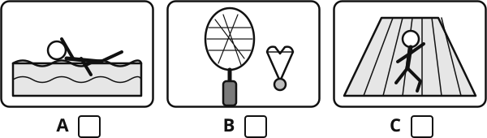
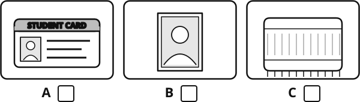
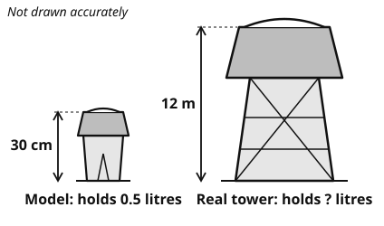
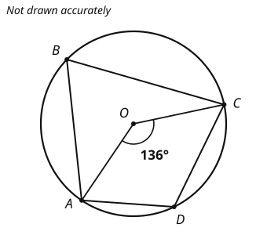
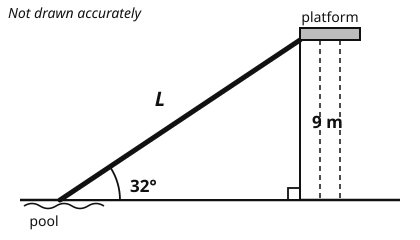
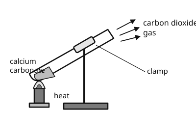
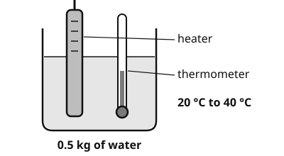
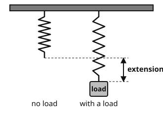
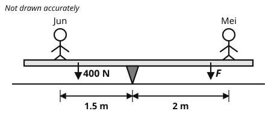
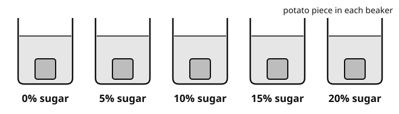

# Year 11 Admission Assessment

Version 3.1, October 2026

[[namebox]]

## Welcome

These activities help us get to know you.
Do your best.
It is fine if you cannot answer every question.
Your teacher will tell you when to start each part.

## How to answer

[[example]]
**Tick** one box.

Which one is a fruit?  a chair [[tick]]  an apple ✓  a bus [[tick]]

**Write** your answer in the box.

12 + 8 = 20

**Show** your working. You can get marks for your working, even if your answer is wrong.

Working
4 × 25 = 100, &nbsp; 100 + 30 = 130

[[/example]]

## The parts of this paper

| Part | What you do | Time |
|---|---|---|
| **Listening** | Listen to a conversation and a talk. Answer 16 questions. | 15 minutes |
| **Reading** | Read two texts. Answer the questions. | 15 minutes |
| **Writing** | Write a story or an essay. | 10 minutes |
| Break | | 5 minutes |
| **Maths** | Fluency, word questions and applied problems. | 25 minutes |
| **Science** | Questions with pictures, tables and graphs. | 8 minutes |

**After this paper:** the Cognitive Ability Screen (a reasoning test, in a separate booklet); the Optional Sciences (a short paper for each science you choose, in another booklet); then a talk with a teacher. Your teacher will explain each part.
You may use a pencil, a rubber and a ruler. You may use a calculator **only** in Maths Section C.

# Listening

There are two parts: **A** and **B**.
Your teacher will play each part **two times**.
**Listen** carefully.
Before each part, you have one minute to read the questions.
You can answer while you listen, or after.

## Part A

You will hear a conversation at a sports centre. **Answer** questions 1 to 8.

### 1 [[marks:1]]
What does Li Na want to do at the sports centre?
**Tick** one picture.

{.w90}

### 2 [[marks:1]]
When is the pool closed for cleaning?
**Tick** one.

[[tick]] Monday mornings  [[tick]] Wednesday mornings  [[tick]] Sunday evenings

### 3 [[marks:1]]
What must Li Na bring tomorrow?
**Tick** one picture.

{.w90}

### 4 [[marks:1]]
How much is a student membership for one month?  ¥ [[answer:short]]

### 5 [[marks:1]]
How many lanes can members use in the evenings, after five o'clock? [[answer:short]]

### 6 [[marks:1]]
What time does the pool open at the weekend? [[answer:short]]

### 7 [[marks:1]]
Li Na says, "Oh no. I'd better set an alarm."
Why does she say this?

[[lines:2]]

### 8 [[marks:1]]
Why does the receptionist tell Li Na about the session on Tuesday evenings?

[[lines:2]]

## Part B {.newpage}

You will hear a talk by **Dr Lin Feng**. He is an engineer who designs buildings.
Your teacher will play the talk **two times**.
You have one minute to read questions 9 to 16 first.

### 9 [[marks:1]]
How old must a bamboo pole be before it is cut for building?

[[answer:short]] years

### 10 and 11 [[marks:2]]
**Complete** the notes. **Write** one to three words in each gap.

[[example]]
**Example:** Bamboo is not a tree. It is a grass.
[[/example]]

#### Notes: treating bamboo

**10** &nbsp; First, the poles are soaked in a [[answer:wide]] for about a week.

**11** &nbsp; Second, they are dried slowly in the [[answer]] for two months.

### 12 [[marks:1]]
What does "tensile strength" measure? **Tick** one.

[[tick]] How heavy a material is.

[[tick]] How hard you can pull a material before it breaks.

[[tick]] How long a material lasts outside.

[[tick]] How much a material costs.

### 13 [[marks:1]]
How many weeks did it take to build the sports hall?  [[answer:short]] weeks

### 14 [[marks:1]]
Dr Lin says that most of the engineering in a bamboo building is in the joints.
**Give two** reasons from the talk.

[[lines:3]]

### 15 [[marks:1]]
Some architects call bamboo "the poor man's timber".
What does Dr Lin think about these architects? **Tick** one.

[[tick]] He agrees that bamboo is only for poor people.

[[tick]] He thinks they criticise bamboo but are happy to be seen with his building.

[[tick]] He thinks they have never seen a bamboo building.

[[tick]] He thinks they should design the next sports hall.

### 16 [[marks:1]]
What is the main purpose of Dr Lin's talk? **Tick** one.

[[tick]] To persuade the school to build its bicycle shelter from bamboo.

[[tick]] To explain how bamboo is used in buildings and make students think about it.

[[tick]] To describe how his team built a sports hall in Guangxi.

[[tick]] To warn that steel is destroying the environment.

# Reading

There are two parts: **A** and **B**.
Part B is harder than Part A.
**Do as much as you can. It is fine if you do not finish.**
You have 15 minutes. When you finish, wait for your teacher.

## Part A

**Read** the web page. Then **answer** questions 1 to 7.

![A web page of Sunrise Community Centre: Summer workshops for ages 12 to 18. A table lists five workshops. Photography: Monday 9:30 to 12:00, ages 12 and over, 80 yuan, full. Baking: Tuesday 14:00 to 16:30, ages 12 and over, 60 yuan, 4 places left. Robotics: Wednesday 10:00 to 12:30, ages 14 and over, free, 6 places left. Drama: Thursday 14:00 to 17:00, ages 12 and over, 50 yuan, 10 places left. First aid: Friday 9:00 to 12:00, ages 15 and over, free, 8 places left. How to book: book online by Friday 20 June and pay when you book; students with a student card pay half price; Photography: bring your own camera or borrow one from us for 20 yuan; if a workshop is full, add your name to the waiting list and we will email you if a place becomes free. All workshops are taught in English.](diagrams/y11_e01_read_webpage.svg){.w100}

### 1 [[marks:1]]
What time does the Robotics workshop start? [[answer]]

### 2 [[marks:2]]
**Tick** the **two** workshops that are free.

[[tick]] Photography

[[tick]] Baking

[[tick]] Robotics

[[tick]] Drama

[[tick]] First aid

### 3 [[marks:1]]
Jun is 14 years old. Which workshop can he **not** join? [[answer:wide]]

### 4 [[marks:1]]
Chen Yu has a student card. How much does she pay for the Drama workshop? ¥ [[answer:short]]

### 5 [[marks:1]]
Mei wants to do Photography, but she does not have a camera. What can she do?

[[answer:full]]

### 6 [[marks:1]]
What is the last day you can book a workshop? [[answer:wide]]

### 7 [[marks:1]]
The Photography workshop is full. What should you do?

[[answer:full]]

## Part B {.newpage}

**Read** the story. Then **answer** questions 8 to 14.

[[passage]]
#### Homing

Chen Yu had not wanted to come. Her parents were both working through the summer, and the small town where her grandfather lived had, as far as she could tell, exactly one shop, one bridge and no wifi worth the name. "Three weeks," her mother had said, in the voice that meant the matter was closed.

Her grandfather lived above a bicycle repair shop that he no longer ran. The stairs smelt of oil. On the flat roof, in a wooden loft he had built himself, he kept twenty-two pigeons. He introduced them to her on the first evening, one by one, as if they were neighbours. Chen Yu nodded politely and counted the days.

He was not a talker. Meals passed with the radio on, and when she asked questions he answered with a word or two, or simply with a look. But on the fourth morning he knocked on her door before six and said, "We're taking the birds out. You can carry the basket."

She went reluctantly. The basket was heavier than it looked, and it moved. They cycled to a field beyond the bridge, perhaps eight kilometres from the house, and he set the basket down in the wet grass and waited for the sun to clear the hills. Then he opened the lid.

The birds did not rush. They walked out, stretched and shook themselves, like people getting off a bus. Then, one after another, they went up, and in a few seconds they had become a single grey shape turning above the field. Twice they circled. Then the shape straightened and slid away towards the town.

"How do they know the way?" Chen Yu asked.

Her grandfather was already folding the basket. He did not answer.

"Will they all come back?"

He looked at her for a moment, then at the sky, and got on his bicycle.

They rode home slowly. Chen Yu's legs ached, and she found she was annoyed: with the heavy basket, with the silence, with the whole pointless business of letting birds go so that they could come back to the place they had started from. When they reached the roof, the loft was empty. He sat down on an upturned crate and poured tea from a flask. He did not look at his watch, because he did not wear one.

She meant to go inside. Instead, she stood at the edge of the roof and watched the far end of the valley, where the birds had gone. The town below was waking up; a bus coughed at the stop; somebody was shouting about fish. None of it mattered. Without deciding to, she had reached the point where the sky had become the only thing worth looking at.

They came in a loose line, low over the rooftops, and dropped one by one onto the loft. Her grandfather counted them under his breath, in the order they landed. Twenty-one.

"One's missing," Chen Yu said.

"Yes."

"Which one?"

"The young hen. The grey one with the white tail." He said it without worry, the way you might say that a friend was running late. He drank his tea. The town went on with its morning.

Chen Yu did not go inside. She scanned the sky until her eyes watered, and when at last a single bird came in from the wrong direction, flapping hard, she heard herself shout. The grey hen landed clumsily, walked into the loft and began to drink as if nothing had happened.

Her grandfather stood up and folded the crate. "Tomorrow," he said, "we go further."

Chen Yu looked at the empty sky, and then at him.

"What time?" she said.
[[/passage]]

### 8 [[marks:1]]
Why does Chen Yu spend the summer with her grandfather?

[[answer:full]]

### 9 [[marks:1]]
"She went reluctantly." What does "reluctantly" mean? **Tick** one.

[[tick]] happily  [[tick]] without wanting to  [[tick]] quickly  [[tick]] alone

### 10 [[marks:2]]
At the start, Chen Yu thinks the town is boring.
**Give two** details from the first paragraph that show this.

[[lines:2]]

### 11 [[marks:1]]
Chen Yu asks, "Will they all come back?" Her grandfather does not answer.
Why do you think he does not answer?

[[lines:2]]

### 12 [[marks:1]]
"The sky had become the only thing worth looking at."
What does this sentence tell you about how Chen Yu has changed?

[[lines:2]]

### 13 [[marks:1]]
When one bird is missing, the grandfather speaks "the way you might say that a friend was running late".
What does this show about him?

[[lines:2]]

### 14 [[marks:1]]
The story ends with Chen Yu's question, "What time?"
Why do you think the writer ends the story in this way?

[[lines:2]]

# Writing

**Choose one** task: A or B.
**Tick** the box for the task you choose.
**Plan** your ideas in the plan box. Then **write** on the lines.
You have 10 minutes. Write as much as you can.

### Task A: a story [[tick]]

**Write** a story that begins with this sentence:

> The box had been in the cupboard for as long as anyone could remember.

Think about: what is in the box, who opens it, and what changes because of it.

### Task B: an essay [[tick]]

Some people say:

> Every school should make its students do at least one hour of sport every day.

Do you agree? **Write** an essay for your English teacher. Give your opinion, with reasons and examples. Say what people who disagree with you might think, and answer them.

---

#### Plan

[[box:8:Notes and ideas (this part is not marked)]]

#### Your writing {.newpage}

Task A [[tick]]  Task B [[tick]]

[[lines:22]]

# Maths

You have 25 minutes. Do as much as you can.
**Write** your answer in the box. **Show** your working in the working box.
Your teacher can read any question to you.
**Sections A and B:** you may **not** use a calculator.
**Section C:** you **may** use a scientific calculator.

## Section A: Fluency

No calculator

[[example]]
**What the maths words mean**
**Simplify fully:** write it as simply as you can, for example 2<i>x</i> + 4<i>x</i> + 2 = 2
**Surd form:** keep the square root in your answer, for example √12 = 2√3
**In the form (*x* + *a*)2 + *b*:** for example *x*2 + 2*x* + 5 = (*x* + 1)2 + 4
**Turning point:** the highest or lowest point of a curve.
**The *n*th term:** a rule for any term of a sequence. For 3, 5, 7, 9, ... the *n*th term is 2*n* + 1.
[[/example]]

### 1 [[marks:1]]
**Simplify fully** &nbsp; (16*x*8)3/4  [[answer]]

### 2 [[marks:1]]
**Expand and simplify** &nbsp; (3 − √2)2  **Give** your answer in the form *a* + *b*√2.  [[answer]]

### 3 [[marks:2]]
(a) **Write** &nbsp; *x*2 − 8*x* + 3 &nbsp; in the form &nbsp; (*x* − *a*)2 − *b*.  [[answer]]

(b) **Write down** the coordinates of the turning point of the curve &nbsp; *y* = *x*2 − 8*x* + 3.

( [[answer:short]] , [[answer:short]] )

### 4 [[marks:2]]
**Solve** by factorising &nbsp; 3*x*2 + 5*x* − 2 = 0

[[box:3:Working]]

*x* = [[answer:short]]  or  *x* = [[answer:short]]

### 5 [[marks:2]]
Here is a sequence: &nbsp; 5, &nbsp; 12, &nbsp; 23, &nbsp; 38, &nbsp; 57, &nbsp; ...

**Find** an expression for the *n*th term.

[[box:3:Working]]

[[answer:wide]]

### 6 [[marks:2]]
**Solve** the simultaneous equations

*y* = *x* + 3
*x*2 + *y*2 = 29

[[box:5:Working]]

*x* = [[answer:short]] , *y* = [[answer:short]]  or  *x* = [[answer:short]] , *y* = [[answer:short]]

## Section B: Word questions {.newpage}

No calculator

The questions in this section are in words only.
**Read** each question carefully. Decide what to do.

[[example]]
**Write an equation, then solve it.**
Three consecutive numbers add up to 87. Find the numbers.
(Consecutive numbers come one after another, like 5, 6 and 7.)

Let the smallest number be *n*. The numbers are *n*, *n* + 1 and *n* + 2.
**Equation:** *n* + (*n* + 1) + (*n* + 2) = 87
**Solve:** 3*n* + 3 = 87, so 3*n* = 84, so *n* = 28.
**Answer:** the numbers are 28, 29 and 30.
[[/example]]

### 7 [[marks:2]]
The brightness of the light from a lamp is inversely proportional to the square of the distance from the lamp.
At a distance of 2 metres, the brightness is 9 units.
**Work out** the brightness at a distance of 6 metres.

[[box:3:Working]]

[[answer:short]] units

### 8 [[marks:2]]
The product of two consecutive even numbers is 168.
**Write** an equation, then **solve** it.
**Find** both possible pairs of numbers.

[[box:4:Working]]

[[answer:short]] and [[answer:short]]  or  [[answer:short]] and [[answer:short]]

### 9 [[marks:2]]
A box has 5 red pens and 3 blue pens.
Amir takes one pen at random and keeps it. Then he takes another pen at random.
**Work out** the probability that the two pens are **different** colours.

[[box:4:Working]]

[[answer]]

### 10 [[marks:2]]
Zhang Wei cycles from home to school.
When he cycles at 15 km/h, he arrives 4 minutes late.
When he cycles at 20 km/h, he arrives 2 minutes early.
**Write** an equation, then **solve** it.
**Find** the distance from his home to school.

[[box:4:Working]]

[[answer:short]] km

## Section C: Applied problems {.newpage}

You may use a scientific calculator

**Show** your working. You can get marks for your working, even if your answer is wrong.

### 11 [[marks:2]]
{.w55 .right}

80 students took a test.
The graph shows their marks.

(a) **Find** an estimate of the median mark.

[[answer:short]] marks

(b) **Estimate** how many students scored **more than** 60 marks.

[[answer:short]] students

[[clear]]

### 12 [[marks:2]]
{.w55 .right}

A model of a water tower is 30 cm tall.
It holds 0.5 litres of water.
The real tower is mathematically similar to the model.
It is 12 m tall.

**Work out** how many litres the real tower holds.

Working

[[answer]] litres

[[clear]]

### 13 [[marks:2]]
{.w45 .right}

A, B, C and D are points on a circle with centre O.
Angle AOC = 136°.

(a) **Work out** angle ABC.

[[answer:short]] °

(b) **Work out** angle ADC. **Give a reason** for your answer.

[[answer:short]] °

Reason:

[[clear]]

### 14 [[marks:2]]
{.w55 .right}

The top of a water slide is 9 m above the ground.
The slide is straight and makes an angle of 32° with the ground.

**Work out** the length *L* of the slide.
**Give** your answer correct to 1 decimal place.

Working

*L* = [[answer]] m

[[clear]]

### 15 [[marks:2]]
A ball is thrown straight up.
Its height, *h* metres, after *t* seconds is given by

*h* = 20*t* − 5*t*2

**Find** the two times when the ball is **12 m** above the ground.
**Give** your answers correct to 2 decimal places.

[[box:5:Working]]

*t* = [[answer:short]] s  and  *t* = [[answer:short]] s

### 16 [[marks:2]]
Li Na and Wang Hao each put ¥5000 in a savings account for 5 years.

| | Interest |
|---|---|
| **Li Na's account** | 3% per year, **compound** interest (the interest is added to the account each year) |
| **Wang Hao's account** | 3.2% per year, **simple** interest (the same amount of interest every year, on ¥5000 only) |

Who has more money after 5 years? **Show** how you decide.

[[box:5:Working]]

**Tick** one.  Li Na [[tick]]  Wang Hao [[tick]]

# Science

You have 8 minutes. Do as much as you can.
Your teacher can read any question to you.

### 1 [[marks:2]]
The table shows the gases in the air a person breathes in and breathes out.

<table class="dt">
<tr><th>Gas</th><th>Air breathed in (%)</th><th>Air breathed out (%)</th></tr>
<tr><td>Nitrogen</td><td>78</td><td>78</td></tr>
<tr><td>Oxygen</td><td>21</td><td>16</td></tr>
<tr><td>Carbon dioxide</td><td>0.04</td><td>4</td></tr>
</table>

(a) Which gas increases the most? [[answer:wide]]

(b) **Explain** why there is less oxygen in the air breathed out.

[[lines:1]]

### 2 [[marks:2]]
{.w50 .right}

Amir heats 100 g of calcium carbonate, CaCO3.
It breaks down into calcium oxide and carbon dioxide:

CaCO3 → CaO + CO2

Relative atomic masses: Ca = 40, C = 12, O = 16.

(a) **Work out** the relative formula mass of CaCO3. [[answer:short]]

(b) 56 g of calcium oxide is made.
What mass of carbon dioxide is made? [[answer:short]] g

[[clear]]

### 3 [[marks:1]]
{.w50 .right}

A heater warms 0.5 kg of water from 20 °C to 40 °C.
The specific heat capacity of water is 4200 J/kg °C.

**Work out** the energy transferred to the water.

Use: energy = mass × specific heat capacity × temperature change.

[[answer]] J

[[clear]]

### 4 [[marks:1]]
{.w45 .right}

Sofia hangs loads on a spring and measures the extension.

| Load (N) | 0 | 1 | 2 | 3 |
|---|---|---|---|---|
| Extension (cm) | 0 | 2.5 | 5.0 | 7.5 |

The spring is not stretched past its limit.
What will the extension be with a load of 4 N?

[[answer:short]] cm

[[clear]]

### 5 [[marks:1]]
{.w70}

Jun and Mei sit on a seesaw. It is balanced.
Jun weighs 400 N and sits 1.5 m from the pivot. Mei sits 2 m from the pivot.

**Work out** Mei's weight, *F*. Use: moment = force × distance from the pivot.

[[answer]] N

### 6 [[marks:3]]
Mei cuts five pieces of potato of the same size and mass.
She puts each piece in a different sugar solution for 30 minutes. Then she measures the change in mass.

{.w100}

| Sugar solution (%) | 0 | 5 | 10 | 15 | 20 |
|---|---|---|---|---|---|
| Change in mass (g) | +0.6 | +0.2 | −0.2 | −0.5 | −0.9 |

(a) **Describe** the pattern in the results.

[[lines:1]]

(b) **Write** one variable Mei must keep the same.

[[lines:1]]

(c) Mei wants to find the exact concentration at which the mass does not change. **Suggest** how she could change her method to find it.

[[lines:1]]

[[stop:Thank you. You have finished this paper. Please wait for your teacher.]]
