

# Year 12 Admission Assessment: Optional sciences

Version 3.1, October 2026

[[namebox]]

## Welcome

These questions show us what you already know in science. They help us plan your A Level courses.
Do your best. It is fine if you cannot answer every question.
If you have not learnt a topic, tell your teacher and go on to the next question.
**Do only the sciences your teacher tells you to do.** **Tick** the sciences you are doing today:

 Biology [[tick]]   Chemistry [[tick]]   Physics [[tick]]

## How to answer

[[example]]
**Tick** one box.

Which one is a gas at room temperature?  iron [[tick]]  oxygen ✓  water [[tick]]

**Write** your answer in the box. Give the unit if the question asks for it.

Mass of 2 litres of water: 2 kg

**Show** your working. You can get marks for your working, even if your answer is wrong.

Working
speed = 100 ÷ 20 = 5 m/s

**Explain** means: say what happens **and** why. Use scientific words.
[[/example]]

## The parts of this paper

| Part | What you do | Time |
|---|---|---|
| **Biology** | 7 questions, 15 marks | 15 minutes |
| **Chemistry** | 8 questions, 15 marks | 15 minutes |
| **Physics** | 7 questions, 15 marks. The equations you need are printed in a box. | 15 minutes |

You may use a pencil, a rubber, a ruler and a **scientific calculator** in all three sciences.
Your teacher can read any question to you in English. Write all your answers in English.
Stop at the end of each science and wait for your teacher.

# Biology

You may use a scientific calculator

You have 15 minutes. Do as much as you can.
Your teacher can read any question to you.

### 1 [[marks:1]]
This is a plant cell.

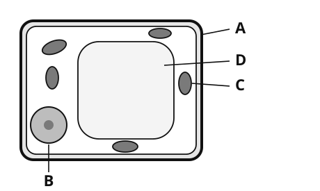{.w55}

Which letter shows the part where photosynthesis happens? **Write** the letter. [[answer:short]]

### 2 [[marks:2]]
The graph shows how temperature affects the rate of a reaction controlled by an enzyme.

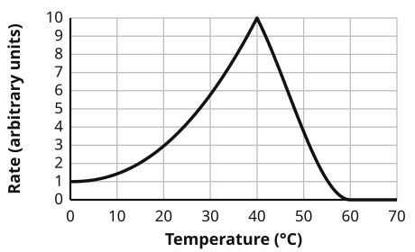{.w60}

(a) **Write** the optimum temperature of this enzyme. [[answer:short]] °C

(b) At 60 °C the rate is zero. **Write** the scientific word for what has happened to the enzyme. [[answer]]

### 3 [[marks:3]]
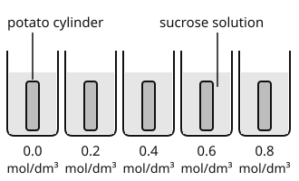{.w50 .right}

Mei cuts five potato cylinders of the same size and mass.
She puts each one in a different sucrose solution for one hour.
Then she measures the change in mass.

[[clear]]

| Concentration of sucrose solution (mol/dm³) | 0.0 | 0.2 | 0.4 | 0.6 | 0.8 |
|---|---|---|---|---|---|
| Change in mass (%) | +8 | +3 | 0 | −4 | −9 |

(a) Which concentration of sucrose solution has the same concentration as the contents of the potato cells? [[answer:short]] mol/dm³

(b) **Explain** why the potato cylinder in the 0.8 mol/dm³ solution lost mass.

[[lines:2]]

### 4 [[marks:1]]
The graph shows the glucose concentration in a person's blood after a meal.

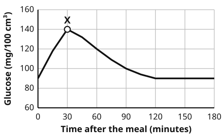{.w60}

At point X the pancreas releases a hormone. This hormone makes the blood glucose concentration fall.
**Write** the name of the hormone. [[answer]]

### 5 [[marks:3]]
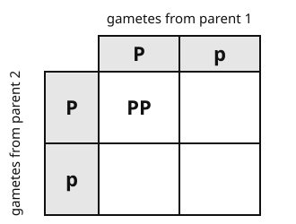{.w45 .right}

In pea plants, the allele for purple flowers (**P**) is dominant.
The allele for white flowers (**p**) is recessive.
Two plants with the genotype **Pp** are crossed.

(a) **Complete** the Punnett square to show the genotypes of the offspring.

(b) What percentage of the offspring are expected to have white flowers?

[[answer:short]] %

(c) **Write** the expected ratio of purple-flowered plants to white-flowered plants.

[[answer:short]] : [[answer:short]]

[[clear]]

### 6 [[marks:3]]
Li Na estimates the number of dandelion plants in a square field 20 m by 20 m. She places a quadrat 0.5 m by 0.5 m (area 0.25 m²) at 10 random positions and counts the dandelions inside it each time.

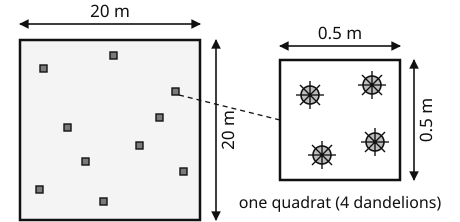{.w60}

| Quadrat | 1 | 2 | 3 | 4 | 5 | 6 | 7 | 8 | 9 | 10 |
|---|---|---|---|---|---|---|---|---|---|---|
| Number of dandelions | 3 | 5 | 2 | 4 | 6 | 3 | 4 | 5 | 2 | 6 |

(a) **Work out** an estimate of the total number of dandelion plants in the field. **Show** your working.

[[box:2:Working]]

[[answer]] dandelion plants

(b) **Explain** why Li Na placed the quadrat at random positions.

[[lines:1]]

### 7 [[marks:2]]
A population of beetles lives on dark soil. Some beetles are light brown and some are dark brown. Birds eat the beetles. The chart shows how the percentage of dark beetles in the population changed over 15 generations.

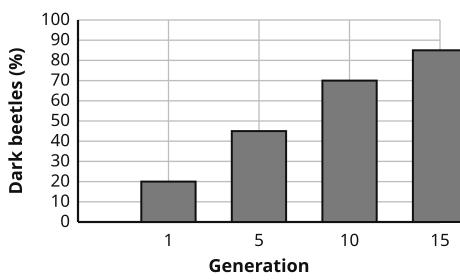{.w55}

**Explain** how natural selection caused this change.

[[lines:3]]

[[stop:Stop. That is the end of Biology. Wait for your teacher.]]

# Chemistry

You may use a scientific calculator

You have 15 minutes. Do as much as you can.
Your teacher can read any question to you.
Relative atomic masses: H 1, C 12, O 16, Na 23, Cl 35.5, Ca 40.

### 1 [[marks:1]]
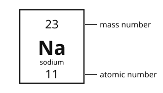{.w45 .right}

This is the box for sodium from the periodic table.

How many **neutrons** are there in one atom of sodium?

[[answer:short]]

[[clear]]

### 2 [[marks:2]]
The table shows some properties of three substances, X, Y and Z.

| Substance | Melting point (°C) | Conducts electricity when solid? | Conducts electricity when molten? |
|---|---|---|---|
| X | 801 | no | yes |
| Y | −182 | no | no |
| Z | 3550 | no | no |

(a) Which substance is an ionic compound? **Write** the letter. [[answer:short]]

(b) **Explain** why this substance conducts electricity when it is molten but not when it is solid.

[[lines:2]]

### 3 [[marks:1]]
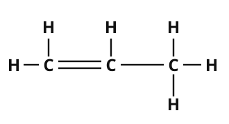{.w40 .right}

This is the displayed formula of a hydrocarbon.

**Write** the name of the homologous series it belongs to.

[[answer]]

[[clear]]

### 4 [[marks:3]]
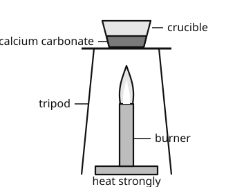{.w50 .right}

When calcium carbonate is heated strongly, it decomposes:

CaCO3 → CaO + CO2

Amir heats 25.0 g of calcium carbonate until it has all decomposed.

**Work out** the mass of calcium oxide (CaO) made. **Show** your working.

Working

[[answer]] g

[[clear]]

### 5 [[marks:1]]
Molten lead(II) bromide is electrolysed using graphite electrodes.

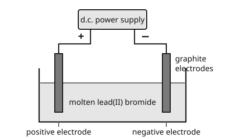{.w65}

**Write** the name of the product formed at the **negative** electrode. [[answer]]

### 6 [[marks:1]]
This is the reaction profile for a chemical reaction.

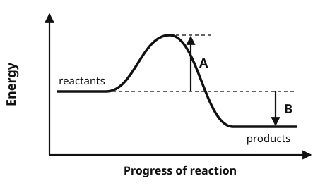{.w55}

Which arrow, **A** or **B**, shows the activation energy? **Write** the letter. [[answer:short]]

### 7 [[marks:3]]
Chen Yu adds marble chips (calcium carbonate) to dilute hydrochloric acid and collects the carbon dioxide. She does the experiment twice: experiment 1 at 25 °C and experiment 2 at 35 °C. She uses the same mass of marble chips and the same volume and concentration of acid each time.

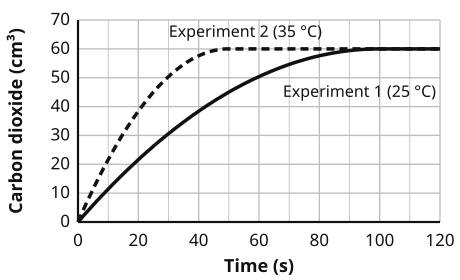{.w60}

(a) How long does experiment 1 take to finish? [[answer:short]] s

(b) **Explain**, in terms of particles, why the reaction is faster at 35 °C.

[[lines:3]]

### 8 [[marks:3]]
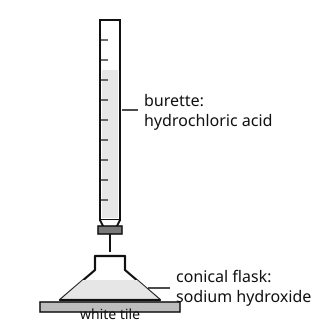{.w45 .right}

Wang Hao puts 25.0 cm³ of sodium hydroxide solution in a conical flask.
He titrates it with hydrochloric acid of concentration 0.100 mol/dm³.

NaOH + HCl → NaCl + H2O

His results:

| Titration | rough | 1 | 2 | 3 |
|---|---|---|---|---|
| Volume of acid (cm³) | 20.60 | 20.05 | 19.95 | 20.40 |

(a) Which **two** titrations should he use to find the mean volume? [[answer:short]] and [[answer:short]]

(b) The mean volume of acid is 20.00 cm³. **Work out** the concentration of the sodium hydroxide solution in mol/dm³. **Show** your working.

[[clear]]

[[box:4:Working]]

[[answer]] mol/dm³

[[stop:Stop. That is the end of Chemistry. Wait for your teacher.]]

# Physics

You may use a scientific calculator

You have 15 minutes. Do as much as you can.
Your teacher can read any question to you.

<h4>Equations you may need</h4>
<table>
<tr><td>average speed = distance ÷ time</td><td>voltage = current × resistance</td></tr>
<tr><td>acceleration = change in velocity ÷ time taken</td><td>electrical power = voltage × current</td></tr>
<tr><td>force = mass × acceleration</td><td>charge = current × time</td></tr>
<tr><td>weight = mass × g &nbsp;(g = 10 N/kg)</td><td>resistors in series: R = R1 + R2</td></tr>
<tr><td>momentum = mass × velocity</td><td>transformer: Vp ÷ Vs = Np ÷ Ns &nbsp;(p primary, s secondary)</td></tr>
<tr><td>work done = force × distance</td><td>pressure = force ÷ area</td></tr>
<tr><td>gravitational potential energy = mass × g × height</td><td>density = mass ÷ volume</td></tr>
<tr><td>kinetic energy = ½ × mass × speed²</td><td>wave speed = frequency × wavelength</td></tr>
<tr><td>power = energy transferred ÷ time</td><td>efficiency = useful energy out ÷ total energy in</td></tr>
</table>

### 1 [[marks:1]]
The graph shows the velocity of a car during 14 seconds.

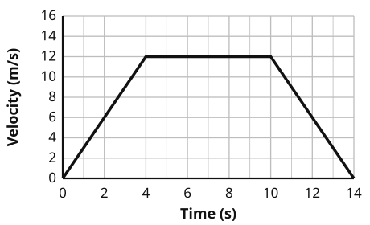{.w60}

**Work out** the acceleration of the car during the first 4 seconds.

[[answer]] m/s²

### 2 [[marks:2]]
Sofia pulls a box of mass 10 kg along the floor with a force of 50 N. The friction force is 20 N.

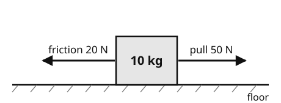{.w55}

(a) **Work out** the resultant force on the box. [[answer:short]] N

(b) **Work out** the acceleration of the box. [[answer:short]] m/s²

### 3 [[marks:2]]
Zhang Wei has a mass of 60 kg. He climbs a staircase 5 m high in 10 seconds.

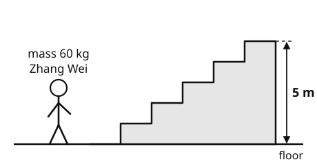{.w60}

(a) **Work out** the gravitational potential energy he gains. [[answer]] J

(b) **Work out** his average power while climbing. [[answer]] W

### 4 [[marks:2]]
A 12 V battery is connected to two resistors in series, as shown.

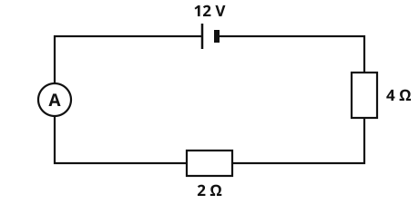{.w55}

(a) **Work out** the total resistance of the circuit. [[answer:short]] Ω

(b) **Work out** the reading on the ammeter. [[answer:short]] A

### 5 [[marks:3]]
The diagram shows a transformer.

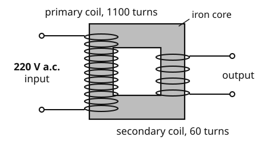{.w60}

(a) **Work out** the output voltage. [[answer:short]] V

(b) **Explain** why the transformer does not work if the input is d.c. (direct current).

[[lines:3]]

### 6 [[marks:2]]
Tom measures the count rate of a radioactive source for 8 days. The count rates have been corrected for background radiation.

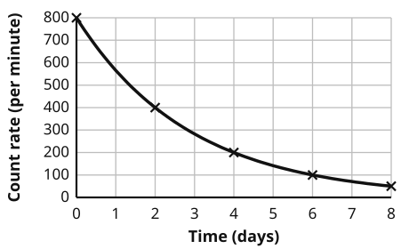{.w60}

(a) Use the graph to find the half-life of the source. [[answer:short]] days

(b) Before he put the source in place, Tom measured the count rate with no source present. **Explain** why.

[[lines:2]]

### 7 [[marks:3]]
Trolley A has a mass of 2 kg and moves at 3 m/s towards trolley B. Trolley B has a mass of 1 kg and is at rest. The trolleys stick together when they collide.

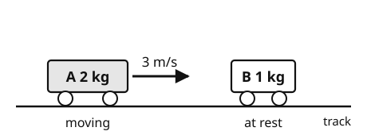{.w60}

(a) **Work out** the momentum of trolley A before the collision. [[answer]] kg m/s

(b) **Work out** the velocity of the two trolleys after the collision. **Show** your working.

[[box:3:Working]]

[[answer]] m/s

[[stop:Stop. That is the end of Physics. Thank you. Wait for your teacher.]]
