

# Year 12 Admission Assessment

Version 3.1, October 2026

[[namebox]]

## Welcome

These activities help us get to know you.
Do your best.
It is fine if you cannot answer every question.
Your teacher will tell you when to start each part.

## How to answer

[[example]]
**Tick** one box.

Which one is a fruit?  a chair [[tick]]  an apple ✓  a bus [[tick]]

**Write** your answer in the box.

12 + 8 = 20

**Show** your working. You can get marks for your working, even if your answer is wrong.

Working
4 × 25 = 100, &nbsp; 100 + 30 = 130

[[/example]]

## The parts of this paper

<table class="parts">
<colgroup><col style="width:17%"><col style="width:65%"><col style="width:18%"></colgroup>
<tr><th>Part</th><th>What you do</th><th>Time</th></tr>
<tr><td><b>Listening</b></td><td>Listen to a conversation and a talk. Answer 16 questions.</td><td>15 minutes</td></tr>
<tr><td><b>Reading</b></td><td>Read two texts. Answer the questions.</td><td>15 minutes</td></tr>
<tr><td><b>Writing</b></td><td>Write a story or an essay.</td><td>10 minutes</td></tr>
<tr><td>Break</td><td></td><td>5 minutes</td></tr>
<tr><td><b>Maths</b></td><td>Fluency, word questions and applied problems.</td><td>25 minutes</td></tr>
<tr><td><b>Science</b></td><td>Questions with pictures, tables and graphs.</td><td>8 minutes</td></tr>
<tr><td>Other parts</td><td>In <b>separate booklets</b>, after a break: a cognitive ability screen (puzzles), the sciences you will study, and an interview.</td><td>later today</td></tr>
</table>

You may use a pencil, a rubber and a ruler. You may use a calculator **only** in Maths Section C.

# Listening

There are two parts: **A** and **B**.
Your teacher will play or read each part **two times**.
**Listen** carefully.
Before each part, you have one minute to read the questions.
You can answer while you listen, or after.

## Part A

You will hear a phone conversation between **Li Na**, a school student, and her cousin **Chen Yu**, a university student. **Answer** questions 1 to 8.

### 1 [[marks:1]]
What does Chen Yu study?
**Tick** one picture.

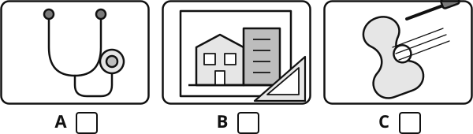{.w90}

### 2 [[marks:1]]
Where does Chen Yu live?
**Tick** one.

[[tick]] in a flat  [[tick]] in a student hall  [[tick]] with her family

### 3 [[marks:1]]
What does Chen Yu do on Wednesday afternoons?
**Tick** one picture.

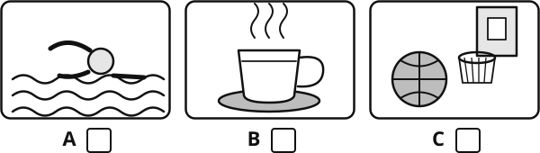{.w90}

### 4 [[marks:1]]
How many students are in Chen Yu's room this year, including Chen Yu? [[answer:short]]

### 5 [[marks:1]]
How long does it take Chen Yu to cycle to her classes? [[answer:short]] minutes

### 6 [[marks:1]]
How much does Chen Yu earn an hour **now**? ¥ [[answer:short]]

### 7 [[marks:1]]
Li Na says, "I don't think I could do that."
What does she mean?

[[lines:2]]

### 8 [[marks:1]]
Why does Chen Yu tell Li Na about her three school friends?

[[lines:2]]

## Part B {.newpage}

You will hear a talk by **Dr Wang Hao**. He is an engineer who designs plants that turn seawater into drinking water.
Your teacher will play or read the talk **two times**.
You have one minute to read questions 9 to 16 first.

### 9 [[marks:1]]
How many grams of salt are there in one litre of seawater?

[[answer:short]] grams

### 10 and 11 [[marks:2]]
**Complete** the notes. **Write** one to three words in each gap.

[[example]]
**Example:** Osmosis is the natural movement of water through a very thin skin called a membrane.
[[/example]]

#### Notes: turning seawater into drinking water

**10** &nbsp; Sand filters remove sand, seaweed and tiny living things that would [[answer]] the membranes.

**11** &nbsp; At the end, [[answer]] are added back, because completely pure water tastes flat.

### 12 [[marks:1]]
The plant has four stages.
**Write** 1, 2, 3 and 4 to show the order of the stages. 1 is the **first** stage.

[[answer:step]] Push the water through membranes at high pressure.

[[answer:step]] Pump seawater in through a pipe on the sea floor.

[[answer:step]] Add minerals and a little chlorine.

[[answer:step]] Remove sand and tiny living things.

### 13 [[marks:1]]
How many cubic metres of drinking water does the plant produce each day **now**?

[[answer]] cubic metres

### 14 [[marks:1]]
Dr Wang says the brine must be released "slowly and far out" from the shore.
**Use** the talk to **explain** why.

[[lines:2]]

### 15 [[marks:1]]
Some people say that a coastal city with a desalination plant never needs to worry about water again.
What does Dr Wang think about this? **Tick** one.

[[tick]] He agrees, because the sea will never run out.

[[tick]] He thinks cities should stop wasting water through leaking pipes first.

[[tick]] He thinks desalination is too dangerous for the coast and should stop.

[[tick]] He thinks only engineers should decide about water.

### 16 [[marks:1]]
What is the main purpose of Dr Wang's talk? **Tick** one.

[[tick]] To persuade the audience that desalination plants should be closed.

[[tick]] To explain how seawater is made drinkable and to weigh the benefits against the costs.

[[tick]] To advertise the plant that his team built.

[[tick]] To report that the city's pipes are leaking.

# Reading

There are two parts: **A** and **B**.
Part B is harder than Part A.
**Do as much as you can. It is fine if you do not finish.**
You have 15 minutes. When you finish, wait for your teacher.

## Part A

**Read** the web page. Then **answer** questions 1 to 7.

![A web page for Harbour Summer Academy: two-week courses for students aged 16 to 18. Dates: Session 1, 6 to 17 July; Session 2, 20 to 31 July. Courses: Engineering Design, university campus, 6800 yuan; Creative Writing, city library, 4500 yuan; Marine Biology, coastal field centre, 7200 yuan; Debating and Public Speaking, university campus, 4500 yuan. Fees include lunch and materials. Accommodation in a shared room costs 2400 yuan extra for students who do not live in the city. How to apply: 1 complete the online form; 2 upload a letter from a teacher; 3 pay a deposit of 500 yuan by 15 May. Places are limited to 20 on each course. Scholarships: ten full scholarships for students whose families cannot pay the fee; write 300 words on why you want to attend; deadline 30 April. Note: students on the Marine Biology course must be able to swim 50 metres.](diagrams/y12_e01_read_webpage.svg){.w100}

### 1 [[marks:1]]
On which dates is Session 2? [[answer:wide]]

### 2 [[marks:1]]
How much does the Creative Writing course cost? [[answer]]

### 3 [[marks:2]]
**Tick** the **two** courses that take place at the university campus.

[[tick]] Engineering Design

[[tick]] Creative Writing

[[tick]] Marine Biology

[[tick]] Debating and Public Speaking

### 4 [[marks:1]]
Sofia lives in another city. She wants to do the Marine Biology course and stay in the shared accommodation.
How much will she pay in total? ¥ [[answer]]

### 5 [[marks:1]]
What must you upload with the online form? [[answer:wide]]

### 6 [[marks:1]]
Wang Hao cannot swim. Which course can he **not** choose? [[answer:wide]]

### 7 [[marks:1]]
Tom wants a scholarship. What must he write, and by what date?

[[answer:full]]

## Part B {.newpage}

**Read** the article. Then **answer** questions 8 to 14.

[[passage]]
#### Lost, and Better for It

*By Lin Xiaoyu*

Last spring, in a city I had never visited, my phone died at four o'clock on a Saturday afternoon. I remember the moment precisely, because of what followed: a cold, almost childish panic. I was standing on an ordinary street, in daylight, surrounded by people, and I had no idea which way to turn. The blue dot that had guided me for a decade had vanished, and with it, apparently, went my sense of direction, my memory of the route and my nerve.

It took me a moment to realise how absurd this was. I am an adult. I can read. The city had street signs, a river, a cathedral tower visible above the rooftops and several thousand residents who knew exactly where the station was. Yet my first instinct was not to look up at the tower but down at the dead screen, as if staring at it hard enough might bring it back to life.

Navigation apps are, I admit, a marvel. They have ended the misery of the folded paper map that could never be refolded, and the arguments in the front seats of cars. They have made unfamiliar cities feel safe for lone travellers, and they have saved a good many of us from missed trains. I am not about to suggest that anyone delete them. What I want to question is the habit of using them for every journey, including the ones we have made fifty times before.

Here is what I notice. When I follow the blue line, I arrive, but I arrive knowing nothing. I could not tell you what I passed. The city shrinks to a corridor: a screen, a pavement and a destination. The phone is a patient, tireless servant, and like all servants who do everything for us, it leaves us quietly incapable.

This is not merely a romantic complaint. Researchers who study how we find our way distinguish between following a route (turn left, then second right) and building a mental map of a place. The second skill is slower and harder, and it is the one that fades when we never use it. A study I read about last year asked two groups of volunteers to learn a new part of a city, one group with an app and one with a paper map and their own eyes. A week later, the map group could still sketch the area; the app group could barely recall the name of the street where they had started. I did not find this surprising. Nobody remembers a journey they did not have to pay attention to.

There is also the small matter of other people. On that Saturday afternoon, after several minutes of staring at a blank screen, I finally did what my grandmother would have done in the first thirty seconds: I asked someone. An elderly man with a shopping bag not only pointed me towards the station but walked me to the corner, told me which bakery to visit and which to avoid, and wished me a good journey in a dialect I only half understood. It was the best conversation I had all weekend. Every app-guided journey I have ever made has been a journey in which I spoke to no one.

I can hear the objection. Getting lost is a luxury; most of us are simply trying to get to work on time, and nobody wants to be late for an interview because they fancied a little adventure. Fair enough. I am not asking anyone to be lost when it matters. I am suggesting something far more modest: that on the journeys that do not matter, the walk to a friend's house, the Sunday wander, the trip to a shop three streets away, we leave the phone in our pocket and find out whether we still can.

Since that afternoon I have followed a rule. In a new city, I allow myself the app for the first day. After that, I navigate by tower, river and the kindness of strangers, and I accept that I will sometimes end up in the wrong place. I have ended up in some excellent wrong places. I have also, for the first time in years, started to see the cities I visit as places rather than as routes.

My phone, charged again, still knows the way. I am simply trying to make sure that I do too.
[[/passage]]

### 8 [[marks:1]]
In the first paragraph, the writer says that her "sense of direction", her "memory of the route" and her "nerve" vanished with the blue dot.
**Using your own words**, explain what she lost when her phone died.

[[lines:2]]

### 9 [[marks:1]]
What does "absurd" mean in "how absurd this was"? **Tick** one.

[[tick]] dangerous  [[tick]] ridiculous  [[tick]] unlucky  [[tick]] exciting

### 10 [[marks:1]]
"Yet my first instinct was not to look up at the tower but down at the dead screen."
What does this sentence tell you about the writer's habits?

[[lines:2]]

### 11 [[marks:1]]
How does the writer feel about her meeting with the elderly man?
**Give** one piece of evidence from the text.

[[lines:2]]

### 12 [[marks:1]]
The writer calls the phone "a patient, tireless servant".
What does this comparison suggest about the phone, and why is it effective?

[[lines:2]]

### 13 [[marks:1]]
Which statement best describes the writer's view of navigation apps? **Tick** one.

[[tick]] Everyone should delete them.

[[tick]] They are useful, but we should sometimes find our own way.

[[tick]] Paper maps are always better than apps.

[[tick]] Getting lost is always a good thing.

### 14 [[marks:2]]
**Using your own words**, give **two** reasons the writer gives for not using the app on every journey.

**Reason 1**

[[lines:1]]

**Reason 2**

[[lines:1]]

# Writing

**Choose one** task: A or B.
**Tick** the box for the task you choose.
**Plan** your ideas in the plan box. Then **write** on the lines.
You have 10 minutes. Write as much as you can.

### Task A: a story [[tick]]

**Write** a story that ends with the words:

> ... and for the first time, I was glad I had stayed.

Ideas: who is telling the story, where they are, why they wanted to leave, what changed their mind.

### Task B: an essay [[tick]]

Some people say:

> Exam results are the only fair way to choose students for university.

Do you agree? **Write** an essay for a student magazine. Give your opinion, with reasons and examples.
**Include** at least one argument **against** your view, and explain why you do not accept it.

---

#### Plan

[[box:8:Notes and ideas (this part is not marked)]]

#### Your writing {.newpage}

Task A [[tick]]  Task B [[tick]]

[[lines:22]]

# Maths

You have 25 minutes. Do as much as you can.
**Write** your answer in the box. **Show** your working in the working box.
Your teacher can read any question to you.
**Sections A and B:** you may **not** use a calculator.
**Section C:** you **may** use a scientific calculator.

## Section A: Fluency

No calculator

[[example]]
**What the maths words and symbols mean**
**In the form *a* + *b*√5:** write the answer like 2 + 3√5, where *a* and *b* are whole numbers.
**Surd form:** keep the square root in your answer, for example √12 = 2√3.
**f(*x*) = 2*x* + 1** means "double *x*, then add 1". So f(3) = 7. **gf(*x*)** means "do f first, then do g". **f−1(*x*)** is the **inverse** of f: it undoes f.
**d<i>y</i>d<i>x</i>** is the **gradient function** (the derivative). If <i>y</i> = <i>x</i><i>n</i>, then d<i>y</i>d<i>x</i> = <i>nx</i><i>n</i> − 1. Example: <i>y</i> = <i>x</i>2 + 4<i>x</i> gives d<i>y</i>d<i>x</i> = 2<i>x</i> + 4.
**A column vector** 3−1 means 3 across and 1 down. **|a|** is the **length** (magnitude) of the vector **a**.
[[/example]]

### 1 [[marks:1]]
**Expand and simplify** &nbsp; (√5 + 1)(√5 − 2).  **Give** your answer in the form *a* + *b*√5.

[[answer:wide]]

### 2 [[marks:1]]
**Solve** &nbsp; 32*x* − 1 = 81  *x* = [[answer:short]]

### 3 [[marks:2]]
f(*x*) = <i>x</i> − 32  g(*x*) = *x*2 + 1

(a) **Work out** gf(7).  [[answer:short]]

(b) **Find** f−1(*x*).  f−1(*x*) = [[answer]]

### 4 [[marks:2]]
*y* = *x*3 − 6*x*2 + 5*x*

(a) **Find** d<i>y</i>d<i>x</i>.  d<i>y</i>d<i>x</i> = [[answer:wide]]

(b) **Work out** the gradient of the curve at the point where *x* = 2.  [[answer:short]]

### 5 [[marks:2]]
**a** = 3−1  **b** = −24

(a) **Write** 2**a** − **b** as a column vector.  [[answer:short]]

(b) **Work out** |**a** + **b**|. **Give** your answer in surd form.  [[answer:short]]

### 6 [[marks:2]]
(a) **Write** *x*2 − 8*x* + 3 in the form (*x* − *a*)2 − *b*.  [[answer:wide]]

(b) **Hence solve** *x*2 − 8*x* + 3 = 0. **Give** your answers in surd form.

*x* = [[answer]]  or  *x* = [[answer]]

## Section B: Word questions {.newpage}

No calculator

The questions in this section are in words only.
**Read** each question carefully. Decide what to do.

[[example]]
**Write an equation, then solve it.**
Three consecutive numbers add up to 87. Find the numbers.
(Consecutive numbers come one after another, like 5, 6 and 7.)

Let the smallest number be *n*. The numbers are *n*, *n* + 1 and *n* + 2.
**Equation:** *n* + (*n* + 1) + (*n* + 2) = 87
**Solve:** 3*n* + 3 = 87, so 3*n* = 84, so *n* = 28.
**Answer:** the numbers are 28, 29 and 30.
[[/example]]

### 7 [[marks:2]]
Mei saves money every week.
In the first week she saves ¥20. Each week she saves ¥6 more than the week before.
So she saves ¥20, then ¥26, then ¥32, and so on.

(a) In which week does she **first** save more than ¥100?  Week [[answer:short]]

(b) **Work out** the total amount she has saved after 12 weeks.

[[box:3:Working]]

¥ [[answer]]

### 8 [[marks:2]]
The brightness of light from a lamp is **inversely proportional to the square** of the distance from the lamp.
At a distance of 2 metres, the brightness is 90 units.
**Work out** the brightness at a distance of 3 metres.

[[box:3:Working]]

[[answer]] units

### 9 [[marks:2]]
Two numbers add up to 9.
The sum of their squares is 53.
**Write** an equation in one unknown, then **solve** it.
**Find** the two numbers.

[[box:4:Working]]

[[answer:short]] and [[answer:short]]

### 10 [[marks:2]]
Jun cycles 12 km from home to school at a steady speed.
If he cycled 3 km/h faster, the journey would take 12 minutes less.
**Write** an equation, then **solve** it.
**Find** Jun's usual speed.

[[box:5:Working]]

[[answer:short]] km/h

## Section C: Applied problems {.newpage}

You may use a scientific calculator

**Show** your working. You can get marks for your working, even if your answer is wrong.

### 11 [[marks:2]]
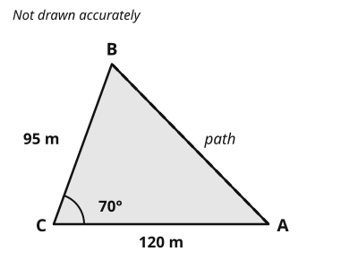{.w50 .right}

A field is a triangle ABC.
CA = 120 m, CB = 95 m and angle ACB = 70°.
A straight path is to be built from A to B.

**Work out** the length of the path.
**Give** your answer to 3 significant figures.

Working

[[answer]] m

[[clear]]

### 12 [[marks:2]]
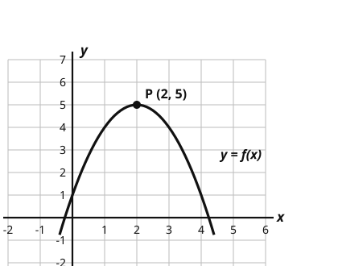{.w50 .right}

The diagram shows the graph of *y* = f(*x*).
The maximum point of the curve is P (2, 5).

**Write** the coordinates of the maximum point of each of these graphs.

(a) *y* = f(*x*) + 3  ( [[answer:short]] , [[answer:short]] )

(b) *y* = f(*x* + 1)  ( [[answer:short]] , [[answer:short]] )

[[clear]]

### 13 [[marks:2]]
80 students took a test. The cumulative frequency graph shows their marks.

{.w55}

(a) **Find** the median mark.  [[answer:short]]

(b) **Work out** the interquartile range.  [[answer:short]]

### 14 [[marks:2]]
Mei plays two matches in a table tennis competition.
The probability that she wins the first match is 0.6.
If she wins the first match, the probability that she wins the second is 0.7.
If she loses the first match, the probability that she wins the second is 0.4.

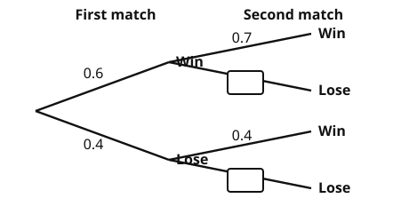{.w55}

(a) **Complete** the tree diagram.

(b) **Work out** the probability that Mei wins **exactly one** of the two matches.

[[box:2:Working]]

[[answer]]

### 15 [[marks:2]]
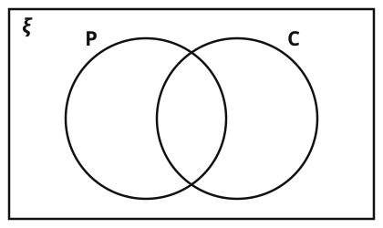{.w50 .right}

There are 40 students in a year group.
24 study Physics (P). 18 study Chemistry (C). 6 study neither.

(a) **Complete** the Venn diagram.

&nbsp; &nbsp; n(P ∩ C) = [[answer:short]]

(b) A student is chosen at random.
**Work out** the probability that the student studies **exactly one** of the two subjects.

[[answer:short]]

[[clear]]

### 16 [[marks:2]]
The population of a town is 48 000.
The population grows by 2.5% every year.
The town council says: "The population will pass 60 000 within 8 years."
Is the council right? **Show** how you decide. You can use the table.

<table class="dep">
<tr><th>Year</th><th>0</th><th>1</th><th>2</th><th>3</th><th>4</th><th>5</th><th>6</th><th>7</th><th>8</th></tr>
<tr><th>Population</th><td>48 000</td><td>49 200</td><td></td><td></td><td></td><td></td><td></td><td></td><td></td></tr>
</table>

[[box:2:Working]]

**Tick** one.  Yes, the council is right. [[tick]]  No, the council is wrong. [[tick]]

# Science

You have 8 minutes. Do as much as you can.
Your teacher can read any question to you.

### 1 [[marks:1]]
This is a food chain.

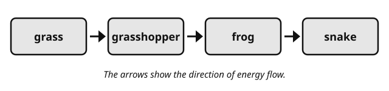{.w90}

Which organism is the **secondary consumer**? **Write** its name. [[answer]]

### 2 [[marks:2]]
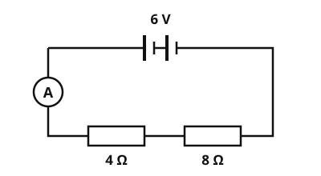{.w50 .right}

The diagram shows a circuit.

(a) **Work out** the total resistance of the circuit.

[[answer:short]] Ω

(b) **Work out** the reading on the ammeter. Use: *V* = *I* × *R*.

[[answer:short]] A

[[clear]]

### 3 [[marks:1]]
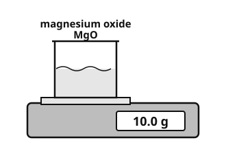{.w40 .right}

The beaker holds 10.0 g of magnesium oxide, MgO.
Relative atomic masses: Mg = 24, O = 16.

**Work out** the number of moles of magnesium oxide in the beaker.
Use: moles = mass ÷ relative formula mass.

[[answer:short]] mol

[[clear]]

### 4 [[marks:3]]
Aisha investigates how fertiliser affects plant growth. She grows one plant in each pot and waters each pot with a different concentration of fertiliser. After 4 weeks she measures the height of each plant.

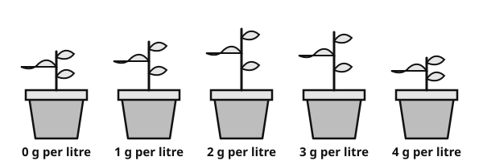{.w80}

| Fertiliser (grams per litre of water) | 0 | 1 | 2 | 3 | 4 |
|---|---|---|---|---|---|
| Height of plant after 4 weeks (cm) | 12 | 15 | 19 | 18 | 10 |

(a) **Describe** the pattern in the results.

[[lines:1]]

(b) **Write** one variable Aisha must keep the same.

[[lines:1]]

(c) Aisha grew only one plant at each concentration. **Suggest** one way to improve her method.

[[lines:1]]

### 5 [[marks:1]]
The diagram shows a wave. Its frequency is 50 Hz.

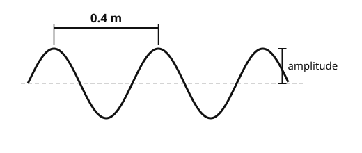{.w70}

**Work out** the speed of the wave. Use: wave speed = frequency × wavelength.

[[answer:short]] m/s

### 6 [[marks:1]]
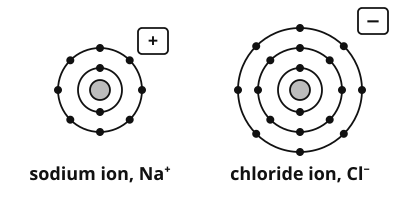{.w55 .right}

Sodium chloride is made of these ions.
**Solid** sodium chloride does **not** conduct electricity.
**Molten** (melted) sodium chloride **does** conduct electricity.

**Explain** why.

[[lines:2]]

[[clear]]

### 7 [[marks:1]]
{.w55 .right}

The diagram shows an alveolus in the lung.

**Write** one feature of the alveolus that makes gas exchange fast, and say **why** it helps.

[[lines:2]]

[[clear]]

[[stop:Thank you. You have finished this paper. Please wait for your teacher.]]
