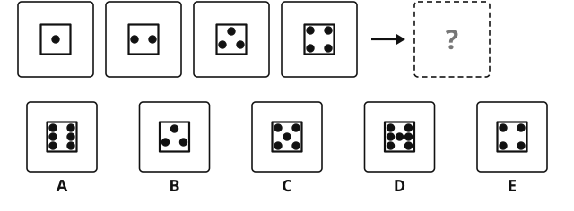
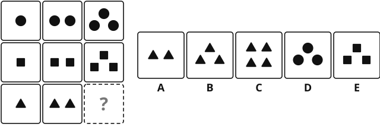
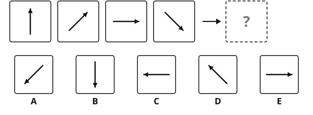
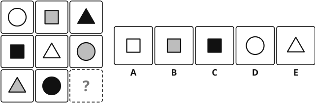
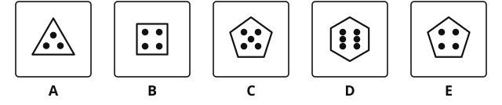
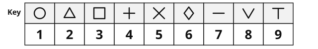
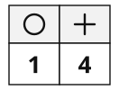
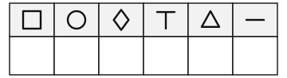
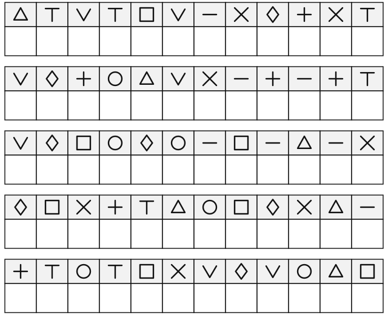

# Cognitive Ability Screen

Years 11 and 12. Version 3.1, October 2026

[[namebox]]

## Welcome

This is not a test you can pass or fail.
It helps us plan how to support your learning.
There are four short parts. Each part is timed.
Your teacher will tell you when to start and when to stop each part.
Some questions are easy and some are hard. Nobody gets them all right.
If you are not sure, choose the answer you think is best and go on.

## How to answer

[[example]]
Most questions have five answers, **A**, **B**, **C**, **D** and **E**.
**Write** the letter of your answer in the box.  B

Some questions ask for a number.
**Write** the number in the box.  20

If you change your mind, cross out your first answer and write the new one.
[[/example]]

## The parts

| Part | What you do | Time |
|---|---|---|
| **1 Non-verbal reasoning** | Patterns made of shapes. 12 questions. | 8 minutes |
| **2 Quantitative reasoning** | Patterns made of numbers. 12 questions. | 8 minutes |
| **3 Verbal reasoning** | Patterns made of words. 12 questions. | 6 minutes |
| **4 Processing speed** | Write the number for each symbol, as fast as you can. | 90 seconds |

You need a pencil and a rubber. You may **not** use a calculator.
Your teacher can read the instructions to you again in English.
Do not turn the page until your teacher tells you to.

# Part 1: Non-verbal reasoning

You have **8 minutes**. There are 12 questions.
Each question shows a pattern made of shapes. One figure is missing.
**Choose** the figure from **A** to **E** that fits the pattern. **Write** the letter in the box.

[[example]]
**Example.** Which figure goes in the empty cell?

{.w90}

Each row has one shape. Across each row, the colour goes white, grey, black.
So the missing figure is a **black triangle**. The answer is **B**.  B
[[/example]]

There are three kinds of question:
**Which figure goes in the empty cell?** Look across the rows and down the columns.
**Which figure comes next?** Look at how the figures change from left to right.
**Which figure is the odd one out?** Four figures follow the same rule. One does not.

### 1 [[marks:1]]
Which figure comes next?

{.w90}

**Write** the letter. [[answer:short]]

### 2 [[marks:1]]
Which figure goes in the empty cell?

{.w90}

**Write** the letter. [[answer:short]]

### 3 [[marks:1]]
Which figure is the odd one out?

{.w90}

**Write** the letter. [[answer:short]]

### 4 [[marks:1]]
Which figure comes next?

{.w90}

**Write** the letter. [[answer:short]]

### 5 [[marks:1]]
Which figure goes in the empty cell?

{.w90}

**Write** the letter. [[answer:short]]

### 6 [[marks:1]]
Which figure is the odd one out?

{.w90}

**Write** the letter. [[answer:short]]

### 7 [[marks:1]]
Which figure comes next?

{.w90}

**Write** the letter. [[answer:short]]

### 8 [[marks:1]]
Which figure goes in the empty cell?

{.w90}

**Write** the letter. [[answer:short]]

### 9 [[marks:1]]
Which figure is the odd one out?

{.w90}

**Write** the letter. [[answer:short]]

### 10 [[marks:1]]
Which figure comes next?

{.w90}

**Write** the letter. [[answer:short]]

### 11 [[marks:1]]
Which figure goes in the empty cell?

{.w90}

**Write** the letter. [[answer:short]]

### 12 [[marks:1]]
Which figure goes in the empty cell?

{.w90}

**Write** the letter. [[answer:short]]

[[stop:Stop. Wait for your teacher.]]

# Part 2: Quantitative reasoning

You have **8 minutes**. There are 12 questions. **No calculator.**
Each question shows a pattern made of numbers. **Find** the rule. Then **write** the missing number, or the letter, in the box.

[[example]]
**Example 1. Which number comes next?**  3, 6, 9, 12, ?
The numbers go up by 3 each time. The next number is **15**.  15

**Example 2. Which number is missing?**  2 : 6  4 : 12  5 : ?
In each pair, the second number is 3 times the first. 5 × 3 = 15.  15

**Example 3. Which number is missing?**  Each row follows the same rule.

<table class="nmat"><tr><td>1</td><td>2</td><td>3</td></tr><tr><td>4</td><td>1</td><td>5</td></tr><tr><td>2</td><td>6</td><td class="gap">?</td></tr></table>

In each row, the first two numbers add to make the third. 2 + 6 = 8.  8
[[/example]]

### 1 [[marks:1]]
Which number comes next?

4, 8, 12, 16, ?

**Write** the number. [[answer:short]]

### 2 [[marks:1]]
Which number comes next?

50, 45, 40, 35, ?

**Write** the number. [[answer:short]]

### 3 [[marks:1]]
Which number is missing? The rule is the same in every pair.

6 : 3  8 : 4  10 : ?

**Write** the number. [[answer:short]]

### 4 [[marks:1]]
Which number is missing? Each row follows the same rule.

<table class="nmat"><tr><td>3</td><td>4</td><td>7</td></tr><tr><td>6</td><td>2</td><td>8</td></tr><tr><td>5</td><td>4</td><td class="gap">?</td></tr></table>

**Write** the number. [[answer:short]]

### 5 [[marks:1]]
Which number comes next?

1, 2, 4, 8, 16, ?

**Write** the number. [[answer:short]]

### 6 [[marks:1]]
Which is the **largest**?

<b>A</b> 12 <b>B</b> 0.6 <b>C</b> 35 <b>D</b> 0.55 <b>E</b> 23

**Write** the letter. [[answer:short]]

### 7 [[marks:1]]
Which number comes next?

2, 3, 5, 8, 12, ?

**Write** the number. [[answer:short]]

### 8 [[marks:1]]
Which number is missing? The rule is the same in every pair.

4 : 7  10 : 19  7 : ?

**Write** the number. [[answer:short]]

### 9 [[marks:1]]
Which number is missing? Each row follows the same rule.

<table class="nmat"><tr><td>2</td><td>3</td><td>6</td></tr><tr><td>4</td><td>5</td><td>20</td></tr><tr><td>3</td><td>7</td><td class="gap">?</td></tr></table>

**Write** the number. [[answer:short]]

### 10 [[marks:1]]
Each shape stands for a number. The same shape is always the same number.

● + ● + ▲ = 14  ● + ▲ = 9  ▲ = ?

**Write** the number. [[answer:short]]

### 11 [[marks:1]]
Which number comes next?

3, 4, 8, 9, 18, 19, ?

**Write** the number. [[answer:short]]

### 12 [[marks:1]]
Which number is missing? The rule is the same in every pair.

3 : 10  5 : 26  7 : ?

**Write** the number. [[answer:short]]

[[stop:Stop. Wait for your teacher.]]

# Part 3: Verbal reasoning

You have **6 minutes**. There are 12 questions.
Each question is about words. **Choose** the best answer from **A** to **E**. **Write** the letter in the box.

[[example]]
**Example 1.** Day is to night as up is to ... ?

<b>A</b> down <b>B</b> high <b>C</b> sky <b>D</b> light <b>E</b> morning

Day and night are opposites. The opposite of up is **down**.  A

**Example 2.** Which word is the odd one out?

<b>A</b> red <b>B</b> blue <b>C</b> green <b>D</b> cold <b>E</b> yellow

Four words are colours. **Cold** is not a colour.  D

**Example 3.** Mei is taller than Jun. Jun is taller than Tom. Who is the tallest?

<b>A</b> Jun <b>B</b> Tom <b>C</b> Mei <b>D</b> They are the same <b>E</b> Cannot tell

Mei is taller than Jun, and Jun is taller than Tom. So **Mei** is the tallest.  C
[[/example]]

### 1 [[marks:1]]
Hot is to cold as big is to ... ?

<b>A</b> tall <b>B</b> small <b>C</b> long <b>D</b> high <b>E</b> heavy

**Write** the letter. [[answer:short]]

### 2 [[marks:1]]
Which word is the odd one out?

<b>A</b> apple <b>B</b> orange <b>C</b> chair <b>D</b> banana <b>E</b> lemon

**Write** the letter. [[answer:short]]

### 3 [[marks:1]]
Bird is to fly as fish is to ... ?

<b>A</b> swim <b>B</b> water <b>C</b> sea <b>D</b> walk <b>E</b> eat

**Write** the letter. [[answer:short]]

### 4 [[marks:1]]
Li Na is older than Tom. Tom is older than Mei. Who is the youngest?

<b>A</b> Li Na <b>B</b> Tom <b>C</b> Mei <b>D</b> They are the same age <b>E</b> Cannot tell

**Write** the letter. [[answer:short]]

### 5 [[marks:1]]
Which word is the odd one out?

<b>A</b> happy <b>B</b> sad <b>C</b> angry <b>D</b> tall <b>E</b> afraid

**Write** the letter. [[answer:short]]

### 6 [[marks:1]]
Shoe is to foot as hat is to ... ?

<b>A</b> hair <b>B</b> hand <b>C</b> coat <b>D</b> cold <b>E</b> head

**Write** the letter. [[answer:short]]

### 7 [[marks:1]]
All the students in Class 4 play football. Wang Hao is in Class 4.
Which sentence **must** be true?

<b>A</b> Wang Hao plays football. <b>B</b> Wang Hao likes football. <b>C</b> Everyone who plays football is in Class 4. <b>D</b> Wang Hao plays football well. <b>E</b> Wang Hao does not play basketball.

**Write** the letter. [[answer:short]]

### 8 [[marks:1]]
Which word is the odd one out?

<b>A</b> minute <b>B</b> hour <b>C</b> week <b>D</b> clock <b>E</b> year

**Write** the letter. [[answer:short]]

### 9 [[marks:1]]
Begin is to end as ask is to ... ?

<b>A</b> question <b>B</b> answer <b>C</b> say <b>D</b> tell <b>E</b> speak

**Write** the letter. [[answer:short]]

### 10 [[marks:1]]
Three friends sit in a row. Sofia sits on the left of Amir. Jun sits on the right of Amir.
Who sits in the middle?

<b>A</b> Sofia <b>B</b> Amir <b>C</b> Jun <b>D</b> Nobody <b>E</b> Cannot tell

**Write** the letter. [[answer:short]]

### 11 [[marks:1]]
Always is to never as everything is to ... ?

<b>A</b> nothing <b>B</b> something <b>C</b> everyone <b>D</b> anything <b>E</b> all

**Write** the letter. [[answer:short]]

### 12 [[marks:1]]
If it rains, the game stops. The game did not stop.
Which sentence **must** be true?

<b>A</b> It rained. <b>B</b> The game was long. <b>C</b> It will rain tomorrow. <b>D</b> Cannot tell. <b>E</b> It did not rain.

**Write** the letter. [[answer:short]]

[[stop:Stop. Wait for your teacher.]]

# Part 4: Processing speed

In this part you have **90 seconds**. Work as **fast** as you can, but try not to make mistakes.
The key shows nine symbols. Each symbol has a number.

{.w100}

Under each symbol there is an empty box. **Look** at the key. **Write** the number for that symbol in the box.
Go from **left to right** along each row. Do **not** skip any boxes.

[[example]]
**Example.** The circle is 1 in the key, so you write 1. The plus is 4 in the key, so you write 4.

{.w25}
[[/example]]

## Practice

**Write** the number for each symbol in these six boxes now. Use the key above. This practice is not timed.

{.w55}

Your teacher will check your practice row with you.

[[stop:Stop. Wait for your teacher to say "Start".]]

## Now the timed task {.newpage}

**Write** the number for each symbol. Go from left to right along each row, then start the next row.
When your teacher says **"Stop"**, put your pencil down at once.

{.w100}

{.w100}

[[stop:Stop. Thank you. You have finished. Please wait for your teacher.]]
