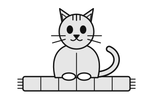
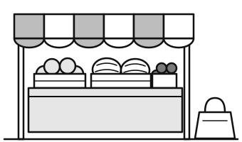
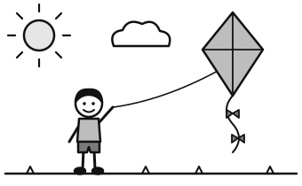
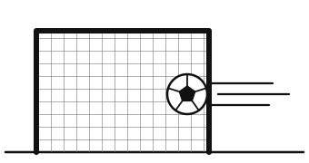
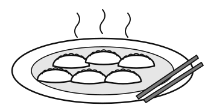
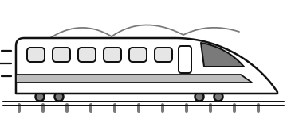
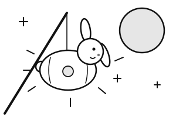
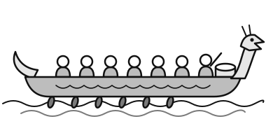

# Early Reading Screen: Reading cards

**For the assessor. Do not show this page to the child.**

The child reads from these cards, one to one. The scripts and scoring rules are in the **instructions** (`Early_Reading_Screen_Guide`); the **record sheets** (`Early_Reading_Screen_Record`) are printed once for each child.

- Print once, single-sided, and keep each card in a plastic sleeve. Colour and greyscale both work.
- Put only the card you are using in front of the child. Keep the record sheets out of sight.
- Do not read the cards aloud. The only words you say from a card are the practice words on Card 3 and the title of each passage, as the script says.
- On Cards 3 to 7 the creature marks a **creature name** (a nonsense word). The small grey numbers on the word cards match the record sheet.
- The passages get harder from Card 9 to Card 16. The child reads only the two or three passages the start rules choose.

| Card | Page | Part | What is on it |
|---|---|---|---|
| 1 | 2 | Letter sounds | 26 single letters |
| 2 | 3 | Letter sounds | 18 letter groups (sh, ai, igh ...) |
| 3 | 4 | Phonics words | Practice: one real word and one creature name |
| 4 | 5 | Phonics words, Section 1 | Words 1 to 10 |
| 5 | 6 | Phonics words, Section 1 | Words 11 to 20 |
| 6 | 7 | Phonics words, Section 2 | Words 21 to 30 |
| 7 | 8 | Phonics words, Section 2 | Words 31 to 40 |
| 8 | 9 | Tricky words | 20 common exception words |
| 9 | 10 | Passages | Passage 1: Where Is the Cat? (Pink, Oxford Level 1+, 23 words) |
| 10 | 11 | Passages | Passage 2: At the Market (Red, Oxford Level 2, 36 words) |
| 11 | 12 | Passages | Passage 3: The Kite (Yellow, Oxford Level 3, 57 words) |
| 12 | 13 | Passages | Passage 4: A New Friend (Light Blue, Oxford Level 4, 79 words) |
| 13 | 14 | Passages | Passage 5: The Lucky Dumpling (Green, Oxford Level 5, 99 words) |
| 14 | 15 | Passages | Passage 6: The Fast Train (Orange, Oxford Level 6, 126 words) |
| 15 | 16 | Passages | Passage 7: The Rabbit Lantern (Turquoise and Purple, Oxford Level 7 to 8, 151 words) |
| 16 | 17 | Passages | Passage 8: The Drummer (Gold and White, Oxford Level 9 to 10, 178 words) |

[[pagebreak]]

Card 1

s

m

t

a

o

p

i

d

n

e

g

c

u

h

b

r

f

k

l

w

j

y

v

z

x

q

[[pagebreak]]

Card 2

sh

ee

ch

ai

th

oo

ar

ck

oa

ng

or

igh

qu

ow

ur

oi

ear

air

[[pagebreak]]

Card 3

{.w25}

hat

jop

[[pagebreak]]

Card 4

1map

2dop

3leg

4mub

5sit

6pem

7shop

8chig

9duck

10thep

[[pagebreak]]

Card 5

11frog

12blom

13jump

14nesk

15bring

16trab

17think

18chulp

19stamp

20glust

[[pagebreak]]

Card 6

21rain

22jeek

23night

24toap

25moon

26darp

27turn

28sorp

29down

30choil

[[pagebreak]]

Card 7

31cake

32jeme

33smile

34plome

35tube

36flape

37garden

38lompid

39picnic

40shoomit

[[pagebreak]]

Card 8

1the

2was

3you

4said

5they

6are

7come

8one

9where

10friend

11door

12find

13could

14water

15many

16again

17half

18people

19busy

20because

[[pagebreak]]

Card 9

#### Where Is the Cat?

{.w55}

The cat is on the mat. 
The cat is on the bed. 
The cat is in the box. 
The cat is on Dad!

[[pagebreak]]

Card 10

#### At the Market

{.w50}

Mei and Gran go to the market. 
Gran gets a fish. 
Gran gets six eggs. 
Gran gets a big melon. 
The bag is full. 
"I can help," said Mei. 
Mei and Gran get on the bus.

[[pagebreak]]

Card 11

#### The Kite

{.w45}

Tom and Dad went to the park. 
They had a big green kite. 
The wind was strong. 
Up, up, up went the kite! 
Then it got stuck in a tree. 
"Oh no!" said Tom. 
Dad got a long stick. 
He got the kite down. 
"Thank you, Dad!" said Tom. 
Soon the kite was up in the sky.

[[pagebreak]]

Card 12

#### A New Friend

{.w40}

It was Monday morning. 
A new girl came to Hao's class. 
Her name was Sofia. 
She sat next to Hao. 
She did not say a word. 
"Do you want to play?" asked Hao. 
Sofia looked at the floor. 
At playtime, they went outside. 
Hao kicked a ball to Sofia. 
Sofia kicked it back, hard! 
The ball shot past Hao into the net. 
"Goal!" shouted Hao. Sofia smiled. 
"Can we play again?" she said. 
They played until the bell rang.

[[pagebreak]]

Card 13

#### The Lucky Dumpling

{.w40}

It was the day before Spring Festival. Lin 
and Grandma were making dumplings in the 
kitchen. Grandma hid a coin inside one of the 
dumplings. "The person who finds the coin 
will be lucky all year," she said.

That evening, the whole family sat down to 
eat. Lin ate one dumpling, then two, then 
three. There was no coin. Lin was too full to 
eat any more.

Dad found nothing. Mum found nothing. 
Then Grandpa bit into a dumpling and 
stopped. He smiled and held up the 
shiny coin.

"Grandpa is the lucky one!" shouted Lin, and 
everyone laughed.

[[pagebreak]]

Card 14

#### The Fast Train

{.w45}

Amir and his mum were going to visit his cousins 
in Shanghai. At the station, the fast train was 
waiting. It was long and white, with a pointed 
nose like a bird.

Amir found his seat next to a big window. At first, 
the train moved slowly. Then it went faster and 
faster. Green fields, rivers and tall buildings 
rushed past.

"This train is even faster than our car!" 
said Amir.

After a while, a lady pushed a trolley along the 
carriage. Mum bought two bowls of noodles and a 
bottle of water. Amir ate his noodles and looked 
out of the window. Soon his eyes began to close.

When he woke up, the train had stopped. "Wake 
up, sleepy head," said Mum. "We are here!"

[[pagebreak]]

Card 15

#### The Rabbit Lantern

{.w35}

Every year, Chen Yu's class made paper lanterns for 
the Mid-Autumn Festival. This year, Miss Wang 
showed them how to make a rabbit.

Chen Yu cut out two long ears and glued them on 
carefully. But when he held up his lantern, one ear 
flopped down. The rabbit's face was crooked, too. Next 
to him, Aisha had made a perfect rabbit with neat 
pink eyes.

"Mine looks silly," Chen Yu said quietly.

That evening, his family walked to the park by the lake. 
The full moon was round and bright, and hundreds of 
lanterns glowed in the dark. Grandpa put a small light 
inside the rabbit, and it began to shine.

A little girl pulled her mother's sleeve. "Look at that 
rabbit!" she said. "It is waving its ear at me!"

Chen Yu looked at his lantern again. Then he smiled, 
lifted it high and made the floppy ear wave hello.

[[pagebreak]]

Card 16

#### The Drummer

{.w40}

Zhang Wei had never felt so nervous. It was the Dragon 
Boat Festival, and his school was racing three other boats 
on the lake. Twelve children sat in two long rows, holding 
their paddles. At the front sat the drummer, and this year 
the drummer was Zhang Wei.

"Remember," said Coach Liu, "the paddlers listen to your 
drum. Keep a steady beat, and they will paddle together."

The whistle blew, and the boats shot forward. Zhang Wei 
was so excited that he beat the drum far too fast. Behind 
him, the paddles splashed in a muddle, and the boat began 
to wobble. Another boat slid past them.

Zhang Wei took a deep breath. He thought of the clock in 
his classroom, ticking slowly and evenly. Boom, boom, 
boom. One by one, the paddlers found the beat, and the 
boat flew across the water like an arrow.

They did not win, but they came a close second. 
Afterwards, Coach Liu shook Zhang Wei's hand. "A good 
drummer does not just make a noise," she said. "A good 
drummer listens."

